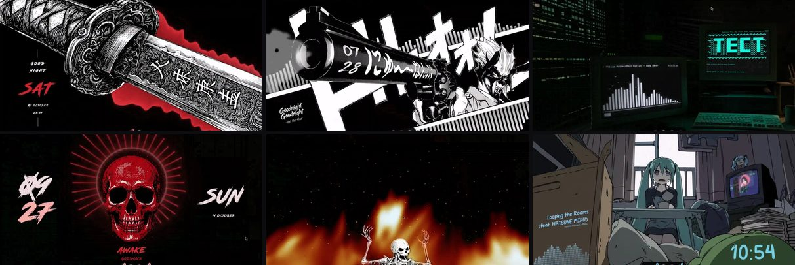

# undershell

<p align="center">
  
</p>

[▶ Watch the 69-second demo](https://github.com/user-attachments/assets/523ec5c1-bcba-4fc5-892a-d8c912360f7a) ·
[More desktops](docs/GALLERY.md)

Desktop widgets that live **under** your shell and **apart** from it: a
standalone Wayland client in C++ (GLES 3) that doesn't depend on any shell or
dotfiles. It integrates with Noctalia (palette) and KDE Plasma (wallpaper,
colour scheme), reads the wallpaper of other shells (caelestia,
DankMaterialShell, …) and wallpaper tools, and runs on
Umbriel/niri/Hyprland/Sway/KDE Plasma/COSMIC and, through an extension, GNOME.
Its first widgets are ports of
[Ryoku](https://github.com/ryoku-dev/ryoku)'s.

- **Same layer as Noctalia's widgets** (layer-shell *bottom*): above the
  wallpaper, below the windows, and click-through.
- **Depth**: widgets pass behind what stands in front in the wallpaper.
  undershell computes each wallpaper's depth map itself, with the model
  Noctalia's `wallpaper_depth` plugin uses (Depth Anything V2), and cuts every
  widget at its own plane on the GPU (see [Depth planes](docs/WALLPAPER.md#depth-planes)).
- **Noctalia colors**: the palette comes from `noctalia theme <wallpaper>
  --scheme <your scheme>` (the same generator the shell uses) and is
  recomputed when you change wallpaper or theme.
- **Lightweight**: PipeWire capture inside the same process (no cava),
  FFT + cava-style processing (adapted from Noctalia, MIT) and the whole
  spectrum drawn in **a single GPU pass** (Ryoku's shader). With music it
  uses ~3% CPU on an HD 520; with no audio it sleeps.

## What it has

| | |
|---|---|
| [Visualizer](docs/LOOKS.md) | 32 looks that follow the music: bars and rings, fire, electricity, rain, neon, a CRT terminal, an old TV, the Game of Life, a lava lamp, a globe… |
| [Widgets](docs/WIDGETS.md) | Clocks (12 faces), calendar, weather, system monitor, activity, notes, the music card, lyrics (karaoke), text, shapes, pictures and a pet |
| [Wallpaper](docs/WALLPAPER.md) | A colour filter, 17 animated effects, particles, the real weather, Wallpaper Engine scenes and videos, depth planes, a layout per wallpaper |
| [Editor](docs/EDITOR.md) | Placing, shaping, grouping and layering widgets on screen, the depth brush, every shortcut |
| [Desktop](docs/DESKTOP.md) | A screensaver, performance profiles, KDE Plasma, GNOME and other shells, the Noctalia bar widget |
| [Options](docs/OPTIONS.md) | Every option of every widget |

## Install

Prebuilt packages for Arch, Fedora 43/44, Debian 13 and Ubuntu 24.04 are on
the [Releases page](https://github.com/EternalSelf-2328/undershell/releases/latest);
then `systemctl --user enable --now undershell` and `undershell msg edit`.
From source:

```sh
git clone https://github.com/EternalSelf-2328/undershell.git && cd undershell
meson setup build --prefix=$HOME/.local
meson compile -C build && meson install -C build
systemctl --user daemon-reload && systemctl --user enable --now undershell
```

Requirements, every distribution's packages, updating and uninstalling:
[docs/INSTALL.md](docs/INSTALL.md).

## Usage

```sh
undershell                  # start (one instance only)
undershell msg edit         # editor on/off
undershell msg demo         # synthetic spectrum for previewing looks
undershell msg status       # widgets, fps, depth mask, audio
undershell msg perf         # performance level, load, what each widget costs (perf eco|balanced|high|ultra|auto sets it)
undershell msg wallpaper-set ~/Pictures/a.jpg [eDP-1]  # through the program that draws the wallpaper
undershell msg add clock flip  # add a widget: visualizer, clock, calendar, weather, system, activity, notes, now_playing, lyrics, text, shape, image, pet, filter, scene
                               # the second word is its look: a clock face, a
                               # visualizer style or a card layout, and the new
                               # widget comes out at that layout's own shape
undershell msg remove clock    # remove it
undershell msg select clock    # select it in the editor (scripts); several ids select them together
undershell msg group viz clock # group widgets (ungroup <id>: its whole group)
undershell msg layer clock up  # restack it: up, down, front, back
undershell msg pick-files tv   # the TV's file chooser: adds to its tv_files ("folder" for folders); an image's picture
undershell msg depth-model     # download the depth model (~95 MB)
undershell msg gallery         # open the editor with the gallery
undershell msg screensaver     # show the screensaver now (screensaver-stop: take it down)
undershell msg reload
undershell msg quit
undershell --snapshot DIR   # render the looks and clock faces to PNG (no window needed)
```

**Editor**: `undershell msg edit` (bind it to a key with the absolute path,
e.g. `"Mod+Ctrl+D" = "spawn:/home/USER/.local/bin/undershell msg edit"` in Umbriel).
Drag widgets, resize them by a corner, change their look with the wheel and
every option in the inspector; **＋** adds a widget, **Esc** finishes. Layers,
groups, the depth brush, shapes and every shortcut: [docs/EDITOR.md](docs/EDITOR.md).

## Configuration

`~/.config/undershell/config.toml`: it's created with defaults the first
time and **applies live** on save. Each `[[widget]]` has `id`, `output`,
`x`, `y`, `width`, `height` and the visualizer options (style, bars,
thickness, reflection, grow, shape, color_mode theme/gradient/custom,
color/color2 as a Noctalia role or `#hex`, gain, smoothing, peaks, mirror,
idle_wave, spin, glow, fps, opacity, depth). You can have several widgets.

Building, the tests and how the code is laid out: [docs/DEVELOPMENT.md](docs/DEVELOPMENT.md).

## Status

A personal project, shared as is: it works day to day on the setup it was
made on (Umbriel + Noctalia, Arch), but it is young and not every compositor
or setup has been tried. It was written with a lot of help from an AI
assistant (Claude); issues and pull requests are welcome.

## License

GPL-3.0-or-later. Credits and third-party licenses (Ryoku GPL-3.0, Noctalia
MIT, OFL fonts, LRCLIB, Depth Anything V2) are in [`NOTICE.md`](NOTICE.md).
