# undershell

<p align="center">
  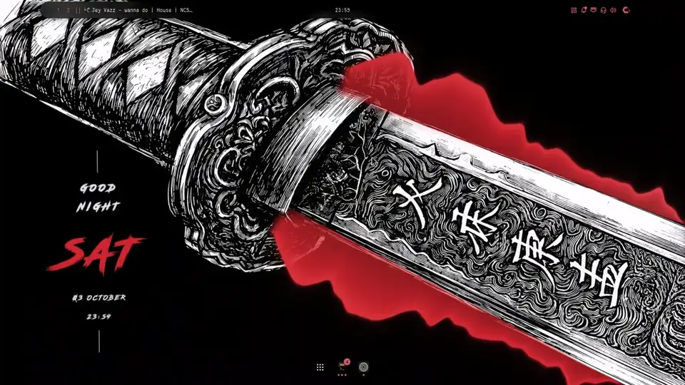
</p>

https://github.com/user-attachments/assets/523ec5c1-bcba-4fc5-892a-d8c912360f7a

Desktop widgets that live **under** your shell and **apart** from it: a
standalone Wayland client in C++ (GLES 3) that doesn't depend on any shell or
dotfiles. It integrates with Noctalia (palette) and KDE Plasma (wallpaper,
colour scheme), reads the wallpaper of other shells (caelestia,
DankMaterialShell, …) and wallpaper tools, and runs on
Umbriel/niri/Hyprland/Sway/KDE Plasma/COSMIC and, through an extension, GNOME.
Its first widgets are ports of
[Ryoku](https://github.com/ryoku-dev/ryoku)'s.

- **Same layer as Noctalia's widgets** (layer-shell *bottom*): above the
  wallpaper, below the windows, and click-through.
- **Depth**: widgets pass behind what stands in front in the wallpaper.
  undershell computes each wallpaper's depth map itself, with the model
  Noctalia's `wallpaper_depth` plugin uses (Depth Anything V2), and cuts every
  widget at its own plane on the GPU (see [Depth planes](#depth-planes)).
- **Noctalia colors**: the palette comes from `noctalia theme <wallpaper>
  --scheme <your scheme>` (the same generator the shell uses) and is
  recomputed when you change wallpaper or theme.
- **Lightweight**: PipeWire capture inside the same process (no cava),
  FFT + cava-style processing (adapted from Noctalia, MIT) and the whole
  spectrum drawn in **a single GPU pass** (Ryoku's shader). With music it
  uses ~3% CPU on an HD 520; with no audio it sleeps.

## Gallery

<table>
  <tr>
    <td width="50%"><a href="docs/media/desk-katana.jpg">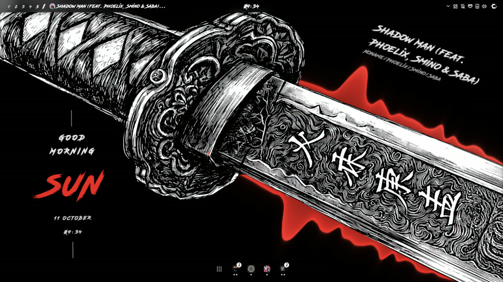</a><br><sub>a <code>wave</code> behind the blade, cut by the depth map</sub></td>
    <td width="50%"><a href="docs/media/desk-muzzle.jpg">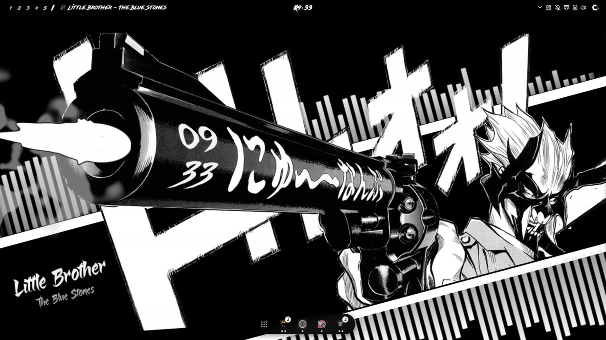</a><br><sub><code>muzzle</code> in ink: every kick is a shot</sub></td>
  </tr>
  <tr>
    <td width="50%"><a href="docs/media/desk-terminal.jpg">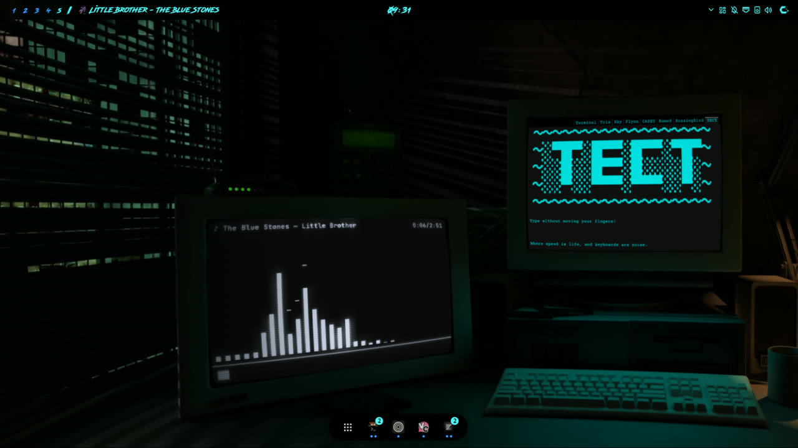</a><br><sub><code>terminal</code> pinned to the CRT's corners</sub></td>
    <td width="50%"><a href="docs/media/desk-skull.jpg">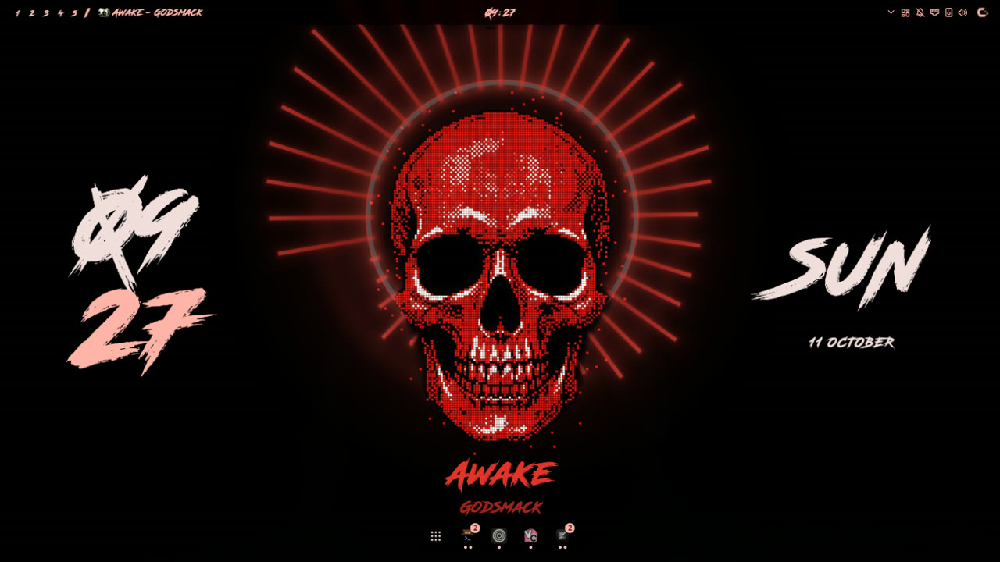</a><br><sub><code>halo</code>, <code>column</code> and <code>goodnight</code> clocks, a text-only music card</sub></td>
  </tr>
  <tr>
    <td width="50%"><a href="docs/media/desk-robot.jpg">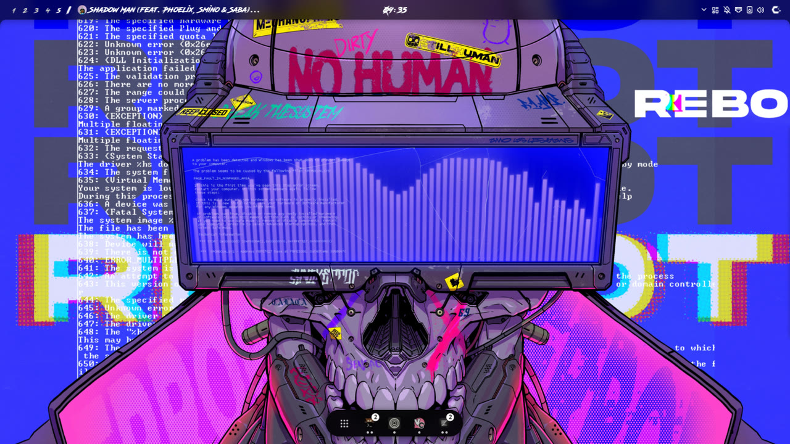</a><br><sub>a spectrum shaped to the visor</sub></td>
    <td width="50%"><a href="docs/media/desk-hands.jpg">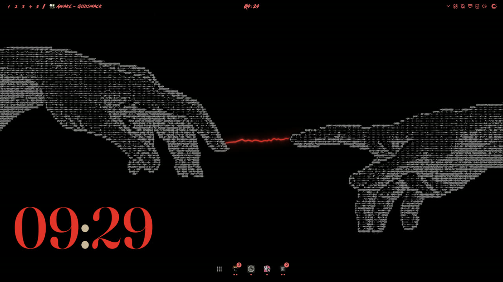</a><br><sub>a <code>line</code> spectrum between the fingers, <code>grand</code> clock</sub></td>
  </tr>
  <tr>
    <td width="50%"><a href="docs/media/desk-eye.jpg">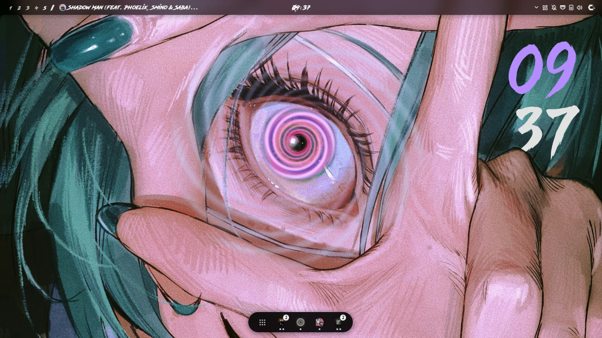</a><br><sub>a <code>column</code> clock in a brush font</sub></td>
    <td width="50%"><a href="docs/media/desk-goodnight.jpg">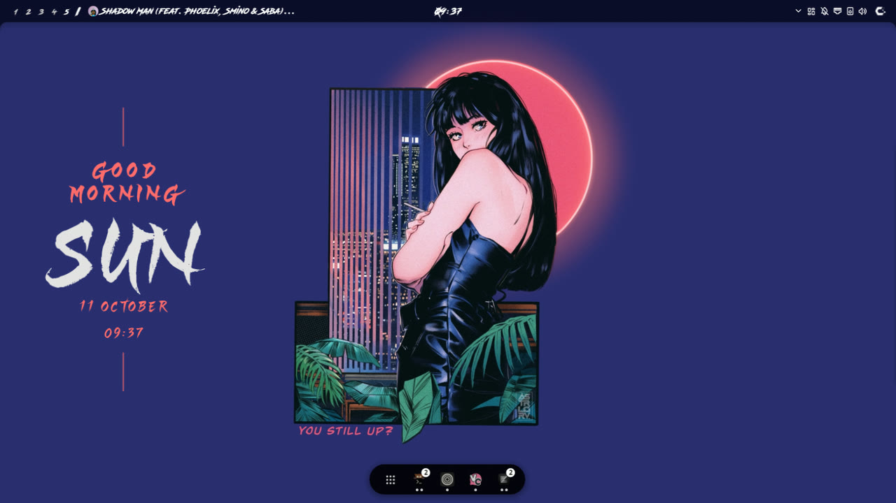</a><br><sub>the <code>goodnight</code> card</sub></td>
  </tr>
</table>

The wallpapers in these captures are other artists' work, shown only as backgrounds.

## Requirements

- **A Wayland compositor with `wlr-layer-shell`**: Umbriel, niri, Hyprland,
  Sway, KDE Plasma (KWin), COSMIC, … **GNOME** has no layer-shell: there the
  bundled GNOME Shell extension runs undershell (see [GNOME](#gnome)).
- **Optional:** [Noctalia](https://github.com/noctalia-dev/noctalia) for the
  palette. On KDE Plasma, undershell reads the wallpaper and the colour scheme
  itself; anywhere else, name the wallpaper in `[general]` (see
  [Without Noctalia](#without-noctalia-kde-plasma-and-others)). **ONNX
  Runtime** (`libonnxruntime`) for depth. **PipeWire** for live audio in the
  visualizers.
- **Libraries:** wayland, EGL / GLES 3, libpipewire-0.3, toml++, glib, cairo,
  pango, fontconfig, xkbcommon, libsystemd (sd-bus), gdk-pixbuf, libcurl,
  and FFmpeg's libavformat, libavcodec, libswscale and libavutil for the TV
  look's videos (optional: built without them, `-Dvideo=disabled`, GIFs still
  play). On Fedora, `ffmpeg-free` plays GIF, VP9 and AV1; H.264 needs the
  `ffmpeg` from RPM Fusion.
- **To build:** a C++20 compiler, meson, ninja, wayland-protocols,
  nlohmann-json, git.

On Arch and derivatives, all of it:

```sh
sudo pacman -S --needed base-devel git meson ninja wayland wayland-protocols libglvnd \
  libpipewire tomlplusplus glib2 cairo pango fontconfig libxkbcommon systemd-libs \
  gdk-pixbuf2 curl nlohmann-json ffmpeg
```

On Debian 13 and Ubuntu 24.04 or newer, the package script below installs
them for you (it needs GCC 13 or newer for C++20).

On Fedora, the package script below installs them for you; to build by hand
instead, after cloning the repository (see [Install](#install)), from inside it:

```sh
sudo dnf install dnf-plugins-core git
sudo dnf builddep packaging/fedora/undershell.spec
```

## Install

**Prebuilt packages:** every [release](https://github.com/EternalSelf-2328/undershell/releases/latest)
has packages for Arch Linux (and derivatives), Fedora 43 and 44, Debian 13 and
Ubuntu 24.04, built by GitHub Actions from the tagged source. Download the
one for your system, then:

```sh
sudo pacman -U undershell-*.pkg.tar.zst                       # Arch, CachyOS, EndeavourOS…
sudo dnf install ./undershell-*.fc44.x86_64.rpm               # Fedora (fc43 or fc44)
sudo apt install ./undershell_*_debian-13_amd64.deb           # Debian 13
sudo apt install ./undershell_*_ubuntu-24.04_amd64.deb        # Ubuntu 24.04 and newer
systemctl --user enable --now undershell
```

To update, install the next release's package the same way. The Ubuntu
package comes without `undershell-depth` (Ubuntu has no ONNX Runtime
package), so there depth behind the wallpaper's subject needs Noctalia's
`wallpaper_depth`.

**From source** (any distribution; `./update.sh` then keeps it up to date):

```sh
git clone https://github.com/EternalSelf-2328/undershell.git
cd undershell
```

**As a package (Arch and derivatives):**

```sh
cd packaging/arch && makepkg -si
systemctl --user enable --now undershell
```

**As a package (Fedora 43, 44):**

```sh
sudo dnf install git rpm-build dnf-plugins-core
packaging/fedora/build-rpm.sh -i
systemctl --user enable --now undershell
```

The script installs the build dependencies, builds the RPM from the checkout
(into `build-rpm/`) and installs it; without `-i` it only builds.

**As a package (Debian 13, Ubuntu 24.04 and newer):**

```sh
sudo apt install git dpkg-dev
packaging/debian/build-deb.sh -i
systemctl --user enable --now undershell
```

Same idea: build dependencies, a `.deb` in `build-deb/`, installed with `-i`.

**By hand:**

```sh
meson setup build --prefix=$HOME/.local
meson compile -C build
meson install -C build
systemctl --user daemon-reload && systemctl --user enable --now undershell
```

`meson install` puts the binary in `~/.local/bin` and the user service in
`~/.local/share/systemd/user/`, where `systemctl --user` finds it. The tests
are optional (see [Build and tests](#build-and-tests)).

**If the service doesn't start** ("A dependency job failed", "unmet condition
check ConditionEnvironment=WAYLAND_DISPLAY", or nothing appears at login):
your compositor doesn't run a systemd graphical session, so systemd doesn't
know the Wayland display. Add this to your compositor's autostart (Hyprland
`exec-once`, niri `spawn-at-startup`, Sway `exec`, …):

```sh
sh -c 'systemctl --user import-environment WAYLAND_DISPLAY && systemctl --user start undershell'
```

or skip the service and autostart `undershell` itself.

It runs as a **systemd user service** tied to the graphical session: it starts
with it, restarts itself if it crashes, and its logs go to the journal
(`journalctl --user -u undershell`). To stop it: `systemctl --user disable --now undershell`.

Every option is documented in [`docs/OPTIONS.md`](docs/OPTIONS.md) (generated
from the same table the inspector uses: `undershell --doc`). For the Noctalia
bar widget, see [Noctalia bar widget](#noctalia-bar-widget).

## Update

From the folder you cloned, one command for every install method:

```sh
./update.sh
```

It finds how undershell was installed (the Arch package, the Fedora RPM, the
Debian/Ubuntu package, or by hand in `~/.local`), runs `git pull`, builds and
installs it again the same way, and restarts the service if it was running.
`./update.sh --dry-run` only says what it would do; `--rebuild` installs again
even when there are no new commits. Packages built from the checkout carry
the commit count in their version (`1.2.0-1.git146`, `1.2.0+git146`), so `dnf`
and `apt` treat each update as newer.

The Noctalia bar plugin updates from Noctalia's plugin store.

## Uninstall

First stop the service, whichever way you installed it:

```sh
systemctl --user disable --now undershell
```

Then remove it the way it was installed:

| Installed with | Remove with |
|---|---|
| the Arch package (`makepkg -si`) | `sudo pacman -R undershell` |
| the Fedora package (`build-rpm.sh -i`) | `sudo dnf remove undershell` |
| the Debian/Ubuntu package (`build-deb.sh -i`) | `sudo apt remove undershell` (`purge` instead of `remove` also drops its package record) |
| by hand (`meson install`) | `ninja -C build uninstall`, from the checkout you installed from |

If you installed by hand and no longer have that `build` folder, delete the
files yourself:

```sh
rm -rf ~/.local/bin/undershell ~/.local/share/undershell ~/.local/share/systemd/user/undershell.service \
       ~/.local/share/doc/undershell ~/.local/share/licenses/undershell
systemctl --user daemon-reload
```

Your layouts, saved profiles and depth corrections stay in
`~/.config/undershell`, and the lyrics cache in `~/.cache/undershell`. To
remove those too: `rm -rf ~/.config/undershell ~/.cache/undershell`. For the
Noctalia bar plugin, remove it from Noctalia's plugin settings (or, if you
linked it from a checkout, `noctalia msg plugins disable eternalself-2328/undershell`
and delete the link).

## Visualizer: 28 looks

`bars`, `split`, `dots`, `segments`, `wave`, `ribbon`, `curtain`, `line`,
`frame` (a ring around the whole screen), `radial`, `orb`, `spiral`: Ryoku's
`spectrum.frag` ported to GLSL ES 3.00, with glow, reflection, falling peaks
and Ryoku's motion (`Motion.qml`). Plus sixteen of its own: `halo` (a glowing
ring), `vortex`, `fire`, `muzzle`, `electric`, `sfx`, `speedlines`, `rain`, `ripples`, `neon`, `fireworks`, `pond`, `aura`, `stars`, `terminal` and `tv` (see below).

<p align="center">
  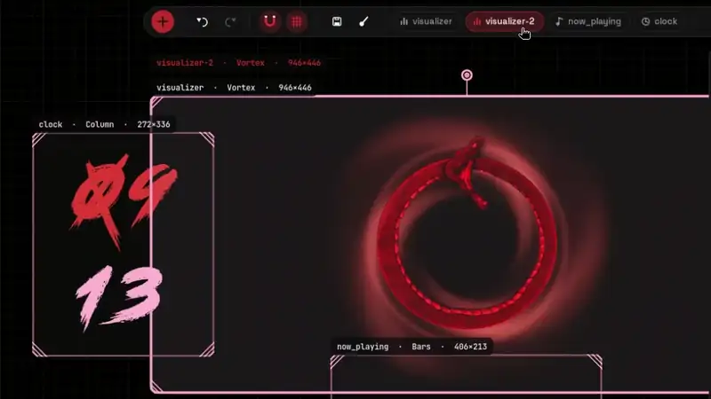<br>
  <sub>One widget, cycled through its looks in the editor.</sub>
</p>

## Clock: 12 faces

`digital`, `minimal`, `analog`, `flip` (cards that flip, colon that
"breathes"), `rings`, `bighour` (outlined month and seconds), `metal` (with
the weather from Noctalia's cache), `goodnight` (the day in the "kana" alphabet),
`grand` (Fraunces serif), `column`, `outline` (hollow numerals) and `banner`
(with a halo). Dates: `inline`, `badge`, `stacked` or `none`. Translated from
Ryoku's QML with its same measurements; the design fits the widget box.
Day and month names follow the system language (or `language = "en" | "es"`).
It redraws only when the second (or minute) changes; `flip` animates at 30 fps.

## Calendar

The **calendar** widget: the **month** as a grid (ISO week numbers if you
like), the **week** as a strip, **today** as a tear-off page, or an
**agenda** of the days ahead, with today in the accent colour, days gone by
faint and weekends tinted. On a glass or solid plate or on nothing, in any
font, the week starting on Monday or Sunday, in English or Spanish; the
mouse wheel steps through the layouts.

**Events**, read from this computer only (nothing is fetched): `.ics` files
or folders of them (**.ics files**, separated by `;`), **khal**'s calendars
(the vdirs in its config) and **Evolution / GNOME Calendar**'s (the local
ones, and the copies Evolution keeps of online accounts; hidden or disabled
calendars are left out). Repeating events, time zones, exceptions and moved
occurrences are understood. The month and the week mark days with a dot per
event in its calendar's colour, the page lists today's, and the agenda shows
what is coming with times and places. Sources are watched, so a change shows
at once (Evolution's cache is looked at every 10 minutes); otherwise it
wakes only at midnight.

<p align="center">
  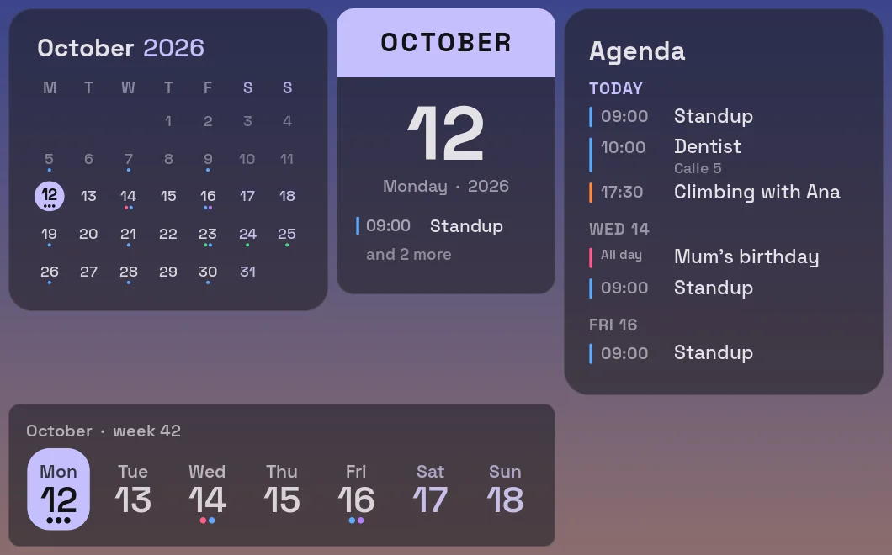
</p>

## Weather

The **weather** widget shows the weather where you say you are, from
[Open-Meteo](https://open-meteo.com) (free, no account, no key): now (an icon,
the temperature, the sky in words and the place), a card with today's high
and low, how it feels, humidity, wind and the next hours, the week (with the
chance of rain), or the hours alone. Type your city in the inspector's
**Location** (`location = "Quito, Ecuador"`) or coordinates
(`location = "-0.18, -78.47"`); nothing locates you on its own. What leaves
your computer: the place's name once, to Open-Meteo's geocoding (its answer
is kept), then only its coordinates rounded to 0.01° (about a kilometre),
every half hour. Answers are kept in `~/.cache/undershell/weather`, so a
restart does not ask again. Metric or imperial, colour or one-colour icons;
it redraws when a report lands and on the hour.

<p align="center">
  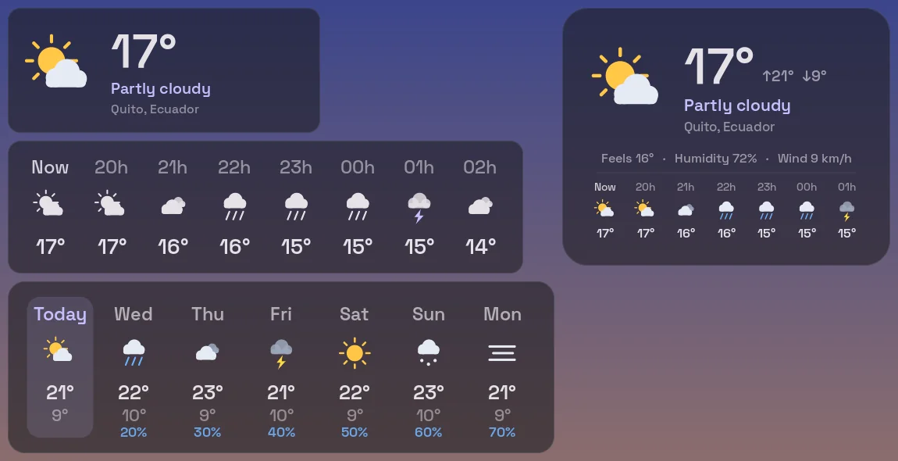
</p>

## Notes

The **notes** widget keeps a note in a Markdown file: headings, lists (nested
too), quotes, rules and tasks (`- [ ]` / `- [x]`), which are ticked with a
click right on the desktop. Write it in the editor straight on the widget
(double-click it, or **Write** in the inspector; Enter breaks the line, the
arrows, Home and End move, Esc or a click elsewhere keeps it), or in any text
editor (**Open the .md**, or `file = "~/notes/today.md"`): the file is
watched, so a change shows at once and nothing is polled. On a sticky-note
paper of any colour, a glass plate or nothing; without a `file` it is kept
in `~/.local/share/undershell/notes/<id>.md`. It draws once per change.

<p align="center">
  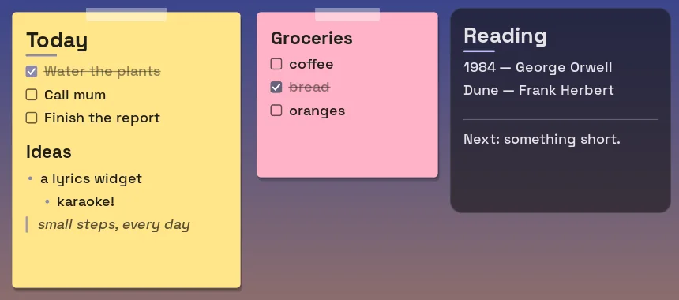
</p>

## Now playing (card)

Ryoku's music card: the cover (downloaded and decoded in the background),
the album color on the plate, the progress bar, the pulse and the play
button (Ryoku's `accentOf`), synced lyrics from **LRCLIB** (cached in
`~/.cache/undershell/lyrics`) with the sung line lit and its neighbors
fading, or a live spectrum when there are no lyrics; wavy seek bar
(**click to jump**), previous / play-pause / next and a button that opens your
app (`music_app`). The player is the one from Noctalia's MPRIS aggregator
(`dev.noctalia.Mpris`, via sd-bus) or, without Noctalia (KDE, GNOME, any other
desktop), the MPRIS player that is playing, staying with it while it plays and
falling back to the one heard last; updates are instant, from signals.
It comes in seven **layouts** (`layout`), each drawn at its own shape, and every
piece of it can be left out. Options: `layout`, `plate` (cover, glass, none),
`rail_style`, `show_lyrics`, `viz` (bars, wave), `accent_source` (album,
theme), `music_app`, `fps`, the `show_*` switches and the type options below.

<p align="center">
  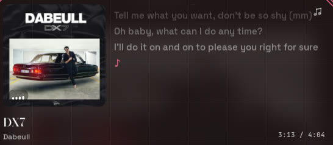
</p>

Widgets are click-through except on their buttons, so the desktop
keeps working normally around them.

## Lyrics

The **lyrics** widget shows the song playing line by line, in time: the
synced lyrics the music card already fetches from LRCLIB (and caches),
from any MPRIS player. Three **layouts**: **three lines** that scroll, the
one being sung in the middle and the ones around it smaller and faint;
**one line** that gives way to the next with a slide, a fade, a pop or typed
out; and **karaoke**, the line lighting up as it is sung. It takes the text
widget's ten styles and every effect, animation and music reaction (the
wheel steps through the styles here too). Without synced lyrics it shows
the title and artist, a note, or nothing; **Delay** nudges the timing when a
song's lyrics run early or late. Between lines it sleeps until the next one
is due, so it only draws while a line changes (karaoke: 30 fps for the
light).

<p align="center">
  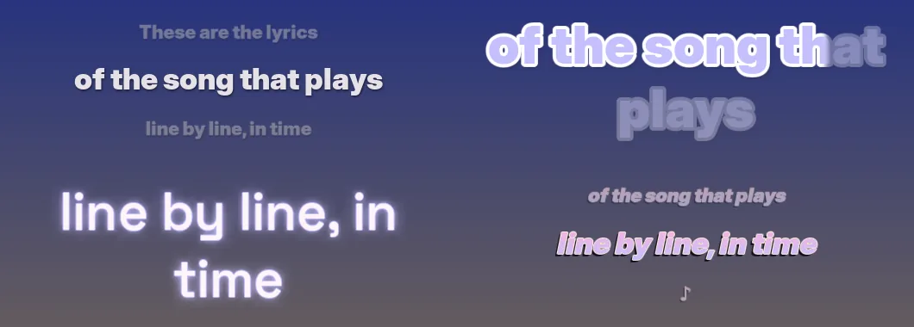
</p>

## Text

Words on the desktop with effects: a **fill** (a colour, a gradient across
the whole text, a moving rainbow, or none for hollow letters), an
**outline**, a **shadow**, a **glow** and a **3D depth** in any direction, each
in any colour. The letters can **wave**, **bounce**, **type themselves**,
**glitch**, **flicker** like a failing neon tube or **shake**, and with the
music they can **pulse**, **glow** or **jump** each with its band of the
spectrum. Ten **styles** (plain, neon, retro, comic, outline, sticker,
chrome, glitch, rainbow, typewriter) set all of that at once, and every
option can then be changed on its own; the mouse wheel over a text steps
through the styles. The words are typed straight into the inspector
(Shift+Enter for a new line), and `{title}`, `{artist}`, `{album}`,
`{time}`, `{date}` and `{day}` are filled in. The text grows to fill its box,
in any installed font. Pango draws it once into a texture and one shader
builds every effect from it: a still text is drawn once, a neon sign
flickers at 12 fps, and only moving letters draw at 60.

<p align="center">
  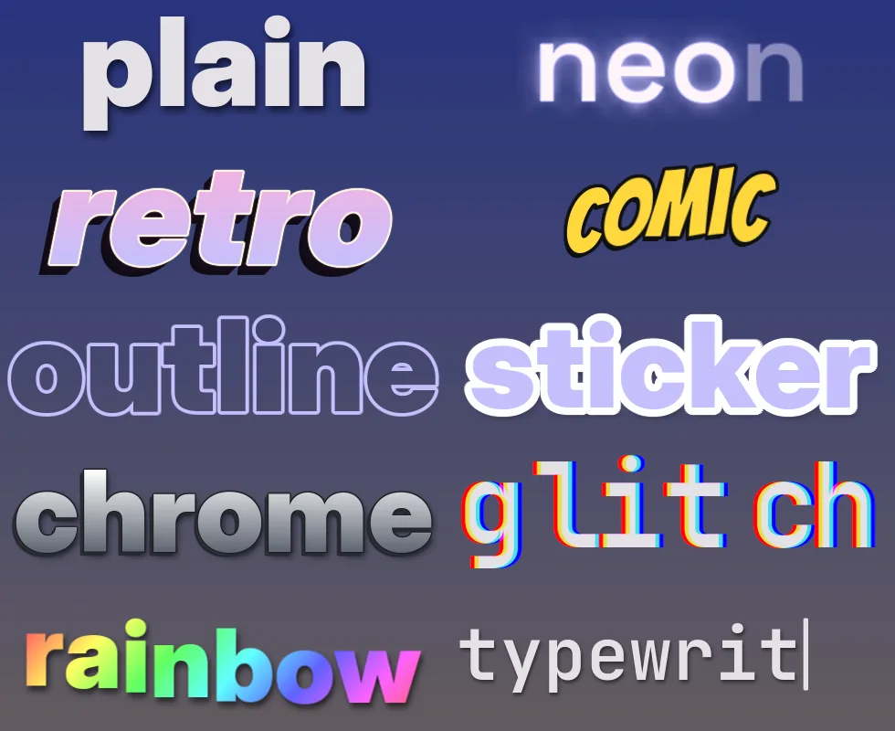
</p>

## Wallpaper filter

The **filter** widget changes how the wallpaper looks: brightness,
contrast, saturation, hue, warmth, a tint or a two-tone in any colours, a
vignette, blur, grain, posterize or pixelate. Ten styles set them at once
(warm, cool, noir, vintage, dream, night, vivid, faded, duotone, or custom),
and each can then be changed; the wheel steps through the styles. A widget
cannot filter what lies under it, so this one draws the wallpaper again,
fitted exactly as the shell fits it (checked: with nothing changed it
matches the real wallpaper pixel for pixel), under every other widget. Turn
**Background only** (its depth) on and the wallpaper's subject stays as it
is: only what lies behind it is filtered. One texture and one draw per
wallpaper or option change, nothing while still; a video or scene
wallpaper has no still picture, and then the filter draws nothing.

<p align="center">
  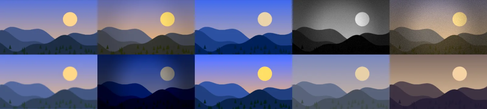
</p>

## Shapes

Geometric shapes to build compositions out of layers (see **Layers** and
**Groups** under Usage): rectangle, ellipse, triangle, polygon (3–16 sides),
star (its points and how sharp they are), heart, ring (or an arc of one),
line, and the Material 3 shapes (cookies, clovers, bursts, flower, sun…).
Each has a **fill** (a colour, a linear or radial gradient between two, or
none), an **outline** inside its edge, a **glow** and a soft **shadow**, and
can **spin** or **pulse** / **glow** with the music's kicks. Every colour can be
a palette role or any colour from the picker. One distance shader draws it
all, so a still shape is drawn once and then costs nothing; the mouse wheel
over one in the editor steps through the shapes.

<p align="center">
  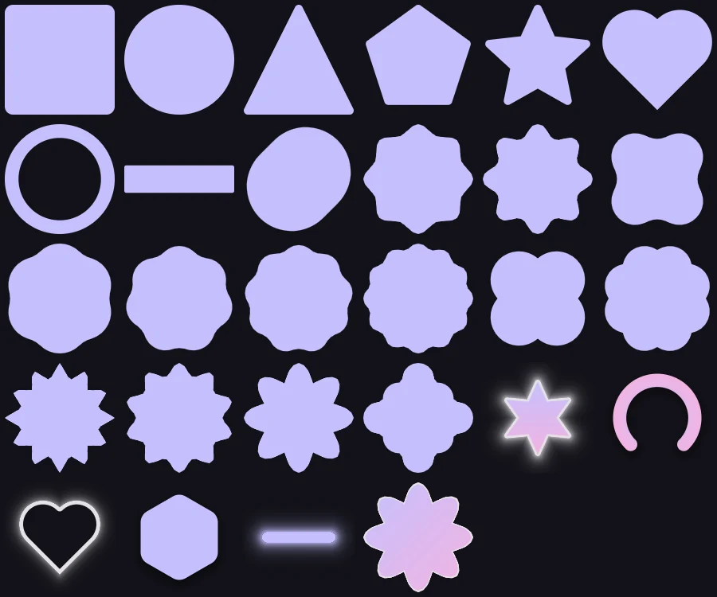
</p>

## Pictures and stickers

The **image** widget puts a picture on the desktop: a photo, a sticker, a GIF,
an animated WebP or APNG, or a video, keeping its transparency. **Choose a
picture…** in the inspector opens the desktop's file chooser (or
`msg pick-files <id>`, or `file = "~/Pictures/cat.png"`). It is fitted into
its box (**Fit**: all of it, filling it, or stretched), with rounded corners
or **cut** to a circle or a Material 3 shape, and as a sticker: an
**outline** round its silhouette in any colour and a soft **shadow** under
it. **Mirror** flips it; an animation has a **speed**; it can **bounce** or
**pulse** with the music's kicks. Like every widget it can pass behind the
wallpaper's subject.

A still picture is decoded once, at the size it is shown, and drawn once. An
animation is decoded on its own thread (FFmpeg, as for the TV; GIFs and still
pictures also through gdk-pixbuf), kept whole when it is short, and the
widget sleeps until its next frame is due: a 12 fps GIF is drawn 12 times a
second.

## Usage

```sh
undershell                  # start (one instance only)
undershell msg edit         # editor on/off
undershell msg demo         # synthetic spectrum for previewing looks
undershell msg status       # widgets, fps, depth mask, audio
undershell msg add clock flip  # add a widget to the config: visualizer, clock, calendar, weather, notes, now_playing, lyrics, text, shape, image, filter
                               # the second word is its look: a clock face, a
                               # visualizer style or a card layout, and the new
                               # widget comes out at that layout's own shape
undershell msg remove clock    # remove it
undershell msg select clock    # select it in the editor (scripts); several ids select them together
undershell msg group viz clock # group widgets (ungroup <id>: its whole group)
undershell msg layer clock up  # restack it: up, down, front, back
undershell msg pick-files tv   # the TV's file chooser: adds to its tv_files ("folder" for folders); an image's picture
undershell msg depth-model     # download the depth model (~95 MB)
undershell msg gallery         # open the editor with the gallery
undershell msg reload
undershell msg quit
undershell --snapshot DIR   # render the looks and clock faces to PNG (no window needed)
```

**Editor** (`msg edit`, e.g. bound to `"Mod+Ctrl+D" = "spawn:/home/USER/.local/bin/undershell msg edit"`
in Umbriel; use the absolute path, since Umbriel's PATH doesn't include `~/.local/bin`):

<p align="center">
  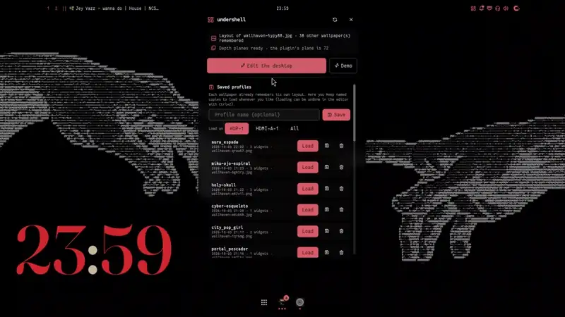
</p>

| Action | How |
|---|---|
| Toolbar | drag it by its grip (the dots at its start) anywhere; let go near the left or right edge and it stands up as a column there; double-click the grip to give it back its own place: the top, or the bottom while a widget lies under it at the top. Panels and popovers follow it |
| Select | click or its chip (empty space: deselect) · **Tab** / Shift+Tab · **Shift+click** adds a widget to the selection or takes it out; the selected widgets move together, and their box has corners that scale them all (keeping their proportions) and a knob that turns them all about its centre |
| Layers | the toolbar's **layers** button opens a panel with the screen's widgets front to back. Drag a row up or down to restack it (or **PgUp** / **PgDn**, Shift: to the front / back); the **eye** hides a widget (hidden, it has no surface at all: it costs nothing), the **lock** keeps it from being picked or moved on the desktop (it can still be selected in the panel); double-click a row to name it. A wheel scrolls a long list. Saved in the widget's block as `layer`, `hidden`, `locked` and `name` |
| Groups | select several widgets and press **Ctrl+G** (or the panel's group button): clicking any of them then picks the whole group, to move, scale, turn, duplicate or delete it as one. **Double-click** one to pick just that member; **Ctrl+Shift+G** ungroups (with a member alone picked, it just leaves the group). In the panel a group folds under its name: its eye and lock act on every member, a row dropped between two members joins the group and one dragged out of it leaves. Saved as `group = "Group 1"` in each member, so groups go along with profiles and saved layouts |
| Move / resize | drag · **any corner** (the opposite one stays put, turned widgets too) |
| Magnet | snaps to the screen center, the edges and other widgets (guide lines); toggle it in the toolbar; **Shift** inverts it while held |
| Shape | The inspector's **Shape** section has a **Mode**: *None*; *Tilt* (lean back, lean sideways, skew and distance: `tilt_x`, `tilt_y`, `skew`, `perspective`); *Corners*, the widget's four corners as free points you drag onto the wallpaper; or *Mesh* (below). Saved as `warp = "none" \| "tilt" \| "pin" \| "mesh"`; a new shape starts from where the widget is drawn, and depth, clicks and the editor follow it. Placing points: a loupe magnifies the wallpaper under the one you drag, **Shift** moves it at a quarter speed, the arrows nudge the last one by 1 px (Shift 16 px), dragging inside moves them all, and the widget's resolution follows its shape |
| Mesh | Bends the widget to the shape of something in the wallpaper (a column, a flag, a rock, a box's corner): a grid of **3×3, 4×4 or 5×5** points you drag. **Between points**: *Smooth* curves through them, *Straight* keeps each cell flat and folds at the points. **Base shape** lays the grid as *Flat*, *Arc*, *Bulge*, *Flag*, *Cylinder* or *Wave* on the mesh's four corners, with a **Curvature** (−100…100; negative bends the other way); moving a point by hand makes it *Custom*. **Reset mesh** lays it flat again. Saved as `mesh_grid`, `mesh_between`, `mesh_preset`, `mesh_amount` and `mesh = [x0, y0, …]` (row by row from the top-left); `msg set <id> mesh_preset arc` works from scripts too |
| Other screens | A layout remembers the screen size it was made on (`space = [w, h]`; older blocks get the size of the screen they are first shown on). On a monitor of another size or scale every widget, pin and depth plane goes where the same part of the wallpaper is now (through the fill mode), so it stays on the rock or the portal it was placed on. The output's real logical size comes from xdg-output, so fractional scales (e.g. 1366×768 at 0.98) line up too |
| Layouts on any monitor | A saved profile loads onto the monitor it is loaded from (the editor's Profiles card), or the one chosen with **Load on** in the bar plugin, or onto **All** of them (`msg save-load <id> [output\|all]`); only that monitor's widgets are replaced, the others keep theirs, so the same profile can show on several screens; its `space` fits it to that screen's size through the wallpaper, so it also works across different resolutions. A block naming a monitor this machine does not have shows on the first one, so layouts can be shared between setups |
| Language | The editor speaks English or Spanish. By default it follows the system locale (`es_*` → Spanish, anything else → English); the **Language** buttons at the foot of the shortcuts card (`?`) pin it, saved as `[general] language = "system" \| "en" \| "es"`. Option values are shown translated (the config keeps the values themselves), and long labels shrink or end in “…” instead of running into the controls |
| Fold panels | The inspector, the layers panel and the depth brush panel have a chevron button in their title: it folds the panel to just its title (to see and paint the wallpaper behind it) and unfolds it again, in place. Panels still drag by their title while folded (`msg card fold inspector\|layers\|paint` does the same from a script) |
| Tilt | drag the **knob** above the selected widget (0.1° steps; **Shift** = ten times finer; the magnet catches multiples of 15° within 2°) · **Ctrl+←/→** 0.1°, Ctrl+Shift 1° · Shift-drag any slider to nudge it · *Rotation* in the inspector · `rotation = 20` in the config (degrees, clockwise) |
| Fine-tune | **arrows** 1 px · Shift+arrows 16 px · **Alt**+arrows = size (with key repeat) |
| Change look | **wheel** over the widget (visualizer style, clock face or shape) |
| Options | the **inspector** appears next to the selected widget, in sections (Look, Colour, Music, Time & data, Placement) showing only the settings that do something for its current look; drag it by its title to move it out of the way (double-click the title to put it back); the depth brush panel moves the same way. It offers: lists ‹ ›, switches, sliders (drag or wheel) and theme colour swatches; you see every change live |
| Any colour | the **＋** at the end of a colour row opens the colour picker: a saturation/brightness square and a hue bar (dragged live, one undo step), a hex field (type `#rrggbb` or `#rgb`, or paste one with Ctrl+V, through `wl-paste` from wl-clipboard), an **eyedropper** that takes a colour from the wallpaper (a loupe shows the pixels under the pointer; Esc or right click cancels), the wallpaper's own dominant colours and the ones you used lately (kept in `~/.local/state/undershell/recent-colors`). The colour is stored as hex, e.g. `color = "#3a944a"`. A dark colour does not hide the editor: its accent is lifted until it reads |
| Add | the **＋** button in the toolbar opens the gallery: visualizer, clock, music, shape, image |
| Toolbar | it steps aside to the bottom of the screen while a widget lies under it at the top (or is dragged there), and comes back once the top is clear; panels and popovers follow it |
| Scroll a panel | the wheel, or drag the bar at its right edge (a click on the bar jumps there): the inspector, the font list, the Layers panel and the profiles |
| Duplicate / delete | **Ctrl+D** · **Del** (or the inspector buttons); with several selected, all of them (a duplicated group becomes a group of its own, stacked just above it) |
| Undo / redo | **Ctrl+Z** · **Ctrl+Shift+Z** / Ctrl+Y (moves, sizes, looks, options, additions, deletions, layers and groups) |
| Exit | **Esc**, Enter or right-click |

While editing with no music, the visualizers move with the demo spectrum.
With the grid on (toolbar), positions snap to it (16 px) on release and are saved to the config,
without touching the rest of the file.

## Music card

**Layout** (`layout`) picks the shape of the card:

| | |
|---|---|
| `sheet` | the original: the sleeve leads, this song's lyrics run beside it, and the track, its clock, the rail and the three moves close it out (560 × 302) |
| `vinyl` | the sleeve is the label of a record whose grooves turn while the song plays, with the track and the moves to its right (440 × 160) |
| `tile` | a small card the sleeve steps out of, the track set against the right edge (320 × 132) |
| `poster` | the artwork is the card, the track on it under a veil (300 × 400) |
| `strip` | one line of it, for a narrow gap (560 × 72) |
| `portrait` | the sleeve on top, everything else centred under it (280 × 392) |
| `text` | only the title and the artist, as large as the widget's box allows (any size) |

Only `sheet` has room beside the sleeve, so the lyrics and the spectrum belong
to it. The others make their own use of the sleeve, the track and the moves.

**Just the track** (`layout = "text"`): no sleeve, no clock, no controls -- the
title and the artist, scaled together until they meet the box one way or the
other, so resizing the widget resizes the type. `text_form` is `stacked` (the
title over the artist; a long title breaks into two balanced lines when that
lets it be clearly larger) or `line` (`Title · Artist` on one baseline).
`text_align` (left, center, right) and `text_valign` (top, center, bottom) set
where it sits in the box. The fonts, `artist_size` (the artist's share: half
the title by default), `show_artist`, `plate` and `ink` still apply. Nothing on
it moves, so it only redraws when the song changes.

**The pieces** switch off one by one: `show_cover`, `show_artist`, `show_time`,
`show_rail`, `show_transport`, `show_open` (the button that opens your player),
`show_pulse` (the bars on the sleeve while sound is moving), `show_viz` and
`show_lyrics`. A piece that is not shown leaves no hit target behind.

**Seek rail** (`rail_style`): `wave` (a travelling wave), `line`, `dots`,
`bars` (they stand taller where the song has been) or `ring`, drawn around the
sleeve. The ring needs a round sleeve -- the record, or `cover_shape =
"circle"` -- and anywhere else it keeps to the rail.

**The track's type**: `title_size`, `artist_size` and `time_size` scale the
sizes the card was drawn with, and `title_font`, `artist_font` and `time_font`
take any family installed (empty keeps the design's). The block is placed by
what the type really paints, so a decorative face that spills out of its
metrics still sits right. See [Fonts](#fonts).

**Cover shape** cuts the cover to a Material 3 shape (`cover_shape`: any of
the 18 names), or `cycle`: each song gets its own shape (the same song, the
same shape) and the cover morphs into it on Material's expressive spring,
overshooting a little. `rounded` keeps the rounded square.

**Lyrics style** sets how far the sung line stands out from the ones around
it. `plain` is Ryoku's gentle step: a couple of pixels larger, a weight up,
and the album's colour. `focus` takes it much further -- the sung line is
set half again as large and bold, and its neighbours fall back -- while
keeping one face and one size per line, so no lyric in any language can come
out uneven.

## With nothing playing

`idle` in `[general]` sets what every visualizer does as soon as the sound
stops (a third of a second of grace): `show`
(as is, the default), `hide` (a quick fade out; a hidden visualizer stops
drawing, so it costs nothing) or `demo` (it moves on a demo spectrum). Each
visualizer's **With no music** option (`idle = "auto" | "show" | "hide" |
"demo"`) follows the general one on `auto` or overrides it. Music brings
them back at once; while editing they are always shown.

## Halo

The `halo` look is one perfectly round ring of light. Its glow is built
like real bloom (a tight, a medium and a wide falloff summed as light, then
tone mapped, so the core turns white-hot instead of clipping):

- **Every song fills the range** — each signal is normalised to the song's
  own recent range (a few seconds), so trap, swing and a ballad all move;
  how loud the song really is still counts, so calm music stays calmer.
  The first second and a half of sound eases in.
- **Pulse** — the bass envelope, on a soft curve: the light and the glow's
  reach pump with the groove.
- **Breathing** — the size follows the energy relative to its recent level
  on a critically damped spring: it swells with the phrasing and settles
  smoothly, never jitters.
- **Beat flash** — kicks, found by spectral flux on the bass (how fast it
  *rises*, over its own mean plus 1.6 deviations, not how loud it is), flash the light
  for about a quarter second; strong ones send a soft **wave** of light out.
- **Tone** — the colour drifts slowly from the primary toward the secondary
  as the music gets brighter (more treble).
- **Aurora** (off by default) — a slow brightness drift along the ring; the
  shape stays round.

**Shape** turns the ring into any of Material 3's 18 shapes (cookies,
flower, clovers, bursts, sunny, puffy diamond…), its line and glow kept even
along every curve.

Options: Shape, Size, Line width, Glow reach, Glow strength, Pulse, Breathing, Beat flash,
Beat waves, Aurora; *Smoothing* sets how soft the breathing is, *Gain* the
sensitivity, *Colour* the colours (theme: primary → secondary).

## Vortex

The `vortex` look takes the halo's ring as an event horizon and winds arms
of gaseous light around it in a logarithmic spiral, streaming inward like
water down a drain; the centre stays empty (put it around something on your
wallpaper and let depth keep that in front). It shares the halo's music —
pulse, breathing, beat flash and waves, all normalised per song — and adds
spin: the energy speeds it up on a spring and each kick gives a burst that
brakes by itself. **Mode**: `inward` (arms outside the ring, drawn in),
`outward` (outside, pouring out — a white hole), `inside` (a tunnel inside
the ring, sinking to the centre; only the halo's glow outside) and
`inside_out` (the tunnel welling up from the centre). **Ring** dims the
horizon ring down to 0 (arms only; their inner end then dissolves softly).
Options: Mode, Ring, Horizon size, Reach, Arms, Twist, Turbulence,
Spin speed, Clockwise, Horizon line, Glow strength, and the halo's music
options. Colour 1 lights the horizon, Colour 2 the outer arms.

## Fire

The `fire` look is a fire rising from the bottom of its box: flames torn
into tongues by noise that erodes the silhouette more as it rises, with a
textured, hot core and sparks that climb out of it and die. The music feeds
it like the halo (per-song normalisation): the energy sets the height, the
**spectrum** shapes it across the width (bass in the middle), the bass pulse
stokes the core, a kick throws a **flare** and a burst of sparks, and the
flames rise faster when the music is busy. Options: Shape (`bonfire`, a
cone; `wall`, full width), Colours (`fire`, a black-body ramp; `theme`,
Colour 1 for the core and Colour 2 for the tongues), Height, Turbulence,
Spectrum shape, Sparks, Speed, Pulse, Breathing, Beat flare.

## Muzzle flash

The `muzzle` look is the burst at a gun's muzzle, made for wallpapers with a
gun in them: **every kick of the music is a shot**, as hard as the kick. A
shot is a white-hot core, flame tongues fanned forward and shorter spikes to
the sides, ragged and different every time; it grows in about 30 ms and is
gone in about 150, sparks fly out in a fan, and a little smoke stays,
swelling and rising. Between shots an ember glows with the bass. The muzzle
is the box's **left edge** and the shot goes right: turn, pin or mesh the
widget onto the barrel (see Shape). Options: Drawn as (`flash`, light in
white, yellow and orange, or the theme's colours with Colours `theme`;
`manga`, flat white with a black ink outline, for black-and-white artwork),
Reach, Side spikes, Sparks, Smoke, Ember.

<p align="center">
  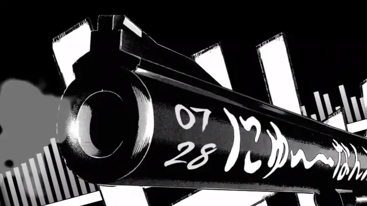
</p>

## Electricity

The `electric` look is electricity in three forms (Form, `electric_form`):

| | |
|---|---|
| `arc` | an arc from the box's left edge to its right, re-forming faster the louder the music (7 to 28 times a second); every kick flashes it, adds a strand and throws off forks. Pin or mesh its ends onto two things in the wallpaper |
| `bolts` | every kick strikes: a bolt comes down from the top edge in about 30 ms, flickers with two more return strokes and is gone in half a second; a hard kick can strike twice |
| `plasma` | a plasma globe: filaments from the electrode at its heart to the glass, drifting round it, more of them and brighter with the music, all flashing on a kick |

Its forks stay inside the box (or the globe). Drawn as `flash` (a white-hot
core in a glow, electric blue or the theme's colours with Colours `theme`) or
`manga` (white with a black ink outline). Amount (strands, filaments, a second
bolt), Branches, Glow, Thickness, Beat flash and Follows the music set the
rest. In silence the arc and the globe keep crackling faintly, a few frames a
second. The paths are built on the CPU and only the pixels near them are
shaded, so a big box costs no more than a small one (about 1.5 ms of GPU a
frame for a 1074 × 621 arc on an Intel HD 520).

## Onomatopoeia

The `sfx` look letters a sound effect on the kicks, the way comics do, in
four traditions (Language, `sfx_language`):

| | soft kick | kick | hard kick |
|---|---|---|---|
| `english` (comics) | THUD, BUMP | BAM!, POW!, WHAM! | BOOM!, KABOOM! |
| `japanese` (manga, anime) | トン, ズン | ドン!, バン! | ドカーン!!, ドドン!! |
| `korean` (manhwa) | 통, 쿵 | 쾅!, 펑! | 콰광!!, 두둥!! |
| `chinese` (manhua, donghua) | 咚, 噔 | 砰!, 轰! | 轰隆!!, 嘭!! |

`mix` picks a language per hit. The word slams in past its size in 70 ms
with a shake, holds (longer the harder the kick), and shrinks away when the
next one lands -- one hit at a time, the way a panel letters it. In a tall
box the CJK words run top to bottom. Drawn as `comic` (a colour fill, a
black outline and a solid shadow; Colours `classic` or `theme`) or `manga`
(white with a black outline), with a spiky burst behind it (Burst behind).
Size, Amount (every kick at 1, only the hardest toward 0) and Font (`auto`:
Bangers for English, the heaviest Noto Sans CJK for the rest) set the rest;
`sfx_words = "ZAP!, KRAK!"` in the config letters your own words instead.

The CJK words need a CJK font: `noto-fonts-cjk` (Arch), `google-noto-sans-cjk-fonts`
(Fedora) or `fonts-noto-cjk` (Debian, Ubuntu). Bangers comes bundled.

## Speed lines

The `speedlines` look is manga's lines of motion (Form, `lines_form`):
`focus` -- the focus lines (集中線) that close in on a moment, wedges from the
box's edges toward a clear centre, drawn anew a dozen times a second
(faster with the music) and rushing in on every kick -- or `parallel`,
streaks racing across the box. Colour `black` (ink), `white` or `theme`;
Amount, Clear centre, Thickness and Beat rush set the rest. Lay it over an
action wallpaper, or put the clear centre on a face.

## Rain

The `rain` look lets something fall through the box (Falling, `rain_kind`):
`rain` (streaks that splash at the foot of the box), `snow` (drifting
flakes) or `petals` (sakura, tumbling as they fall). There is more of it the
louder the music, and every kick sends a gust; with Far lightning on, the
hardest kicks strike a faint bolt in the distance. Amount, Wind (its slant
and drift, either way), Speed and Colours (`classic` or `theme`) set the
rest. Turn depth on and it falls behind the wallpaper's subject.

## Ripples

The `ripples` look is water: every kick drops a drop that opens rings,
slowing as they spread and fading, and smaller drops fall between the kicks
with the music. The rings are flattened as water seen at an angle
(Perspective) and their near side catches more light. Drawn as `flash`
(light on water, or the theme's colours) or `manga` (inked rings that thin
as they fade); Rings, Size, Drops between and Beat drop set the rest. Put it
on a lake or a puddle in the wallpaper, with tilt or corners for the angle.

## Neon sign

The `neon` look is a sign in glass tubes: your words (`neon_text = "OPEN"` in
the config; `LIVE` until you set it, in any font with Font) or a Shape:
`heart`, `star`, `circle`, `bolt`, `note` or `arrow`. It hums a little
brighter with the music and flares on every kick; with Failing tubes up, now
and then a letter or a piece of the shape fails and stutters back, and an
unlit tube still shows as dark glass. Colour (any palette role or hex), Size
and Beat flash set the rest. Pin it to a wall or a shop front in the
wallpaper.

## Fireworks

The `fireworks` look bursts one on every kick -- at the kick, the shell's
trail shown as already risen, so it lands on the beat -- and hard kicks
burst two. Kind: `peony` (a sphere of sparks), `willow` (gold, long trails
that droop), `ring`, or `mix`. The sparks slow, fall, trail and crackle out.
Drawn as `flash` (light, classic colours or the theme's) or `manga` (inked
sparks); Amount (which kicks), Size and Beat burst set the rest.

## Water wave

The `pond` look is a single wave in the middle of still water: the bass
lifts the water at the centre and a kick sends one wave out, fast at first,
then slowing and flattening as it spreads. The surface is lit like water --
a bright crest where it faces the light, a soft shadow in the troughs either
side. As a `ring` seen from above (Perspective flattens it, as water seen at
an angle) or as a `line`, one wave running along a surface seen from the
side. Waves at once (1 to 4), Size, Colours (`water` or `theme`) and Beat
wave set the rest. In silence a slow wave goes out now and then.

## Aura

The `aura` look is a fantasy aura: thin tongues of light flowing out and
licking upward, a soft glow round them and motes of light drifting up
through it. Shape: `orb` (round a glowing orb), `ring` (round an empty
middle -- put another widget in it) or `rise` (rising from the bottom edge,
like a hero powering up). Colours: `arcane`, `holy`, `frost`, `nature`,
`infernal`, `void` or `theme`. The groove makes the flames reach further and
flow faster, a kick flares them (Beat flare); Size, Flames, Motes of light
and Speed set the rest. The flames always fit in the box.

## Stars

The `stars` look, in three modes: `field`, a sky whose stars twinkle on
their own and brighten with their band of the music, the brightest
sparkling, and a shooting star across it on a strong kick; `warp`, flying
through them, faster with the groove and leaping on a kick; and
`constellation`, fixed stars joined by faint lines, a different figure
lighting up on each kick. Colours `night`, `gold` or `theme`; How many,
Size, Speed (the warp's) and Shooting stars set the rest. They are drawn as
strokes of light, so only the pixels near a star cost anything.

<p align="center">
  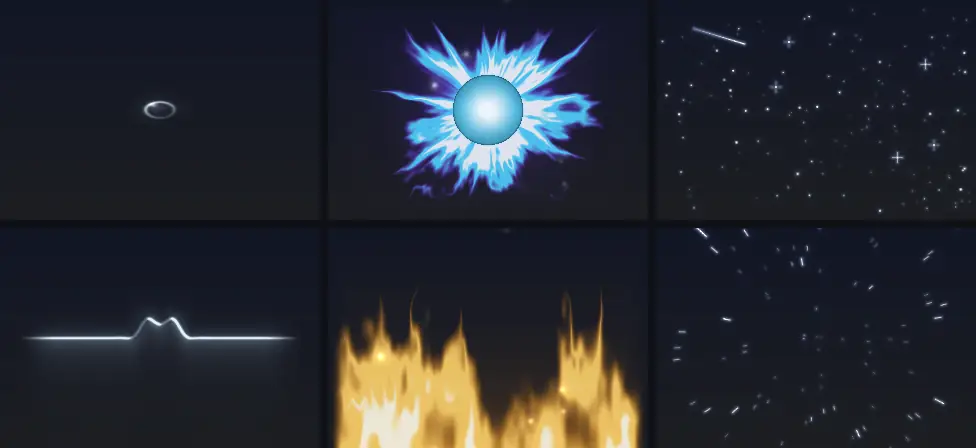<br>
  <sub><code>pond</code> ring and line · <code>aura</code> orb and rise · <code>stars</code> field and warp</sub>
</p>

## Terminal

The `terminal` look is a terminal on a CRT, for the computer screens in a
wallpaper (pin its corners to the screen). It Shows (`term_mode`):

| | |
|---|---|
| `code` | a shell session typing itself -- a pull and a build, code, a ping, and the song that is playing -- faster with the music, its output pouring on the kicks |
| `spectrum` | the spectrum in block characters, the song and its time above it, where it is along the foot |
| `matrix` | columns of katakana and digits falling, faster with the music, a glitch on a kick |
| `monitor` | this machine's CPU (each core), memory, network and busiest processes, read from `/proc` once a second, and the music's pulse |

The screen is phosphor -- `green`, `amber`, `white` or `theme` -- with Glow,
Scanlines, Flicker, Tube curve and Screen glass (the dark glass behind the
text) each from 0 (off) to 1, and Text size. A kick lights the screen up
(Beat flash). The characters come from a sheet built once (JetBrains Mono;
katakana from the system's CJK font) and the whole screen is two passes:
about 0.7 ms of GPU a frame at 1074 × 621.

<p align="center">
  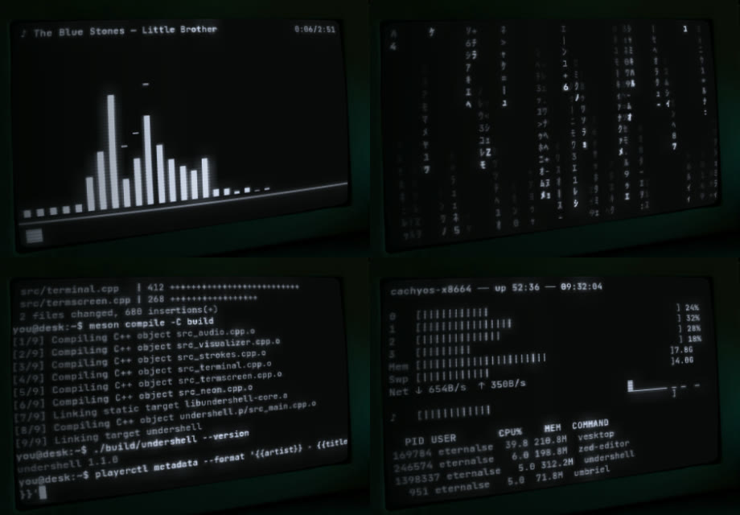<br>
  <sub><code>spectrum</code> · <code>matrix</code> · <code>code</code> · <code>monitor</code></sub>
</p>

## TV

The `tv` look is an old television, for the screens in a wallpaper. It
Shows (`tv_mode`) `static` (snow), `colorbars` (the SMPTE bars), `nosignal`
(the blue screen), `media` (your GIFs and videos) or `channels` (all of
them, your files first, flipping between them). With the music:

- **Beat interference**: a kick throws bands sideways, splits the colours
  and sends a burst of snow across the picture.
- **Speed with music**: videos and GIFs play faster as the song rises
  (0.5× to 1.8×).
- **Channel changes**: hard kicks change the channel, with a moment of snow
  and `CH 03` in the corner.
- **Off in silence**: when the music stops the set switches off the old
  way, into a white line and then a dot, and comes back with the music.

**VHS tape** adds tracking noise, a wobble, worn colour and `PLAY ▶` with a
counter; **Snow over it** lays a little static on any picture. The tube is
the terminal's: Glow, Scanlines, Flicker, Tube curve and Screen glass.

To show your own files, set **Shows** to *Your videos* (or *Channels*) and
use **+ Files** or **+ Folder** under it: they open your desktop's file
chooser (through the XDG desktop portal, or zenity/kdialog where there is
none) and add what you pick to the list, where × takes one out. A folder
plays the media files in it, in order; up to eight files are used. The list
is the `tv_files` key, which you can also write by hand:

```toml
tv_files = ["~/Videos/loops/", "~/Pictures/cat.gif"]
```

From a script, `undershell msg pick-files <id> [folder]` opens the same
chooser for a widget.

Picture `fill` crops them to the screen, `fit` letterboxes them. Each is
decoded on its own thread, scaled down to the widget's size; a short clip
(up to 32 MB once scaled) is kept after its first loop and never decoded
again. Videos need undershell built with FFmpeg (`-Dvideo=enabled`, on by
default when its libraries are found); without it, GIFs still play.

<p align="center">
  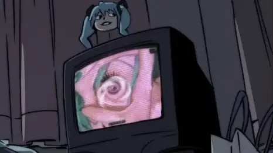
</p>

## Clock structures

Five clock faces are **editable structures**: `goodnight` (the card),
`column`, `flip`, `metal` and `stacked` (the Modern Clock layout: a big
weekday, the date, the time). Select the clock in the editor: the
inspector's **Elements** section lists its parts — open one to set its
**font** (every installed family, each shown in itself; type to search),
size, weight, spacing, capitals and colour; the arrows reorder parts and
the switch hides one (flip keeps its layout). Each structure also has
options of its own: the card's weekday drawn in strokes or set in a font,
the column's line overlap and alignment, flip's corners and pulsing
separator, metal's separator, stacked's alignment, gap and date format.
To use fonts you download, see [Fonts](#fonts). Untouched, a structure looks exactly as designed; changes are flat keys
in the widget (`goodnight_time_font = "Space Grotesk"`,
`goodnight_order = "rule_top,greeting,time,day,date,rule_bottom"`), so
they travel with wallpaper profiles and saved layouts. The other faces
stay as classics.

<p align="center">
  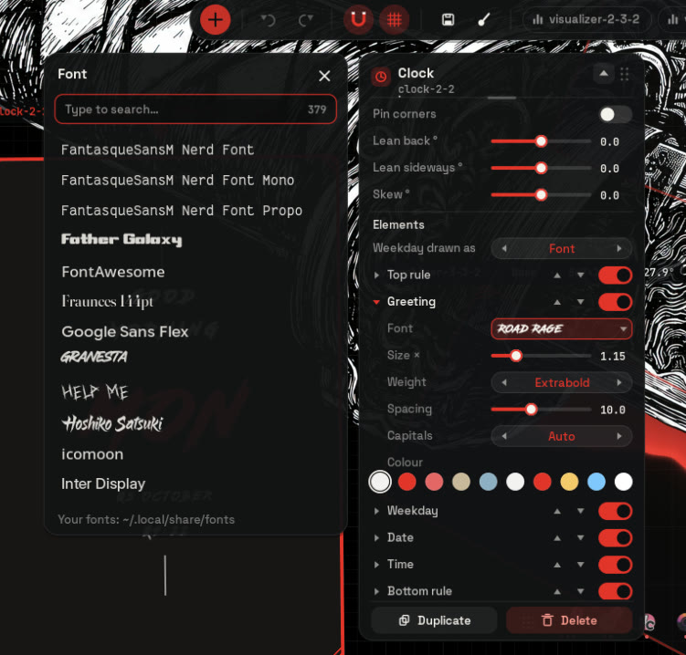
</p>

## Fonts

The five editable clock structures (`goodnight`, `column`, `flip`, `metal`,
`stacked`) can use any font installed on your system, and so do the music
card's title, artist and clock. The classic clock faces keep the fonts of
their design. Space Grotesk, Fraunces, Inter
Display, JetBrains Mono, Google Sans Flex and Bangers come bundled, so they are
always there.

<p align="center">
  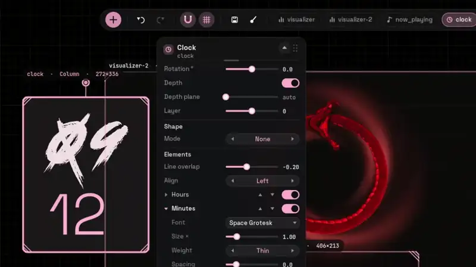
</p>

**Adding your own:**

1. Download the font as `.ttf` or `.otf` (variable fonts work too).
2. Copy the files to `~/.local/share/fonts/` (create the folder if needed;
   subfolders are fine). Fonts installed system-wide, for example with your
   package manager, work as well.
3. In the editor, select the clock, open a part under **Elements** and click
   its **Font**. The list is read again each time it opens, so new fonts show
   up without restarting undershell or running `fc-cache`. Type to search;
   each family is shown in its own typeface.
4. The first entry, **Design · …**, goes back to the face's own font.

**In the config file**, a part's font is `<face>_<part>_font`, with the family
name as `fc-list : family` prints it:

| Face | Parts with a font |
|---|---|
| `goodnight` | `greeting`, `date`, `time` (the weekday is drawn in strokes; `goodnight_day_style = "font"` sets it in `goodnight_day_font`) |
| `column` | `hours`, `minutes`, `extra` (seconds and AM/PM) |
| `flip` | `digits`, `colon` |
| `metal` | `time`, `ampm`, `weekday`, `date`, `weather` |
| `stacked` | `day`, `date`, `time` |

```toml
[[widget]]
type = "clock"
face = "stacked"
stacked_day_font = "Bebas Neue"
stacked_time_font = "JetBrains Mono"
```

If a family name doesn't match an installed font, Pango falls back to a
similar one; check the exact name with `fc-list : family | grep -i <name>`.

## Depth planes

Widgets pass behind the scenery: undershell knows how near each point of the
wallpaper is and erases a widget wherever the wallpaper is nearer than the
widget's plane, on the GPU, live. By default every widget sits on the default
plane, `[general] depth_threshold` (30 unless you set it). Give a widget its
own plane with **Depth plane** in the inspector (or `depth_level = 1..100`).
Higher is nearer: at 95 almost nothing covers the widget, at 5 almost
everything does. `0` goes back to the default plane. Where widgets overlap,
the nearer one is drawn on top (a widget with depth off counts as nearest);
the order you give them in the editor's **Layers** panel (`layer`, higher in
front) overrides that. `depth_feather` softens the edge of every cut.

### Where the depth comes from

undershell runs a depth model,
[Depth Anything V2 Small](https://github.com/DepthAnything/Depth-Anything-V2)
(Apache-2.0), the same one Noctalia's `wallpaper_depth` plugin uses. It does
not need the plugin.

- **Fetch the model once** (~95 MB, from Hugging Face, checked by size and
  SHA-256): the **Download the depth model** button under *Depth* in the
  inspector, or `undershell msg depth-model`. Nothing is downloaded until you
  ask. If the plugin already downloaded it, that copy is used.
- A new wallpaper gets its map in a few seconds (about 5 s on an HD 520
  laptop, for any size), computed by `undershell-depth`, a separate, niced
  process (ONNX Runtime on the CPU), so the model's memory (~460 MB while it
  runs) never stays in the service. The map is then refined against the
  wallpaper (under a second, off the main thread).
- **Every wallpaper with a layout of its own** (see
  [A layout per wallpaper](#a-layout-per-wallpaper)) gets its map ahead of
  time, in the background, at the lowest priority and on half the cores, so
  coming back to it is instant. Those maps are kept for good in
  `~/.cache/undershell/depth` (about 2 MB each); of the others, the 16 most
  recent.
- `undershell msg status` shows the state (`depth: ready`, `computing … (N
  more queued)`, `downloading the model, 42 %`). `[general] depth_model =
  false` turns depth off. It needs undershell built with ONNX Runtime
  (`-Ddepth_model`, on by default when `libonnxruntime` is found: Arch's
  `onnxruntime-cpu`, Fedora's `onnxruntime-devel`, Debian 13's
  `libonnxruntime-dev`; Ubuntu 24.04 has no package, so it is built without).
- Coming from the plugin: the first run writes its threshold and feather into
  `[general]` (`depth_threshold`, `depth_feather`), so layouts look the same.
  undershell no longer reads its masks or maps, so the plugin can be turned
  off unless Noctalia's own desktop widgets use it.

<p align="center">
  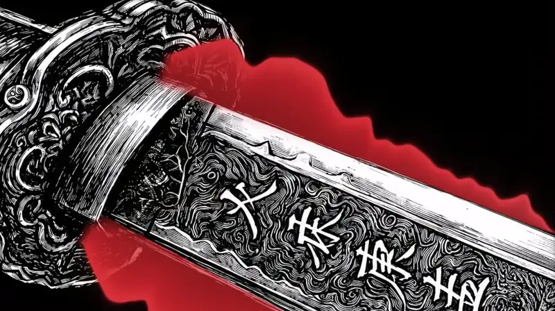<br>
  <sub>The spectrum goes behind the blade: its plane cuts it where the wallpaper is nearer.</sub>
</p>

### Moving wallpapers

A depth mask belongs to one still picture. When a video or a Wallpaper
Engine scene is on screen (undershell asks skwd-wall with `skwd-helm
current`, and also treats a video file set as the wallpaper as moving),
depth turns off for every widget and its controls lock — the inspector
rows, the depth brush, `msg set … depth`, and the Noctalia panel — until a
still wallpaper returns; the widgets' settings are kept. skwd's hooks can
call `undershell msg wallpaper-check` after each change for an instant
update.

### Fixing the depth by hand

The depth model guesses: an object may come out as a ramp (so a plane cuts
it in two), and the background next to an object often gets a halo of
false nearness. The **brush** button in the editor's toolbar opens the
depth brush: the wallpaper is tinted where it would cover the selected
widget (or, with none selected, the default plane), and you correct it.

**Tools** (how you pick an area) — none needs a steady hand except the brush:

- **Brush** — paint; with *Keep to edges* on it only takes what looks like
  the spot under its centre. Shift+wheel sizes it.
- **Wand** — one click takes a whole object: the region that continues
  smoothly in tone and depth, filled solid. Shift+wheel sets the tolerance.
- **Lasso** — click around an object (no dragging); click the first point,
  double-click or press Enter to close; Backspace drops the last point, Esc
  cancels. With *Keep to edges* the outline settles onto nearby edges.
- **Hand** — drag to move the zoomed view (the middle button and the arrow
  keys do it with any tool).

**Actions** (what happens there): **To front**, **To back**, **Match** (the
depth where you start), **Erase** (corrections), **Smooth** (softens
jagged or abrupt depth).

**Zoom**: the wheel zooms about the pointer up to 8× (also + / − / 0 and the
panel's buttons); zoomed, the editor shows the wallpaper magnified and the
brush gets finer by the same factor. **Undo** / Ctrl+Z steps back one
stroke or selection; **Clear all** asks twice; right click or Esc leaves.

<p align="center">
  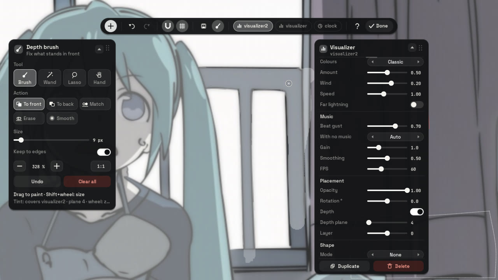
</p>

Corrections are kept per wallpaper in `~/.config/undershell/depth-edits/`
and apply to every widget, including those on the default plane.

## A layout per wallpaper

undershell remembers where your widgets were for each wallpaper. Arrange
them for one wallpaper; when the wallpaper changes (Noctalia's picker,
skwd-wall, `noctalia msg wallpaper-set`, a script) the layout on screen is
filed under the old wallpaper and the new one's comes back: widgets, their
number, positions, tilt, looks and options. A wallpaper seen for the first
time keeps the current layout, so you start from it.

- `config.toml` always holds the layout on screen; the others wait in
  `~/.config/undershell/profiles/<sha256 of the image>.toml` (renaming or
  moving a wallpaper keeps its layout).
- Only the `[[widget]]` blocks move; `[general]` is shared.
- `undershell msg status` shows the current profile; `profiles = false` in
  `[general]` turns this off.

<p align="center">
  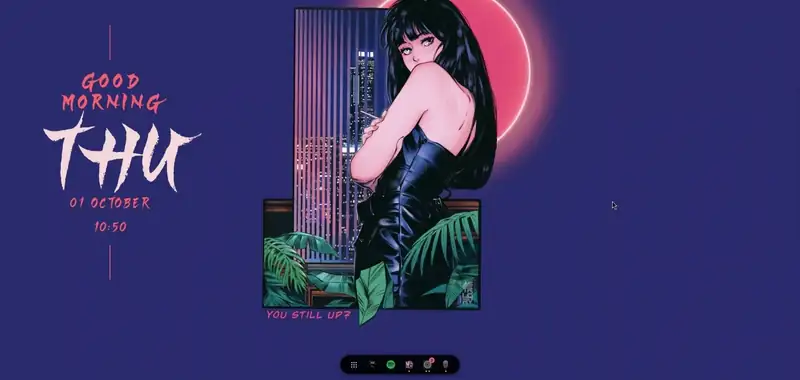
</p>

### Saved profiles

Besides that automatic memory, you can keep named layouts, like save slots
in a game: the **floppy** button in the editor's toolbar opens a panel with
every saved profile (a thumbnail, name, date, wallpaper and widget count).
**Save what is on screen** creates one and lets you type its name (Enter
keeps it); each row can be **loaded** (one undo step: Ctrl+Z brings the
previous layout back), **overwritten**, **renamed** or **deleted** (two
clicks). Loading a profile also makes it the current wallpaper's layout.
They live in `~/.config/undershell/saves/`, and the Noctalia panel lists
them too. From a terminal: `undershell msg saves | save [name] |
save-load <id> | save-overwrite <id> | save-rename <id> <name> |
save-delete <id>`.

## Without Noctalia (KDE Plasma and others)

undershell takes the wallpaper, its fill mode and the colours from the first
of these that is there:

1. **`[general] wallpaper`** (and `wallpaper_fill`) in `config.toml`, if set:
   over any of the others.
2. **KDE Plasma**, inside a Plasma session (or when nothing else is found):
   each screen's desktop wallpaper (`plasma-org.kde.plasma.desktop-appletsrc`,
   the current activity, Plasma's numbering of the screens from
   `kwinoutputconfig.json`; for a wallpaper package such as the default
   *Next*, the image that fits the screen and its dark variant with a dark
   colour scheme), its fill mode, and a palette from the colour scheme and
   accent colour in `kdeglobals` (`primary` is the accent). A change in
   Plasma's settings is picked up at once. A slideshow keeps its current image
   to itself, so it has no depth.
3. **GNOME**, inside a GNOME session: its wallpaper and accent colour (see
   [GNOME](#gnome)).
4. **Noctalia**, when it is running (or installed and nothing below is).
5. **Another shell or wallpaper tool that is running**, read from its own
   files (each format taken from the project's source):

   | | Wallpaper | Colours |
   |---|---|---|
   | [caelestia](https://github.com/caelestia-dots/shell) | `~/.local/state/caelestia/wallpaper/path.txt` | `scheme.json` |
   | [DankMaterialShell](https://github.com/AvengeMedia/DankMaterialShell) | `session.json` (per monitor, fill mode) | `dms-colors.json` |
   | [end-4's illogical-impulse](https://github.com/end-4/dots-hyprland) | `~/.config/illogical-impulse/config.json` | `generated/colors.json` |
   | [Ambxst](https://github.com/Axenide/Ambxst) | `~/.cache/ambxst/wallpapers.json` | `colors.json` |
   | [HyprPanel](https://github.com/Jas-SinghFSU/HyprPanel) | `config.json` (`wallpaper.image`) | — |
   | COSMIC | cosmic-bg's state, per output | — |
   | mpvpaper | its command line (a video: no depth) | — |
   | awww / swww | its cache, per output, with the resize mode | pywal |
   | hyprpaper | `hyprctl hyprpaper listactive`, `hyprpaper.conf` | pywal |
   | wpaperd | its links in `~/.local/state/wpaperd` | pywal |
   | swaybg | its command line | pywal |
   | waypaper | `config.ini` / `state.ini` | pywal |

   "pywal" means `~/.cache/wal/colors.json`, used when it was made from that
   same wallpaper. A shell or tool that starts or stops is noticed within a
   few seconds.

The music card reads the MPRIS players directly when Noctalia's aggregator is
not on the bus. `undershell msg status` shows which source is in use
(`source=plasma`, `source=noctalia`, `+manual`).

### GNOME

GNOME (Mutter) does not implement layer-shell, so a client cannot put itself
on the desktop. undershell ships a small GNOME Shell extension (GNOME 45–51)
that does it the way Desktop Icons NG does: the extension starts undershell
as its own Wayland client, and each widget, a plain window there, becomes a
*desktop* window (below every window, on every workspace, out of Alt+Tab and
the overview, clicks passing through to the desktop) at the place its title
names. The editor is laid over the whole monitor, above the rest, while it is
open. undershell reads GNOME's wallpaper (`picture-uri`, the dark one under a
dark style, `picture-options`) and makes its palette from the accent colour
(GNOME 47+) and the style; a change is picked up at once (dconf's signal).

1. Install undershell (any of the ways above; the extension is installed to
   `…/share/gnome-shell/extensions/undershell@eternalself-2328.github.io`).
2. **Log out and back in** (GNOME Shell on Wayland only sees new extensions
   at login), then enable it:
   ```sh
   gnome-extensions enable undershell@eternalself-2328.github.io
   ```
   or in the Extensions app. It starts undershell; there is no need for the
   systemd service on GNOME (started there, it sees no layer-shell and exits).
3. `undershell msg edit` (e.g. on a keyboard shortcut in GNOME's settings)
   opens the editor as anywhere else.

The widgets are hidden in the overview, like other desktop windows. A
wallpaper slideshow (an `.xml`) has no single picture, so it has no depth.

## Noctalia bar widget

`integrations/noctalia/undershell` is a Noctalia plugin
(`eternalself-2328/undershell`): a bar button
(click: panel, right click: toggle the editor) and a panel that shows the
wallpaper profile and depth state, and per widget: behind the scenery on/off,
depth plane and tilt (committed when a slider is released), and a pencil that
opens the editor on it. It talks to the daemon with `undershell msg`
(`msg json` is its state). With several monitors, saved profiles can be
loaded onto one of them or all. Install it from Noctalia's plugin store (once
it is published there), or from this checkout:

```sh
mkdir -p ~/.local/share/noctalia/plugins/eternalself-2328
ln -s "$PWD/integrations/noctalia/undershell" ~/.local/share/noctalia/plugins/eternalself-2328/undershell
noctalia msg plugins enable eternalself-2328/undershell
```

then add the **undershell** widget to a bar in Noctalia's settings.

## Configuration

`~/.config/undershell/config.toml`: it's created with defaults the first
time and **applies live** on save. Each `[[widget]]` has `id`, `output`,
`x`, `y`, `width`, `height` and the visualizer options (style, bars,
thickness, reflection, grow, shape, color_mode theme/gradient/custom,
color/color2 as a Noctalia role or `#hex`, gain, smoothing, peaks, mirror,
idle_wave, spin, glow, fps, opacity, depth). You can have several widgets.

## Build and tests

```sh
meson setup build --prefix=$HOME/.local
meson compile -C build && meson test -C build
```

The tests don't need a compositor: `config` (loading and in-place editing
of the file, layouts across screen sizes, languages), `depth` (depth maps,
refinement, the brush), `docs` (`docs/OPTIONS.md` is up to date), `editor`
(magnet, limits, grid), `media` (LRC, album color, position), `motion`
(Ryoku's easing) and `render` (the looks against the images in
`tests/golden/`, every shader, glow edges, and text with the bundled fonts,
via headless EGL). The golden images pin the exact pixels of the machine they
were made on; another GPU, Mesa or Pango version draws slightly differently,
so there a mismatch is only reported. `UNDERSHELL_GOLDEN=strict meson test -C build`
makes it fail (for development); if you change a look on purpose:
`build/test_render --update`.

## Structure

| Files | What it does |
|---|---|
| `src/app.*` | Wayland, EGL, loop, surfaces, IPC (`msg …`) |
| `src/anchor.hpp` | layouts that follow the wallpaper across screen sizes |
| `src/i18n.*` | interface language (system, English, Spanish) |
| `src/saves.cpp`, `src/profiles.cpp` | saved profiles; a layout per wallpaper |
| `src/geom.hpp` | rotation, perspective and corner pins (homographies) |
| `src/editor.cpp`, `snap.hpp` | the editor: selection, magnet, keyboard, undo/redo, labels |
| `src/inspector.cpp`, `schema.hpp` | inspector (options per type) and widget gallery |
| `src/widget.*` | the widget interface (`WidgetImpl`) and the type registry |
| `src/visualizer.*`, `motion.hpp`, `shaders/`, `*_shader.inc` | the visualizer (Ryoku's looks, halo, vortex, fire) |
| `src/clock.*`, `src/clockparts.*` | the clocks (Ryoku): faces as display lists; editable structures |
| `src/m3shapes.*` | Material 3 shapes (from Sung) |
| `src/canvas.*` | 2D canvas: rects, circles, segments, arcs, triangles, wave, images + text |
| `src/nowplaying.*` | the music card (Ryoku) |
| `src/media.*`, `src/jobs.*` | MPRIS (sd-bus), covers, album color, lyrics; background jobs |
| `src/text.*` | text: Pango → cached textures |
| `src/textfx.*`, `src/textwidget.*` | text with effects (fill, outline, shadow, glow, 3D, moving letters) and the text widget |
| `src/lyricswidget.*` | the lyrics widget: synced lines, layouts, transitions, karaoke |
| `src/calendar.*` | the calendar widget: month, week, today's page, agenda |
| `src/ics.*`, `src/calsources.*` | iCalendar events (repeats, time zones) and where they come from: .ics, khal, Evolution |
| `src/notes.*` | the notes widget: Markdown, tasks, typing on it, its watched file |
| `src/weather.*`, `src/weatherfeed.*` | the weather widget and its Open-Meteo feed (geocoding, forecast, disk cache) |
| `src/net.*` | HTTPS fetches (http/https only, size-limited) and the cache folder |
| `src/filter.*` | the wallpaper filter: the wallpaper drawn again through colour adjustments |
| `src/shape.*` | the shape widget (one distance shader) |
| `src/image.*`, `src/video.*` | the image widget; decoding stills, GIFs and videos (FFmpeg, gdk-pixbuf) |
| `src/layers.cpp` | the Layers panel's model: order, groups, hiding, locking, moving several widgets |
| `src/audio.*` | PipeWire capture + FFT |
| `src/noctalia.*`, `src/depth.*`, `src/depthfield.*`, `src/depthpaint.cpp` | Noctalia palette, depth masks, per-widget depth planes, the depth brush |
| `src/plasma.*` | KDE Plasma: wallpapers per screen, fill mode, palette from the colour scheme |
| `src/gnome.*`, `integrations/gnome/` | GNOME: wallpaper and accent from gsettings; the GNOME Shell extension that puts the widget windows on the desktop |
| `src/shells.*` | Other shells and wallpaper tools: caelestia, DMS, illogical-impulse, Ambxst, HyprPanel, COSMIC, awww, hyprpaper, wpaperd, swaybg, … |
| `src/depthgen.*`, `src/depthhelper.cpp` | Depth: the model download, `undershell-depth` (which runs it) and the queue and cache of maps |
| `src/wallkind.*` | still or moving wallpaper (depth is off for videos) |
| `src/offscreen.*` | headless rendering (`--snapshot`, tests) |
| `data/fonts/` | Space Grotesk, Fraunces, Inter Display, JetBrains Mono, Google Sans Flex, Bangers (OFL) |
| `integrations/noctalia/undershell/` | the Noctalia bar plugin |
| `packaging/arch/` | PKGBUILD |
| `packaging/build-release.sh`, `.github/workflows/release.yml` | the packages of every release (one container per distribution) |

## Status

A personal project, shared as is: it works day to day on the setup it was
made on (Umbriel + Noctalia, Arch), but it is young and not every compositor
or setup has been tried. It was written with a lot of help from an AI
assistant (Claude); issues and pull requests are welcome.

## License

GPL-3.0-or-later. Credits and third-party licenses (Ryoku GPL-3.0, Noctalia
MIT, OFL fonts, LRCLIB, Depth Anything V2) are in [`NOTICE.md`](NOTICE.md).
