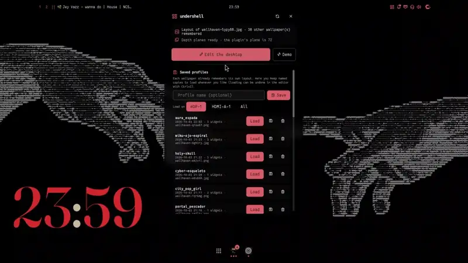

# Editor

Part of [undershell](../README.md)'s documentation.

**Editor** (`msg edit`, e.g. bound to `"Mod+Ctrl+D" = "spawn:/home/USER/.local/bin/undershell msg edit"`
in Umbriel; use the absolute path, since Umbriel's PATH doesn't include `~/.local/bin`):

  

| Action | How |
|---|---|
| Toolbar | drag it by its grip (the dots at its start) anywhere; let go near the left or right edge and it stands up as a column there; double-click the grip to give it back its own place: the top, or the bottom while a widget lies under it at the top. Panels and popovers follow it |
| Select | click or its chip (empty space: deselect) · **Tab** / Shift+Tab · **Shift+click** adds a widget to the selection or takes it out; the selected widgets move together, and their box has corners that scale them all (keeping their proportions) and a knob that turns them all about its centre |
| Layers | the toolbar's **layers** button opens a panel with the screen's widgets front to back. Drag a row up or down to restack it (or **PgUp** / **PgDn**, Shift: to the front / back); the **eye** hides a widget (hidden, it has no surface at all: it costs nothing), the **lock** keeps it from being picked or moved on the desktop (it can still be selected in the panel); double-click a row to name it. A wheel scrolls a long list. Saved in the widget's block as `layer`, `hidden`, `locked` and `name` |
| Groups | select several widgets and press **Ctrl+G** (or the panel's group button): clicking any of them then picks the whole group, to move, scale, turn, duplicate or delete it as one. **Double-click** one to pick just that member; **Ctrl+Shift+G** ungroups (with a member alone picked, it just leaves the group). In the panel a group folds under its name: its eye and lock act on every member, a row dropped between two members joins the group and one dragged out of it leaves. Saved as `group = "Group 1"` in each member, so groups go along with profiles and saved layouts |
| Move / resize | drag · **any corner** (the opposite one stays put, turned widgets too) |
| Magnet | snaps to the screen center, the edges and other widgets (guide lines); toggle it in the toolbar; **Shift** inverts it while held |
| Shape | The inspector's **Shape** section has a **Mode**: *None*; *Tilt* (lean back, lean sideways, skew and distance: `tilt_x`, `tilt_y`, `skew`, `perspective`); *Corners*, the widget's four corners as free points you drag onto the wallpaper; or *Mesh* (below). Saved as `warp = "none" \| "tilt" \| "pin" \| "mesh"`; a new shape starts from where the widget is drawn, and depth, clicks and the editor follow it. Placing points: a loupe magnifies the wallpaper under the one you drag, **Shift** moves it at a quarter speed, the arrows nudge the last one by 1 px (Shift 16 px), dragging inside moves them all, and the widget's resolution follows its shape |
| Mesh | Bends the widget to the shape of something in the wallpaper (a column, a flag, a rock, a box's corner): a grid of **3×3, 4×4 or 5×5** points you drag. **Between points**: *Smooth* curves through them, *Straight* keeps each cell flat and folds at the points. **Base shape** lays the grid as *Flat*, *Arc*, *Bulge*, *Flag*, *Cylinder* or *Wave* on the mesh's four corners, with a **Curvature** (−100…100; negative bends the other way); moving a point by hand makes it *Custom*. **Reset mesh** lays it flat again. Saved as `mesh_grid`, `mesh_between`, `mesh_preset`, `mesh_amount` and `mesh = [x0, y0, …]` (row by row from the top-left); `msg set <id> mesh_preset arc` works from scripts too |
| Other screens | A layout remembers the screen size it was made on (`space = [w, h]`; older blocks get the size of the screen they are first shown on). On a monitor of another size or scale every widget, pin and depth plane goes where the same part of the wallpaper is now (through the fill mode), so it stays on the rock or the portal it was placed on. The output's real logical size comes from xdg-output, so fractional scales (e.g. 1366×768 at 0.98) line up too |
| Layouts on any monitor | A saved profile loads onto the monitor it is loaded from (the editor's Profiles card), or the one chosen with **Load on** in the bar plugin, or onto **All** of them (`msg save-load <id> [output\|all]`); only that monitor's widgets are replaced, the others keep theirs, so the same profile can show on several screens; its `space` fits it to that screen's size through the wallpaper, so it also works across different resolutions. A block naming a monitor this machine does not have shows on the first one, so layouts can be shared between setups |
| Language | The editor speaks English or Spanish. By default it follows the system locale (`es_*` → Spanish, anything else → English); the **Language** buttons at the foot of the shortcuts card (`?`) pin it, saved as `[general] language = "system" \| "en" \| "es"`. Option values are shown translated (the config keeps the values themselves), and long labels shrink or end in “…” instead of running into the controls |
| Fold panels | The inspector, the layers panel and the depth brush panel have a chevron button in their title: it folds the panel to just its title (to see and paint the wallpaper behind it) and unfolds it again, in place. Panels still drag by their title while folded (`msg card fold inspector\|layers\|paint` does the same from a script) |
| Tilt | drag the **knob** above the selected widget (0.1° steps; **Shift** = ten times finer; the magnet catches multiples of 15° within 2°) · **Ctrl+←/→** 0.1°, Ctrl+Shift 1° · Shift-drag any slider to nudge it · *Rotation* in the inspector · `rotation = 20` in the config (degrees, clockwise) |
| Fine-tune | **arrows** 1 px · Shift+arrows 16 px · **Alt**+arrows = size (with key repeat) |
| Change look | **wheel** over the widget (visualizer style, clock face or shape) |
| Options | the **inspector** appears next to the selected widget, in sections (Look, Colour, Music, Time & data, Placement) showing only the settings that do something for its current look; drag it by its title to move it out of the way (double-click the title to put it back); the depth brush panel moves the same way. It offers: lists ‹ ›, switches, sliders (drag or wheel) and theme colour swatches; you see every change live |
| Any colour | the **＋** at the end of a colour row opens the colour picker: a saturation/brightness square and a hue bar (dragged live, one undo step), a hex field (type `#rrggbb` or `#rgb`, or paste one with Ctrl+V, through `wl-paste` from wl-clipboard), an **eyedropper** that takes a colour from the wallpaper (a loupe shows the pixels under the pointer; Esc or right click cancels), the wallpaper's own dominant colours and the ones you used lately (kept in `~/.local/state/undershell/recent-colors`). The colour is stored as hex, e.g. `color = "#3a944a"`. A dark colour does not hide the editor: its accent is lifted until it reads |
| Add | the **＋** button in the toolbar opens the gallery: visualizer, clock, music, shape, image |
| Toolbar | it steps aside to the bottom of the screen while a widget lies under it at the top (or is dragged there), and comes back once the top is clear; panels and popovers follow it |
| Scroll a panel | the wheel, or drag the bar at its right edge (a click on the bar jumps there): the inspector, the font list, the Layers panel and the profiles |
| Duplicate / delete | **Ctrl+D** · **Del** (or the inspector buttons); with several selected, all of them (a duplicated group becomes a group of its own, stacked just above it) |
| Undo / redo | **Ctrl+Z** · **Ctrl+Shift+Z** / Ctrl+Y (moves, sizes, looks, options, additions, deletions, layers and groups) |
| Exit | **Esc**, Enter or right-click |

While editing with no music, the visualizers move with the demo spectrum.
With the grid on (toolbar), positions snap to it (16 px) on release and are saved to the config,
without touching the rest of the file.
