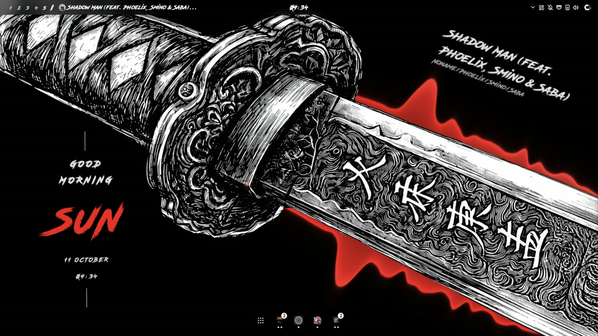
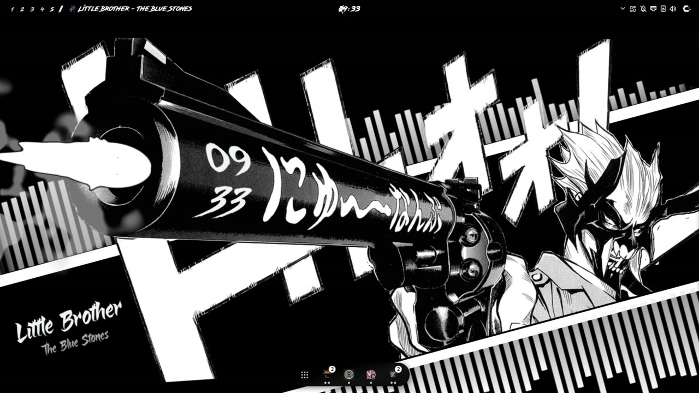
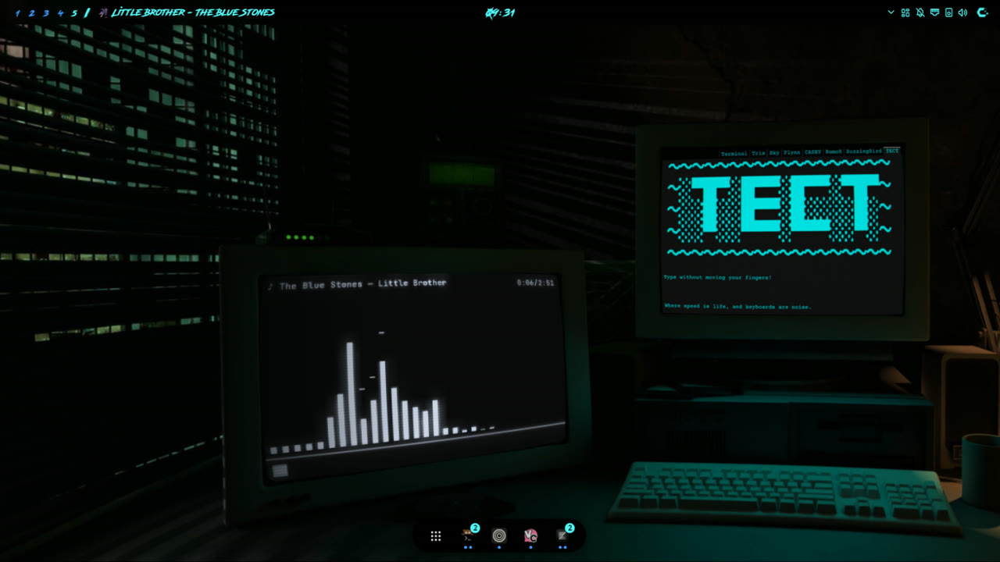
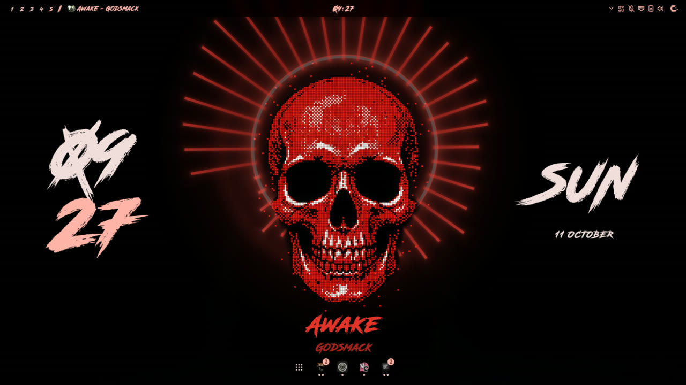
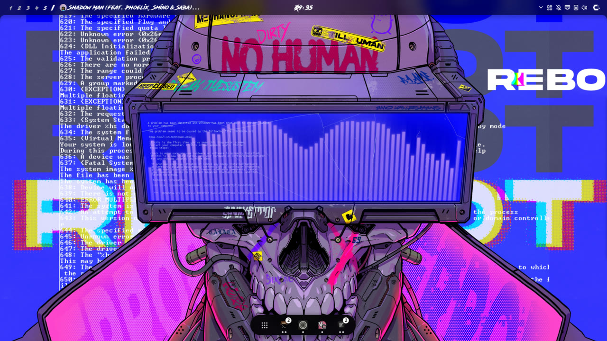
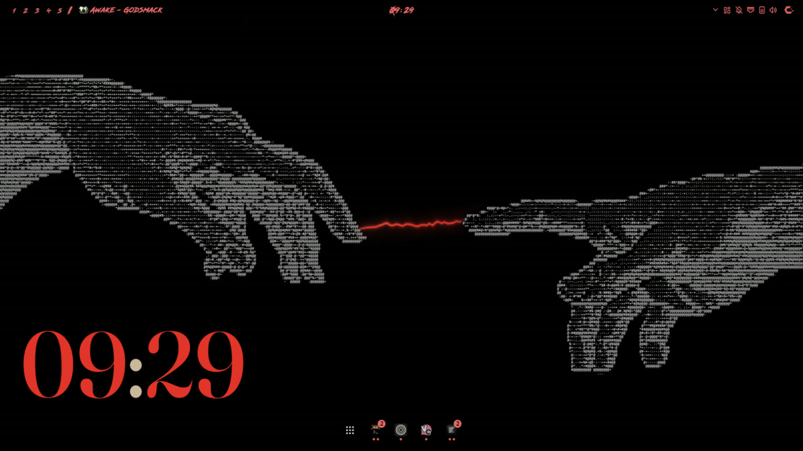
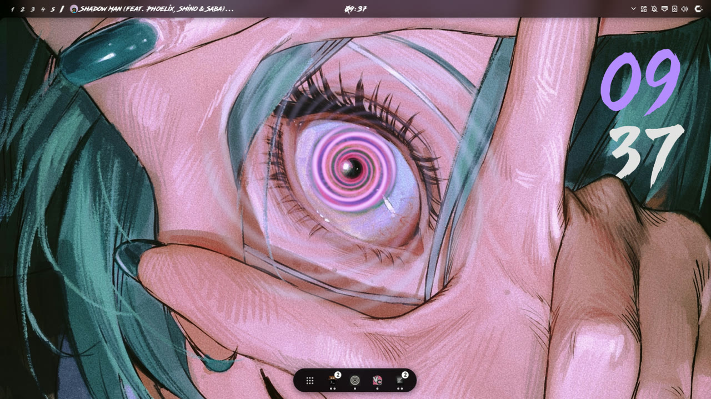
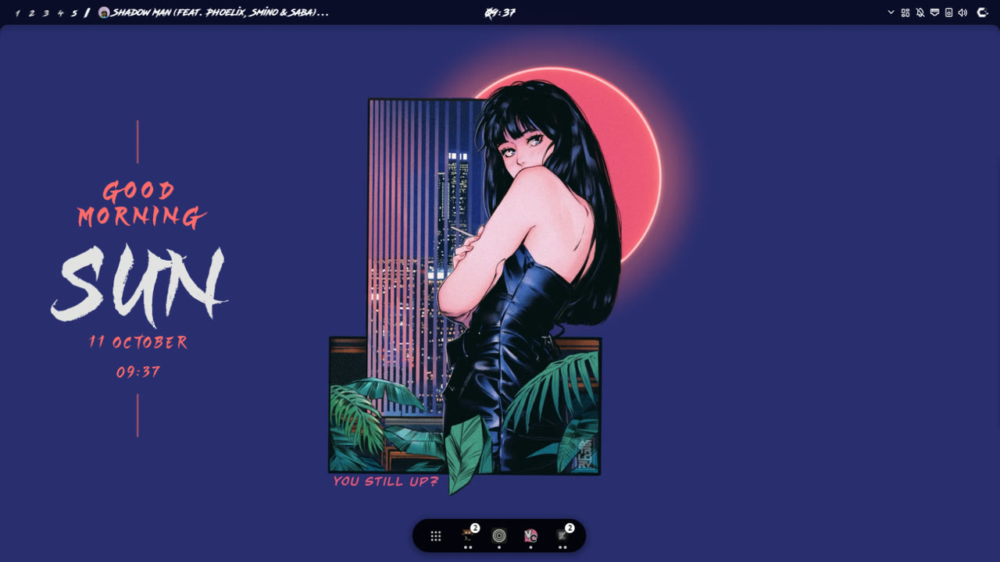

# Gallery

Part of [undershell](../README.md)'s documentation.

## Gallery

<table>
  <tr>
    <td width="50%"> a <code>wave</code> behind the blade, cut by the depth map</td>
    <td width="50%"> <code>muzzle</code> in ink: every kick is a shot</td>
  </tr>
  <tr>
    <td width="50%"> <code>terminal</code> pinned to the CRT's corners</td>
    <td width="50%"> <code>halo</code>, <code>column</code> and <code>goodnight</code> clocks, a text-only music card</td>
  </tr>
  <tr>
    <td width="50%"> a spectrum shaped to the visor</td>
    <td width="50%"> a <code>line</code> spectrum between the fingers, <code>grand</code> clock</td>
  </tr>
  <tr>
    <td width="50%"> a <code>column</code> clock in a brush font</td>
    <td width="50%"> the <code>goodnight</code> card</td>
  </tr>
</table>

The wallpapers in these captures are other artists' work, shown only as backgrounds.
