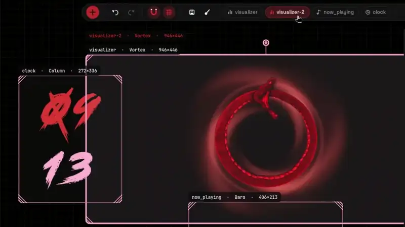
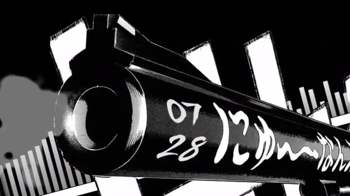
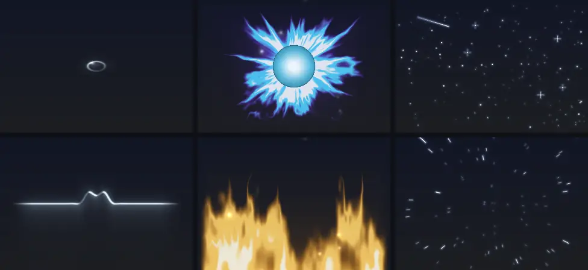
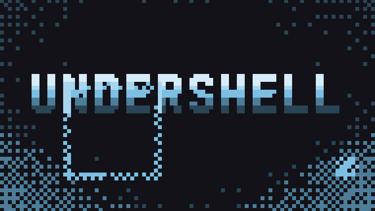
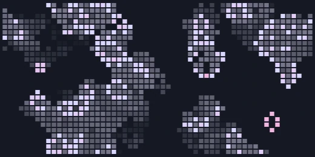
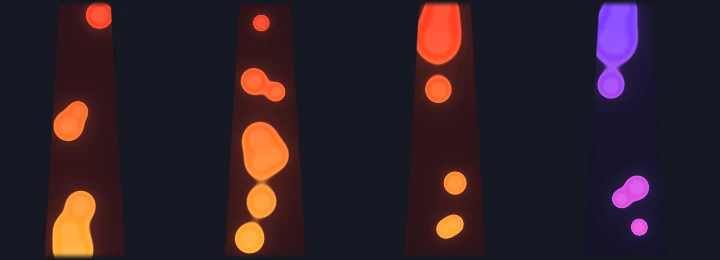
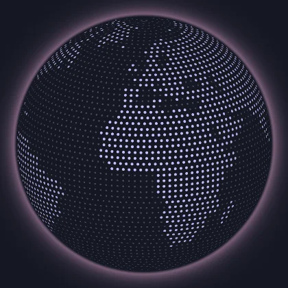
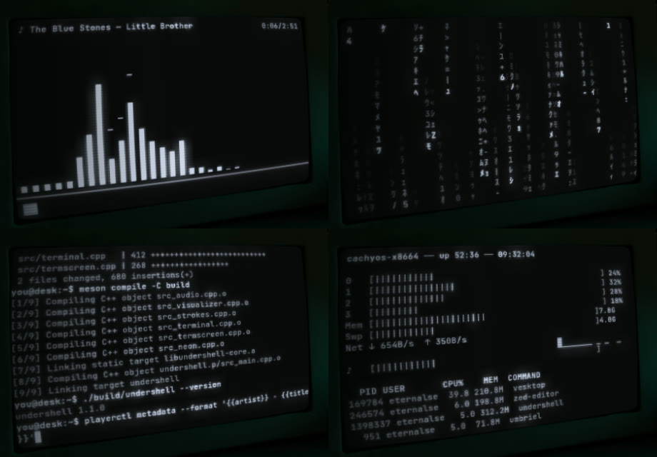
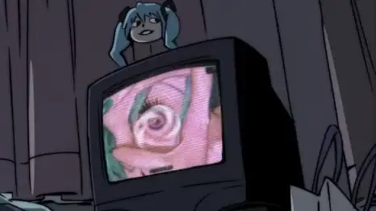

# Visualizer looks

Part of [undershell](../README.md)'s documentation.

## Visualizer: 32 looks

`bars`, `split`, `dots`, `segments`, `wave`, `ribbon`, `curtain`, `line`,
`frame` (a ring around the whole screen), `radial`, `orb`, `spiral`: Ryoku's
`spectrum.frag` ported to GLSL ES 3.00, with glow, reflection, falling peaks
and Ryoku's motion (`Motion.qml`). Plus twenty of its own: `halo` (a glowing
ring), `vortex`, `fire`, `muzzle`, `electric`, `sfx`, `speedlines`, `rain`, `ripples`, `neon`, `fireworks`, `pond`, `aura`, `stars`, `pixels`, `life`, `lava`, `globe`, `terminal` and `tv` (see below).

<p align="center">
  <br>
  <sub>One widget, cycled through its looks in the editor.</sub>
</p>

## With nothing playing

`idle` in `[general]` sets what every visualizer does as soon as the sound
stops (a third of a second of grace): `show`
(as is, the default), `hide` (a quick fade out; a hidden visualizer stops
drawing, so it costs nothing) or `demo` (it moves on a demo spectrum). Each
visualizer's **With no music** option (`idle = "auto" | "show" | "hide" |
"demo"`) follows the general one on `auto` or overrides it. Music brings
them back at once; while editing they are always shown.

## Halo

The `halo` look is one perfectly round ring of light. Its glow is built
like real bloom (a tight, a medium and a wide falloff summed as light, then
tone mapped, so the core turns white-hot instead of clipping):

- **Every song fills the range** — each signal is normalised to the song's
  own recent range (a few seconds), so trap, swing and a ballad all move;
  how loud the song really is still counts, so calm music stays calmer.
  The first second and a half of sound eases in.
- **Pulse** — the bass envelope, on a soft curve: the light and the glow's
  reach pump with the groove.
- **Breathing** — the size follows the energy relative to its recent level
  on a critically damped spring: it swells with the phrasing and settles
  smoothly, never jitters.
- **Beat flash** — kicks, found by spectral flux on the bass (how fast it
  *rises*, over its own mean plus 1.6 deviations, not how loud it is), flash the light
  for about a quarter second; strong ones send a soft **wave** of light out.
- **Tone** — the colour drifts slowly from the primary toward the secondary
  as the music gets brighter (more treble).
- **Aurora** (off by default) — a slow brightness drift along the ring; the
  shape stays round.

**Shape** turns the ring into any of Material 3's 18 shapes (cookies,
flower, clovers, bursts, sunny, puffy diamond…), its line and glow kept even
along every curve.

Options: Shape, Size, Line width, Glow reach, Glow strength, Pulse, Breathing, Beat flash,
Beat waves, Aurora; *Smoothing* sets how soft the breathing is, *Gain* the
sensitivity, *Colour* the colours (theme: primary → secondary).

## Vortex

The `vortex` look takes the halo's ring as an event horizon and winds arms
of gaseous light around it in a logarithmic spiral, streaming inward like
water down a drain; the centre stays empty (put it around something on your
wallpaper and let depth keep that in front). It shares the halo's music —
pulse, breathing, beat flash and waves, all normalised per song — and adds
spin: the energy speeds it up on a spring and each kick gives a burst that
brakes by itself. **Mode**: `inward` (arms outside the ring, drawn in),
`outward` (outside, pouring out — a white hole), `inside` (a tunnel inside
the ring, sinking to the centre; only the halo's glow outside) and
`inside_out` (the tunnel welling up from the centre). **Ring** dims the
horizon ring down to 0 (arms only; their inner end then dissolves softly).
Options: Mode, Ring, Horizon size, Reach, Arms, Twist, Turbulence,
Spin speed, Clockwise, Horizon line, Glow strength, and the halo's music
options. Colour 1 lights the horizon, Colour 2 the outer arms.

## Fire

The `fire` look is a fire rising from the bottom of its box: flames torn
into tongues by noise that erodes the silhouette more as it rises, with a
textured, hot core and sparks that climb out of it and die. The music feeds
it like the halo (per-song normalisation): the energy sets the height, the
**spectrum** shapes it across the width (bass in the middle), the bass pulse
stokes the core, a kick throws a **flare** and a burst of sparks, and the
flames rise faster when the music is busy. Options: Shape (`bonfire`, a
cone; `wall`, full width), Colours (`fire`, a black-body ramp; `theme`,
Colour 1 for the core and Colour 2 for the tongues), Height, Turbulence,
Spectrum shape, Sparks, Speed, Pulse, Breathing, Beat flare.

## Muzzle flash

The `muzzle` look is the burst at a gun's muzzle, made for wallpapers with a
gun in them: **every kick of the music is a shot**, as hard as the kick. A
shot is a white-hot core, flame tongues fanned forward and shorter spikes to
the sides, ragged and different every time; it grows in about 30 ms and is
gone in about 150, sparks fly out in a fan, and a little smoke stays,
swelling and rising. Between shots an ember glows with the bass. The muzzle
is the box's **left edge** and the shot goes right: turn, pin or mesh the
widget onto the barrel (see Shape). Options: Drawn as (`flash`, light in
white, yellow and orange, or the theme's colours with Colours `theme`;
`manga`, flat white with a black ink outline, for black-and-white artwork),
Reach, Side spikes, Sparks, Smoke, Ember.

<p align="center">
  
</p>

## Electricity

The `electric` look is electricity in three forms (Form, `electric_form`):

| | |
|---|---|
| `arc` | an arc from the box's left edge to its right, re-forming faster the louder the music (7 to 28 times a second); every kick flashes it, adds a strand and throws off forks. Pin or mesh its ends onto two things in the wallpaper |
| `bolts` | every kick strikes: a bolt comes down from the top edge in about 30 ms, flickers with two more return strokes and is gone in half a second; a hard kick can strike twice |
| `plasma` | a plasma globe: filaments from the electrode at its heart to the glass, drifting round it, more of them and brighter with the music, all flashing on a kick |

Its forks stay inside the box (or the globe). Drawn as `flash` (a white-hot
core in a glow, electric blue or the theme's colours with Colours `theme`) or
`manga` (white with a black ink outline). Amount (strands, filaments, a second
bolt), Branches, Glow, Thickness, Beat flash and Follows the music set the
rest. In silence the arc and the globe keep crackling faintly, a few frames a
second. The paths are built on the CPU and only the pixels near them are
shaded, so a big box costs no more than a small one (about 1.5 ms of GPU a
frame for a 1074 × 621 arc on an Intel HD 520).

## Onomatopoeia

The `sfx` look letters a sound effect on the kicks, the way comics do, in
four traditions (Language, `sfx_language`):

| | soft kick | kick | hard kick |
|---|---|---|---|
| `english` (comics) | THUD, BUMP | BAM!, POW!, WHAM! | BOOM!, KABOOM! |
| `japanese` (manga, anime) | トン, ズン | ドン!, バン! | ドカーン!!, ドドン!! |
| `korean` (manhwa) | 통, 쿵 | 쾅!, 펑! | 콰광!!, 두둥!! |
| `chinese` (manhua, donghua) | 咚, 噔 | 砰!, 轰! | 轰隆!!, 嘭!! |

`mix` picks a language per hit. The word slams in past its size in 70 ms
with a shake, holds (longer the harder the kick), and shrinks away when the
next one lands -- one hit at a time, the way a panel letters it. In a tall
box the CJK words run top to bottom. Drawn as `comic` (a colour fill, a
black outline and a solid shadow; Colours `classic` or `theme`) or `manga`
(white with a black outline), with a spiky burst behind it (Burst behind).
Size, Amount (every kick at 1, only the hardest toward 0) and Font (`auto`:
Bangers for English, the heaviest Noto Sans CJK for the rest) set the rest;
`sfx_words = "ZAP!, KRAK!"` in the config letters your own words instead.

The CJK words need a CJK font: `noto-fonts-cjk` (Arch), `google-noto-sans-cjk-fonts`
(Fedora) or `fonts-noto-cjk` (Debian, Ubuntu). Bangers comes bundled.

## Speed lines

The `speedlines` look is manga's lines of motion (Form, `lines_form`):
`focus` -- the focus lines (集中線) that close in on a moment, wedges from the
box's edges toward a clear centre, drawn anew a dozen times a second
(faster with the music) and rushing in on every kick -- or `parallel`,
streaks racing across the box. Colour `black` (ink), `white` or `theme`;
Amount, Clear centre, Thickness and Beat rush set the rest. Lay it over an
action wallpaper, or put the clear centre on a face.

## Rain

The `rain` look lets something fall through the box (Falling, `rain_kind`):
`rain` (streaks that splash at the foot of the box), `snow` (drifting
flakes) or `petals` (sakura, tumbling as they fall). There is more of it the
louder the music, and every kick sends a gust; with Far lightning on, the
hardest kicks strike a faint bolt in the distance. Amount, Wind (its slant
and drift, either way), Speed and Colours (`classic` or `theme`) set the
rest. Turn depth on and it falls behind the wallpaper's subject.

## Ripples

The `ripples` look is water: every kick drops a drop that opens rings,
slowing as they spread and fading, and smaller drops fall between the kicks
with the music. The rings are flattened as water seen at an angle
(Perspective) and their near side catches more light. Drawn as `flash`
(light on water, or the theme's colours) or `manga` (inked rings that thin
as they fade); Rings, Size, Drops between and Beat drop set the rest. Put it
on a lake or a puddle in the wallpaper, with tilt or corners for the angle.

## Neon sign

The `neon` look is a sign in glass tubes: your words (`neon_text = "OPEN"` in
the config; `LIVE` until you set it, in any font with Font) or a Shape:
`heart`, `star`, `circle`, `bolt`, `note` or `arrow`. It hums a little
brighter with the music and flares on every kick; with Failing tubes up, now
and then a letter or a piece of the shape fails and stutters back, and an
unlit tube still shows as dark glass. Colour (any palette role or hex), Size
and Beat flash set the rest. Pin it to a wall or a shop front in the
wallpaper.

## Fireworks

The `fireworks` look bursts one on every kick -- at the kick, the shell's
trail shown as already risen, so it lands on the beat -- and hard kicks
burst two. Kind: `peony` (a sphere of sparks), `willow` (gold, long trails
that droop), `ring`, or `mix`. The sparks slow, fall, trail and crackle out.
Drawn as `flash` (light, classic colours or the theme's) or `manga` (inked
sparks); Amount (which kicks), Size and Beat burst set the rest.

## Water wave

The `pond` look is a single wave in the middle of still water: the bass
lifts the water at the centre and a kick sends one wave out, fast at first,
then slowing and flattening as it spreads. The surface is lit like water --
a bright crest where it faces the light, a soft shadow in the troughs either
side. As a `ring` seen from above (Perspective flattens it, as water seen at
an angle) or as a `line`, one wave running along a surface seen from the
side. Waves at once (1 to 4), Size, Colours (`water` or `theme`) and Beat
wave set the rest. In silence a slow wave goes out now and then.

## Aura

The `aura` look is a fantasy aura: thin tongues of light flowing out and
licking upward, a soft glow round them and motes of light drifting up
through it. Shape: `orb` (round a glowing orb), `ring` (round an empty
middle -- put another widget in it) or `rise` (rising from the bottom edge,
like a hero powering up). Colours: `arcane`, `holy`, `frost`, `nature`,
`infernal`, `void` or `theme`. The groove makes the flames reach further and
flow faster, a kick flares them (Beat flare); Size, Flames, Motes of light
and Speed set the rest. The flames always fit in the box.

## Stars

The `stars` look, in three modes: `field`, a sky whose stars twinkle on
their own and brighten with their band of the music, the brightest
sparkling, and a shooting star across it on a strong kick; `warp`, flying
through them, faster with the groove and leaping on a kick; and
`constellation`, fixed stars joined by faint lines, a different figure
lighting up on each kick. Colours `night`, `gold` or `theme`; How many,
Size, Speed (the warp's) and Shooting stars set the rest. They are drawn as
strokes of light, so only the pixels near a star cost anything.

<p align="center">
  <br>
  <sub><code>pond</code> ring and line · <code>aura</code> orb and rise · <code>stars</code> field and warp</sub>
</p>

## Pixels

The `pixels` look is a field of square pixels, after the hero of
[omarchy.org](https://omarchy.org/). Slow noise and a twinkle set each
pixel's brightness and an ordered dither turns it on or off, so the field
thins out toward an empty middle (Empty middle, Density). The music rises
from the bottom in columns, bass at the sides (Music columns), a light
wanders over it (Wandering light) and a strong kick opens a square that
grows and fades (Beat squares). A Word can stand in the middle in big
pixels, shaded top to bottom: any text, `@TIME@` for the time or `@SONG@`
for the song, in any font (JetBrains Mono by default). Colours: `frost` or
`theme`; Pixel size sets the grain. The pixels are worked out on the CPU:
about 8 % of one core at 60 fps on a full 1366×768 screen (an Intel HD 520
laptop), half that at 30.

<p align="center">
  <br>
  <sub><code>pixels</code> with <code>pixels_text = "UNDERSHELL"</code></sub>
</p>

## Game of Life

`life`: Conway's Game of Life over the box, the cells born with three
neighbours and kept with two or three, a little faster with the groove.
Each kick drops gliders and small seeds where the spectrum is loudest, a
dead cell leaves a fading trail, and a world that dies out or freezes
starts again. Cell size, generations per second and the trail are yours;
0.25 ms of GPU at 1074×621 on an HD 520.

<p align="center">
  
</p>

## Lava lamp

`lava`: wax warms at the bottom, rises, cools at the top and sinks again,
the blobs merging and pulling apart as they pass (metaballs). The groove
turns the heat up, so they climb faster and swell; a kick gives the lowest
blob a push. In its glass (a tapered lamp in the middle of the box) or free
over the whole box; classic, neon, ocean or the theme's colours. 0.37 ms of
GPU in its glass.

<p align="center">
  
</p>

## Globe

`globe`: the continents as dots on a turning sphere, the night side dimmer
where the real sun has set (worked out from the date and the time), a thin
atmosphere round the rim. The bass swells the dots; give it **your latitude
and longitude** and it starts with your place in front, marks it, and every
kick sends a ring across the world from there. Turn speed, tilt, how many
dots and how much of the sea shows are yours. The land is Natural Earth's
(1:110m, public domain), 256 × 128 cells built in; 0.41 ms of GPU at
1074×621.

<p align="center">
  
</p>

## Terminal

The `terminal` look is a terminal on a CRT, for the computer screens in a
wallpaper (pin its corners to the screen). It Shows (`term_mode`):

| | |
|---|---|
| `code` | a shell session typing itself -- a pull and a build, code, a ping, and the song that is playing -- faster with the music, its output pouring on the kicks |
| `spectrum` | the spectrum in block characters, the song and its time above it, where it is along the foot |
| `matrix` | columns of katakana and digits falling, faster with the music, a glitch on a kick |
| `monitor` | this machine's CPU (each core), memory, network and busiest processes, read from `/proc` once a second, and the music's pulse |

The screen is phosphor -- `green`, `amber`, `white` or `theme` -- with Glow,
Scanlines, Flicker, Tube curve and Screen glass (the dark glass behind the
text) each from 0 (off) to 1, and Text size. A kick lights the screen up
(Beat flash). The characters come from a sheet built once (JetBrains Mono;
katakana from the system's CJK font) and the whole screen is two passes:
about 0.7 ms of GPU a frame at 1074 × 621.

<p align="center">
  <br>
  <sub><code>spectrum</code> · <code>matrix</code> · <code>code</code> · <code>monitor</code></sub>
</p>

## TV

The `tv` look is an old television, for the screens in a wallpaper. It
Shows (`tv_mode`) `static` (snow), `colorbars` (the SMPTE bars), `nosignal`
(the blue screen), `media` (your GIFs and videos) or `channels` (all of
them, your files first, flipping between them). With the music:

- **Beat interference**: a kick throws bands sideways, splits the colours
  and sends a burst of snow across the picture.
- **Speed with music**: videos and GIFs play faster as the song rises
  (0.5× to 1.8×).
- **Channel changes**: hard kicks change the channel, with a moment of snow
  and `CH 03` in the corner.
- **Off in silence**: when the music stops the set switches off the old
  way, into a white line and then a dot, and comes back with the music.

**VHS tape** adds tracking noise, a wobble, worn colour and `PLAY ▶` with a
counter; **Snow over it** lays a little static on any picture. The tube is
the terminal's: Glow, Scanlines, Flicker, Tube curve and Screen glass.

To show your own files, set **Shows** to *Your videos* (or *Channels*) and
use **+ Files** or **+ Folder** under it: they open your desktop's file
chooser (through the XDG desktop portal, or zenity/kdialog where there is
none) and add what you pick to the list, where × takes one out. A folder
plays the media files in it, in order; up to eight files are used. The list
is the `tv_files` key, which you can also write by hand:

```toml
tv_files = ["~/Videos/loops/", "~/Pictures/cat.gif"]
```

From a script, `undershell msg pick-files <id> [folder]` opens the same
chooser for a widget.

Picture `fill` crops them to the screen, `fit` letterboxes them. Each is
decoded on its own thread, scaled down to the widget's size; a short clip
(up to 32 MB once scaled) is kept after its first loop and never decoded
again. Videos need undershell built with FFmpeg (`-Dvideo=enabled`, on by
default when its libraries are found); without it, GIFs still play.

<p align="center">
  
</p>
