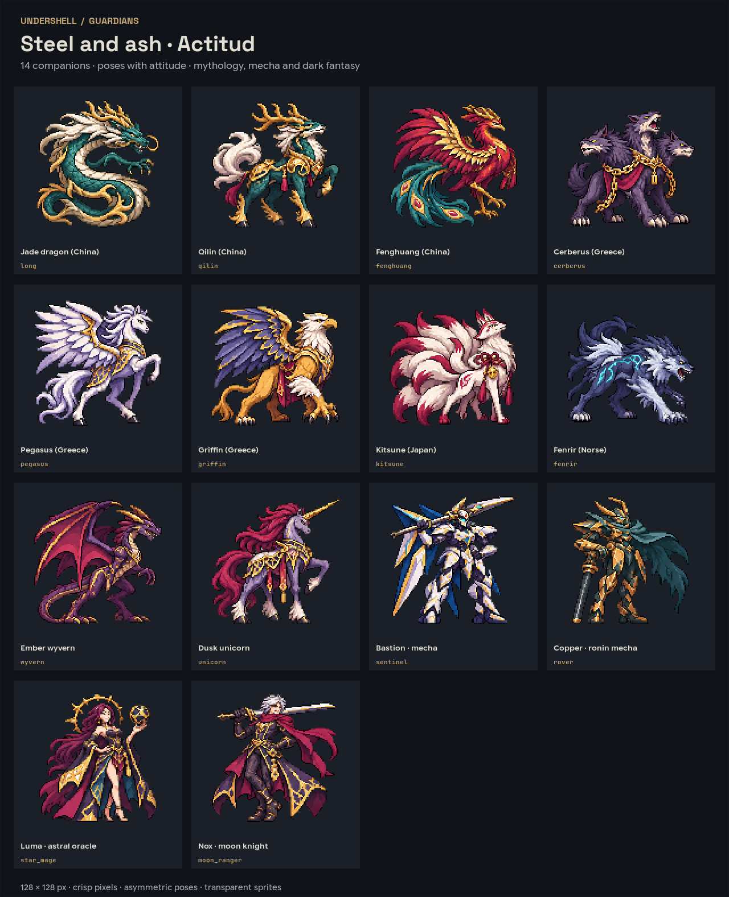
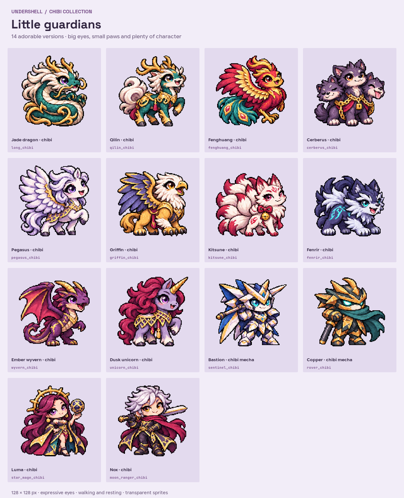

# Pets

Part of [undershell](../README.md)'s documentation.

The `pet` widget is a small companion that lives on the desktop: it walks
along its box, hops onto window tops (on Umbriel), dances while music plays
and dozes in silence. Besides **Sprout**, the original round creature drawn
in code, there are **28 sprite companions**: fourteen in the **Actitud**
collection (mythological creatures, two mecha and two original anime-style
characters) and a **chibi** version of each.





## Choosing one

```sh
undershell msg add pet qilin
undershell msg add pet kitsune_chibi
undershell msg edit
```

In the editor, select the pet and change **Companion**. Several pets can
share a desktop, each with its own species. In `~/.config/undershell/config.toml`:

```toml
[[widget]]
id = "jade-dragon"
type = "pet"
species = "long"
width = 256
height = 256
speed = 1.0
climb = true
dance = true
sleep = true
```

The sprites are 128 × 128 pixels and scale by whole pixels: a 128, 256 or
384 px box shows them at 1×, 2× or 3× (on a scale-1 screen); a box smaller
than 128 physical pixels shrinks them to fit. New sprite pets start at
256 px. **Colour**, **Sprout** and **Colours from** only apply to Sprout; the
others keep their own palettes. A config with no `species`, or one undershell
does not know, gets Sprout.

## Catalogue

| ID | Name | Design |
|---|---|---|
| `sprout` | Sprout | The original: a round body and a green sprout; its colours follow the theme |
| `long` | Jade dragon | China: a serpentine imperial dragon, bronze antlers, jade scales, four claws |
| `qilin` | Qilin | China: a slender scaled beast, antlers, ivory mane, golden ceremonial plates |
| `fenghuang` | Fenghuang | China: a regal bird, copper plumage and a teal tail |
| `cerberus` | Cerberus | Greece: three heads, a bronze collar and a chain |
| `pegasus` | Pegasus | Greece: a steel-grey horse with great sharp-feathered wings |
| `griffin` | Griffin | A lion's body, a raptor's head, slate wings, bronze claws |
| `kitsune` | Kitsune | Japan: a slender fox with an ivory mask, crimson marks and nine tails |
| `fenrir` | Fenrir | Norse: a slate wolf with ice markings |
| `wyvern` | Ember wyvern | Two legs, garnet wings, copper horns |
| `unicorn` | Dusk unicorn | An ash horse, a wine mane and a long old-gold horn |
| `sentinel` | Bastion | An original mecha: tall segmented armour, dorsal fins, a cyan visor and a lance |
| `rover` | Copper | An original ronin mecha: bronze armour, a jade visor, a cape and a sword |
| `star_mage` | Luma | An original astral oracle: a plum mane, a golden halo and a floating orb |
| `moon_ranger` | Nox | An original moon knight: silver hair, a crimson scarf and a sword on the shoulder |

Each one has a chibi version with the same id plus `_chibi` (`long_chibi`,
`cerberus_chibi`, `sentinel_chibi`…): a big head, large eyes, a compact body
and short legs, keeping the colours and accessories of the original.

## Behaviour

Every species has the widget's six behaviours: idle, sitting, walking,
jumping, dancing to the music and sleeping after a minute of silence. Each
collection has three drawings per character (standing, a step and resting):
walking alternates the first two, jumping and dancing use the step, sitting
and sleeping the rest. The chibi collection has a fourth drawing with the
eyes closed for blinking; the Actitud blink is painted at run time. All of
them mirror to face the way they walk. Without Umbriel's window list they
walk along their baseline.

## The artwork

The sprites were made for undershell with image generation, then fitted to a
fixed 128-pixel grid with binary transparency by `tools/pack-pets.cpp`.
They are original designs, distributed under GPL-3.0-or-later like the rest
of the project: the traditional creatures are reinterpreted, not taken from
any game, film or anime, and Bastion, Copper, Luma and Nox are not existing
franchise characters. Hatsune Miku is not included.

The atlases in [`art/pets/`](../art/pets/README.md) are embedded into the
executable at build time (`tools/embed-pets.py`): no files are read and
nothing is downloaded at run time.

`build/test_pets --gallery build/pets` exports the catalogues as the program
draws them (`bestiary.png`, `bestiary-chibi.png`), a transparent PNG of each
companion and a `*-sheet.png` per species: 256 × 768, two 128 × 128 frames in
each row, in the order idle, sit, walk, jump, dance, sleep.

## Adding a species

Register its id and names in `kPetSpecies` (`src/petart.hpp`), add its
drawings to the atlases (see [`art/pets/README.md`](../art/pets/README.md))
and, for the Actitud collection, its eye position for the blink in
`src/petart.cpp`. The inspector's list and its labels read the same catalogue.

Cultural references consulted for the traditional creatures:
[Asian Art Museum: Qilin bringing the jade book](https://searchcollection.asianart.org/objects/2579/qilin-bringing-the-jade-book),
[The Palace Museum: Chinese Dragon](https://intl.dpm.org.cn/topic/2024chinesenewyear.html),
[Cleveland Museum of Art: Fantastic Beasts in Chinese Culture](https://www.clevelandart.org/articles/fantastic-beasts-chinese-culture-and-where-find-them).
