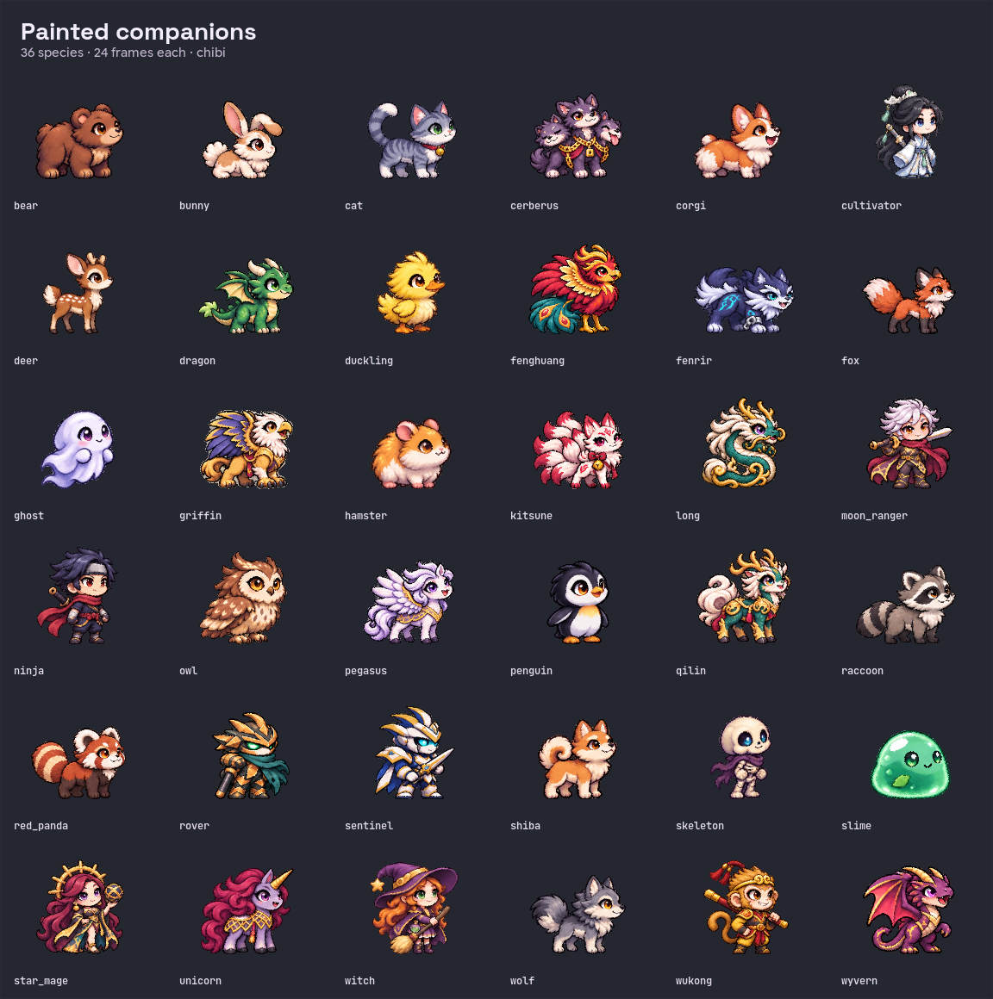
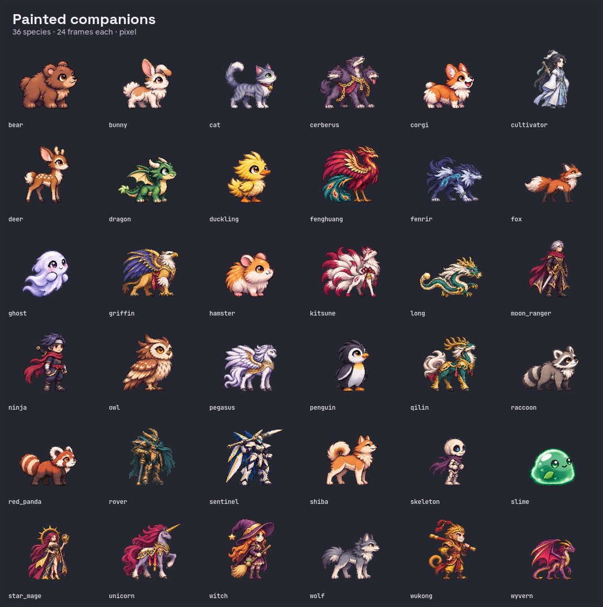
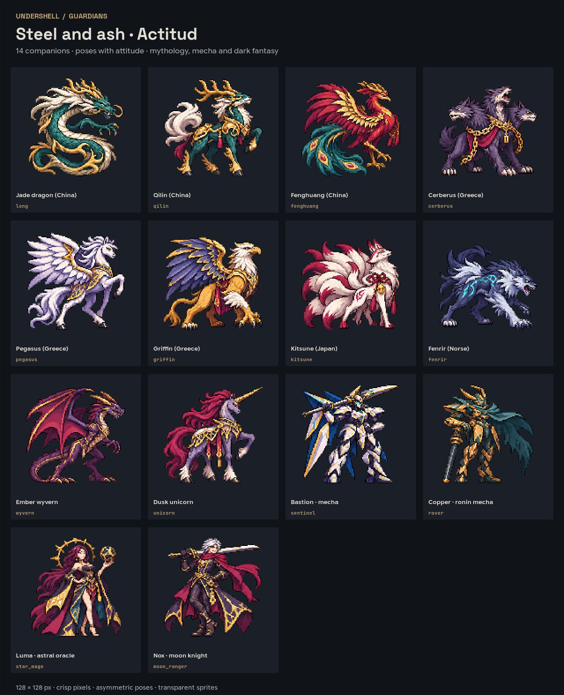
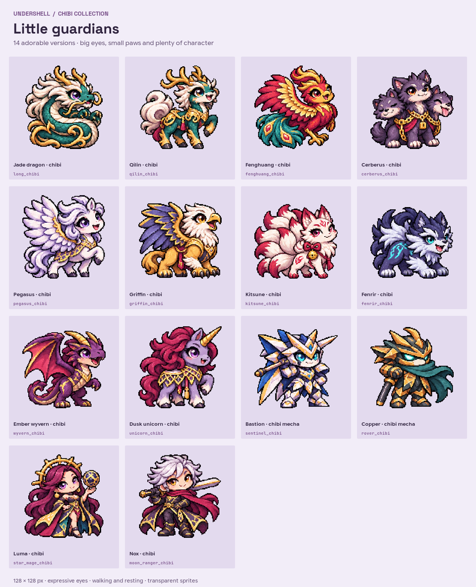

# Pets

Part of [undershell](../README.md)'s documentation.

The `pet` widget is a small companion that lives on the desktop: it walks
along its box, hops onto window tops (on Umbriel), dances while music plays,
sleeps while you are away, tells you of notifications in a bubble, and lets
itself be patted and carried. There are 65 companions:

- **36 painted companions**, with 24 drawings in each of two styles:
  **chibi** and **side-view pixel art** (48 drawings per species). Domestic and
  forest animals, mythical creatures, birds and blobs, and people and spirits.
  Their behaviour comes from the rig, their movement from the drawings.
  The original rig remains as a fallback for species without artwork.
  Choose `art = "chibi"` or `art = "pixel"` in the editor's **Art** row.
- **28 drawn companions**: the fourteen of the **Actitud** collection
  (`*_classic`) and their **chibi** versions (`*_chibi`), three drawings each,
  shown as drawn (alternated, never bent); they can be recoloured too.
- **Sprout**, the original round creature drawn in code.









## Choosing one

```sh
undershell msg add pet fox
undershell msg add pet wukong
undershell msg add pet kitsune_chibi
undershell msg edit
```

In the editor, select the pet and change **Companion**. Several pets can
share a desktop, each with its own species. In `~/.config/undershell/config.toml`:

```toml
[[widget]]
id = "fox"
type = "pet"
species = "fox"
width = 288
height = 288
art = "chibi"            # chibi pixel: the painted frames' style, when it has them
variant = "original"     # original rose jade azure violet gold obsidian frost
paint = "variant"        # variant theme wallpaper custom
notify = "title"         # off react app title full
interact = true
```

Painted and classic companions use a 128 × 128 grid; the fallback rig uses
96 × 96. They scale by whole pixels (a 256 px box shows a painted one at 2×
on a scale-1 screen), and a box too small shrinks them to fit. A config with no
`species`, or one undershell does not know, gets Sprout.

The ids `long`, `qilin`, `fenghuang`, `cerberus`, `pegasus`, `griffin`,
`kitsune`, `fenrir`, `wyvern`, `unicorn`, `sentinel`, `rover`, `star_mage`
and `moon_ranger` select the painted versions; the drawn originals are
`long_classic`, `qilin_classic`… and `long_chibi`, `qilin_chibi`…

## Catalogue

### Painted companions and fallback rigs

Every one walks, runs now and then, sits or lies down, sleeps, dances, leaps
and does the things in the last column when it is left to itself (it also
looks about and at you). The variants are its colourings, the first its
natural one. These part-by-part variants apply to the fallback rig; painted
companions use the tints described under [Colours](#colours).

| ID | Name | Variants | Its habits |
|---|---|---|---|
| `long` | Jade dragon (China) | `jade`, `imperial`, `azure`, `crimson`, `ink` | coils, tilts its head, yawns, shakes |
| `qilin` | Qilin (China) | `gold`, `azure`, `crimson`, `white` | tilts its head, stretches, shakes, sniffs, lies down, hops |
| `fenghuang` | Fenghuang (China) | `crimson`, `azure`, `violet`, `white` | preens, flaps, pecks, tilts its head, stretches |
| `cerberus` | Cerberus (Greece) | `obsidian`, `bronze`, `ash`, `hellfire` | pants, shakes, howls, sniffs, scratches, lies down |
| `pegasus` | Pegasus (Greece) | `white`, `palomino`, `night`, `rose` | tilts its head, flaps, shakes, sniffs, stretches, lies down |
| `griffin` | Griffin (Greece) | `gold`, `storm`, `royal`, `sand` | tilts its head, preens, flaps, stretches, sniffs, lies down |
| `kitsune` | Kitsune (Japan) | `spirit`, `flame`, `moon`, `shadow` | tilts its head, grooms, pounces, stretches, yawns, sniffs, lies down |
| `fenrir` | Fenrir (Norse) | `storm`, `ash`, `night`, `frost` | howls, shakes, sniffs, stretches, lies down, pants |
| `wyvern` | Ember wyvern | `ember`, `ash`, `frost`, `venom` | flaps, stretches, shakes, yawns, sniffs, lies down |
| `unicorn` | Dusk unicorn | `dusk`, `dawn`, `midnight`, `sea` | tilts its head, shakes, sniffs, stretches, lies down, hops |
| `sentinel` | Bastion · mecha | `steel`, `vanguard`, `olive`, `white` | scans, stretches, waves, bows |
| `rover` | Copper · ronin mecha | `copper`, `ronin`, `jade`, `sakura` | scans, spins its prop, bows, stretches |
| `star_mage` | Luma · astral oracle | `astral`, `solar`, `nebula`, `void` | spins its prop, meditates, waves, bows |
| `moon_ranger` | Nox · moon knight | `night`, `eclipse`, `silver`, `harvest` | spins its prop, bows, waves, stretches, scratches its head |
| `cat` | Cat | `tabby`, `ginger`, `black`, `white`, `siamese`, `lilac` | tilts its head, grooms, stretches, yawns, scratches, lies down, pounces, rolls over |
| `shiba` | Shiba dog | `red`, `sesame`, `black_tan`, `cream` | tilts its head, wags, shakes, scratches, sniffs, stretches, rolls over, pants, lies down |
| `corgi` | Corgi | `red`, `tricolor`, `sable`, `merle` | tilts its head, wags, shakes, sniffs, stretches, rolls over, pants, lies down |
| `bunny` | Bunny | `white`, `brown`, `grey`, `dutch` | grooms, sniffs, hops, lies down, stretches, yawns, tilts its head |
| `hamster` | Hamster | `golden`, `white`, `grey`, `panda` | grooms, sniffs, rolls over, yawns, lies down, tilts its head |
| `fox` | Fox | `red`, `arctic`, `silver`, `fennec`, `spirit` | tilts its head, grooms, stretches, yawns, sniffs, pounces, scratches, lies down |
| `wolf` | Wolf | `grey`, `arctic`, `black`, `timber` | howls, shakes, sniffs, stretches, scratches, lies down, pants |
| `deer` | Deer | `fawn`, `stag`, `white`, `autumn` | sniffs, tilts its head, stretches, lies down, scratches, hops |
| `raccoon` | Raccoon | `grey`, `brown`, `silver`, `midnight` | grooms, sniffs, scratches, tilts its head, lies down, rolls over |
| `red_panda` | Red panda | `rust`, `golden`, `snow`, `ember` | grooms, sniffs, tilts its head, stretches, yawns, lies down |
| `bear` | Bear cub | `brown`, `polar`, `black`, `honey` | scratches, sniffs, yawns, stretches, rolls over, lies down, tilts its head |
| `dragon` | Little dragon | `green`, `red`, `blue`, `violet`, `onyx` | flaps, stretches, yawns, shakes, sniffs, lies down, tilts its head |
| `owl` | Owl | `barn`, `snowy`, `horned`, `eagle` | tilts its head, preens, flaps, yawns, hops |
| `penguin` | Penguin | `emperor`, `blue`, `gentoo`, `rockhopper` | tilts its head, flaps, preens, hops, yawns |
| `duckling` | Duckling | `yellow`, `mallard`, `white`, `rubber` | tilts its head, preens, pecks, hops, flaps |
| `slime` | Slime | `green`, `blue`, `pink`, `gold`, `void` | wobbles, hops, yawns |
| `ghost` | Ghost | `white`, `mint`, `lavender`, `pumpkin` | wobbles, waves, yawns, spins its prop |
| `skeleton` | Skeleton | `bone`, `ember`, `cursed`, `royal` | rattles, waves, scratches its head, stretches, bows |
| `wukong` | Sun Wukong · Monkey King | `classic`, `stone`, `victor`, `shadow` | spins its prop, scratches its head, waves, hops, stretches, bows, meditates |
| `cultivator` | Sword cultivator | `azure`, `crimson`, `jade`, `night` | sword dance, meditates, bows, waves, stretches |
| `ninja` | Ninja | `night`, `crimson`, `snow`, `leaf` | hops, bows, waves, stretches, scratches its head |
| `witch` | Little witch | `violet`, `midnight`, `pumpkin`, `forest` | spins its prop, waves, yawns, bows, stretches |

The mythical ones follow the public-domain legends (Journey to the West, the
Shan Hai Jing, the Greek and Norse myths), not any modern rendition; Sun
Wukong is an original design of the Monkey King (golden fillet, staff, tail),
not the one of any game or film. The people are original archetypes.

### Drawn

| `sprout` | Sprout | The original: a round body and a green sprout; its colours follow the theme |
| `long_classic` | Jade dragon | China: a serpentine imperial dragon, bronze antlers, jade scales, four claws |
| `qilin_classic` | Qilin | China: a slender scaled beast, antlers, ivory mane, golden ceremonial plates |
| `fenghuang_classic` | Fenghuang | China: a regal bird, copper plumage and a teal tail |
| `cerberus_classic` | Cerberus | Greece: three heads, a bronze collar and a chain |
| `pegasus_classic` | Pegasus | Greece: a steel-grey horse with great sharp-feathered wings |
| `griffin_classic` | Griffin | A lion's body, a raptor's head, slate wings, bronze claws |
| `kitsune_classic` | Kitsune | Japan: a slender fox with an ivory mask, crimson marks and nine tails |
| `fenrir_classic` | Fenrir | Norse: a slate wolf with ice markings |
| `wyvern_classic` | Ember wyvern | Two legs, garnet wings, copper horns |
| `unicorn_classic` | Dusk unicorn | An ash horse, a wine mane and a long old-gold horn |
| `sentinel_classic` | Bastion | An original mecha: tall segmented armour, dorsal fins, a cyan visor and a lance |
| `rover_classic` | Copper | An original ronin mecha: bronze armour, a jade visor, a cape and a sword |
| `star_mage_classic` | Luma | An original astral oracle: a plum mane, a golden halo and a floating orb |
| `moon_ranger_classic` | Nox | An original moon knight: silver hair, a crimson scarf and a sword on the shoulder |

Each one has a chibi version, `long_chibi`, `cerberus_chibi`, `sentinel_chibi`…:
a big head, large eyes, a compact body and short legs, keeping the colours
and accessories of the original.

## Colours

**Colours from** (`paint`) says where its colours come from:

| `paint` | Colours |
|---|---|
| `variant` | One of its kind's own colourings, `variant` (the catalogue lists them). Painted and classic companions have the tints `original`, `rose`, `jade`, `azure`, `violet`, `gold`, `obsidian`, `frost`. |
| `theme` | The theme's palette (Noctalia's): the body in the primary, the markings in the secondary, the eyes in the tertiary, a pale belly from the primary. |
| `wallpaper` | The wallpaper under it: its dominant colours are read off the main thread whenever it changes, and the liveliest common one becomes the body, another hue the markings, a contrasting one the eyes. |
| `custom` | Your own, part by part. |

The parts are `body_color`, `belly_color` (the underside, the muzzle; a
person's face), `mark_color` (socks, stripes, manes; a person's hair and
trims), `eye_color` (also visors, orbs and glows) and `detail_color` (horns,
hooves, beaks, metal, props). Any of them set in the config overrides
whatever `paint` gives, in any mode; they take a hex colour or a theme role.
Each colour becomes a ramp of four shades with its own outline, the shadows
turned towards blue-violet and the lights towards warm yellow, as pixel
artists shade.

A drawn companion is recoloured by moving its main hue to the body colour
and its second hue to the markings', each pixel keeping its own lightness;
greys, whites, outlines and eyes stay. Only `body_color` and `mark_color`
apply to them.

## What it does

The 36 painted companions select one of their 24 drawings for each action:
idle, breathing, looking about, blinking, sitting, a six-frame walk,
crouching, rising, falling, landing, alert, happy, sleeping, being carried,
and three frames of a species-specific action. Walking advances by the
distance covered. Frames are shown as drawn, with whole-pixel scaling and
horizontal mirroring.

They keep the rig's behaviour: walking and running, hopping onto windows,
looking about, grooming or performing their species' actions, sleeping
while you are away, and dancing to the music. **Liveliness** (`lively`)
controls how often they do something on their own. The three action frames
are shared by the species' spontaneous acts. A painted pose changes when
its state changes; there are no generated in-between deformations.

The fallback rig builds these poses from articulated parts on a 96-pixel
grid. Its tail rotates from the root; robes, capes and serpent bodies do not
use a travelling wave.

The 28 classic drawings use their standing and stepping drawings to walk,
and the resting drawing to sit or sleep. The drawings are never squashed,
bent or made to ripple. Jumps move the whole figure; glints, shadows, dust,
sleep marks and dance notes are added separately.

Painted companions and fallback rigs update at 30 Hz while active, 15 Hz
while idle and 8 Hz asleep. Classic frames update at 12, 8 and 4 Hz
respectively. Their surfaces move at 30 fps while travelling; textures are
uploaded only when the pixels change.

The motion was worked out from references on pixel-art animation, animal
locomotion and other desktop pets, among them:
[Slynyrd's Pixelblog on walk and motion cycles](https://www.slynyrd.com/blog/2024/5/24/pixelblog-50-human-walk-cycle),
[Celeste's player code (squash, stretch, landing)](https://github.com/NoelFB/Celeste),
[Shimeji-ee's actions](https://github.com/DalekCraft2/Shimeji-Desktop/blob/main/conf/actions.xml),
[eSheep's animations](https://github.com/Adrianotiger/desktopPet/blob/master/Pets/esheep64/animations.xml),
[oneko](https://github.com/adryd325/oneko.js),
[PMD SpriteCollab's animation data](https://github.com/PMDCollab/SpriteCollab),
[horse gaits](https://en.wikipedia.org/wiki/Horse_gait) and
[head nodding in walking ungulates](https://pmc.ncbi.nlm.nih.gov/articles/PMC9657284),
[head bobbing in birds](https://reinhold-necker.de/seite10.html),
[anguilliform swimming](https://s2.smu.edu/propulsion/Pages/undulatory.htm),
[fox mousing](https://www.nationalgeographic.com/science/article/foxes-use-the-earths-magnetic-field-as-a-targeting-system)
and [Pacific Rim's heavy mechs](https://www.fxguide.com/?p=45223).

## What it tells you

- **Notifications** (`notify`): it hops, looks at you with a "!" over its
  head and, depending on the option, says in a bubble the app (`app`), the
  app and the title (`title`, the default) or everything (`full`); `react`
  only reacts and `off` ignores them. Critical ones stay a little longer.
  `notify_ignore` lists apps, comma separated, it never tells you about. It
  listens as a monitor on the session bus (like `dbus-monitor`), so the
  shell that shows notifications (Noctalia) still shows and answers them;
  nothing is taken over, and nothing leaves the computer.
- **Coming back** (`greet`): after more than two minutes away it greets you.
- **The battery** (`battery`): at 20, 10 and 5 % while it runs down; glad when
  it charges again.
- **The hour** (`hourly`, off by default): on the hour, the time.
- **Breaks** (`breaks`, minutes; 0 = never): after so long at the computer,
  a reminder and a stretch. Five minutes away count as a break.

A bubble stays `bubble_seconds` (5 by default); several wait their turn.

## Touching it

With **Pat and carry** (`interact`, on by default) the creature itself takes
the pointer, everything else of its box stays click-through:

- a **click** pats it: eyes shut in contentment, hearts;
- a **double click** makes it jump;
- a **drag** picks it up (legs dangling) and carries it; let go and it falls,
  thrown if you flung it, onto whatever is under it.

## From a script

```sh
undershell msg pet say "Compilación terminada"
undershell msg pet react happy     # alert happy dance jump sleep wake
undershell msg pet notify "Backup listo"
```

`say` shows the words in a bubble, `react` makes it react, `notify` is as if
a notification had come (it follows `notify`). Every pet hears it.

## Cost

The 72 painted atlases add 28.46 MiB of compressed PNG data to the
executable (14.87 MiB chibi, 13.59 MiB pixel). A species and style is decoded
on first use and kept in memory: 1.5 MiB per atlas, or 108 MiB after visiting
all 36 species in both styles. Embedded sprites are decoded
directly with Cairo, without an image-loader process or a D-Bus connection.
Across all 36 species on the Skylake laptop, composing a chibi frame took
0.012 ms of CPU on average (0.014 ms worst); first decoding took about
16 ms per species. These timings exclude drawing and GPU uploads.
The pixel style measured 0.007 ms of CPU per composition on average
(0.015 ms worst) and about 12 ms for first decoding, with the same exclusions.

A rigged frame takes about 0.4–0.5 ms of CPU (96 × 96, a body of a dozen
parts, each shaded as one volume) and is uploaded only when it changed. It
is drawn 30 times a second while the companion moves, 15 while it stands
about and 8 asleep: about 1 % of a core idle and 2 % walking on an Intel
HD 520 laptop, the GPU under 0.1 ms. The first time a species appears it is
measured over everything it does (some 15–50 ms) to fit its grid. The
notification monitor is one thread asleep on the bus; the battery is read
every 30 s.

## The artwork

The sprites were made for undershell with image generation, then fitted to a
fixed 128-pixel grid with binary transparency by `tools/pack-pets.cpp`.
They are original designs, distributed under GPL-3.0-or-later like the rest
of the project: the traditional creatures are reinterpreted, not taken from
any game, film or anime, and Bastion, Copper, Luma and Nox are not existing
franchise characters. Hatsune Miku is not included.

The atlases in [`art/pets/`](../art/pets/README.md) are embedded into the
executable at build time (`tools/embed-pets.py`): no files are read and
nothing is downloaded at run time.

`build/test_pets --gallery build/pets` exports the catalogues as the program
draws them (`painted-chibi.png`, `painted-pixel.png`, `bestiary.png`, `bestiary-chibi.png`), a transparent PNG of each classic
companion and a `*-sheet.png` per species: 1024 × 768, eight 128 × 128 frames
in each row (a whole cycle for the walk), in the order idle, sit, walk, jump,
dance, sleep.

The rigged companions are drawn in code (`src/petrig.cpp`) from their builds
(`src/petkinds.cpp`). Their poses also make the guides for **painted frames**:
`build/testtools/petguide` draws each species' 24 poses as a flat-coloured
mannequin (near legs dark, far legs light, tail orange, wings purple), and an
artist paints a sheet over them: 1536 × 1024, 6 × 4 cells of 256 px, facing
right, the ground 24 px above each cell's bottom. The cells are: idle,
breathing, looking about, blink, sit, sit looking at you, a six-frame walk,
crouch, rise, fall, land, alert, petted, two of sleep, carried, and three of
its own action. `tools/import-pet-frames.py` cuts a sheet into
`art/pets/frames/<style>/<id>.png` (128 px frames, binary alpha, each frame
put on the ground and centred by its upper body so the walk does not slide),
and the build embeds every atlas there (`tools/embed-pet-frames.py`, with the
assembler's `.incbin`). A painted companion keeps the rig's behaviour; its
frame is chosen from what it is doing, the walk by the ground covered.
The importer refuses a placement that would crop painted pixels. An action
can float above the ground; it is never left below the rendered ground row.
Painted frames are tinted like the drawn companions (`variant` lists the same
tints).

## Adding a species

**Rigged**: add its `PetKind` and its id and names to `kPetSpecies`
(`src/petart.hpp`), then a block in `build()` of `src/petkinds.cpp`: its
`RigSpec` (plan, proportions in units of a 64 grid, ears, tail, wings,
markings, gait), four or more colour variants and its acts. `test_pets`
checks it at once: it stays inside its grid in every behaviour and act, its
feet touch the ground, its walk has many frames and every variant paints it
differently. `build/testtools/rigzoo` draws it in six moments.

**Drawn**: register its id and names in `kPetSpecies`, add its drawings to the
atlases (see [`art/pets/README.md`](../art/pets/README.md)) and, for the
Actitud collection, its eye position for the blink in `src/petart.cpp`. In
`src/petmotion.cpp`, give it a gait, its speed and step and the regions that
move on their own in `kSpecs`; in `src/pet.cpp`, its habits in `quirksOf`.
The inspector's list and its labels read the same catalogue.

Cultural references consulted for the traditional creatures:
[Asian Art Museum: Qilin bringing the jade book](https://searchcollection.asianart.org/objects/2579/qilin-bringing-the-jade-book),
[The Palace Museum: Chinese Dragon](https://intl.dpm.org.cn/topic/2024chinesenewyear.html),
[Cleveland Museum of Art: Fantastic Beasts in Chinese Culture](https://www.clevelandart.org/articles/fantastic-beasts-chinese-culture-and-where-find-them).
