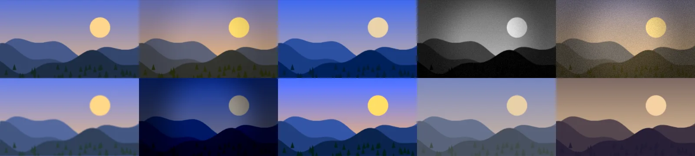
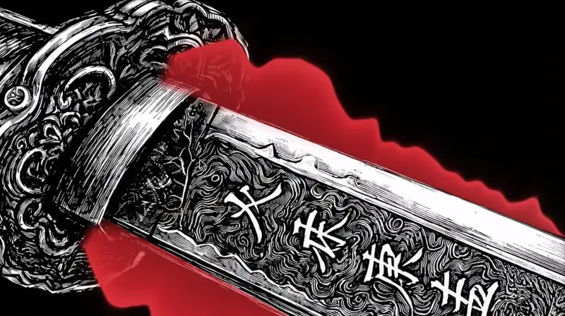
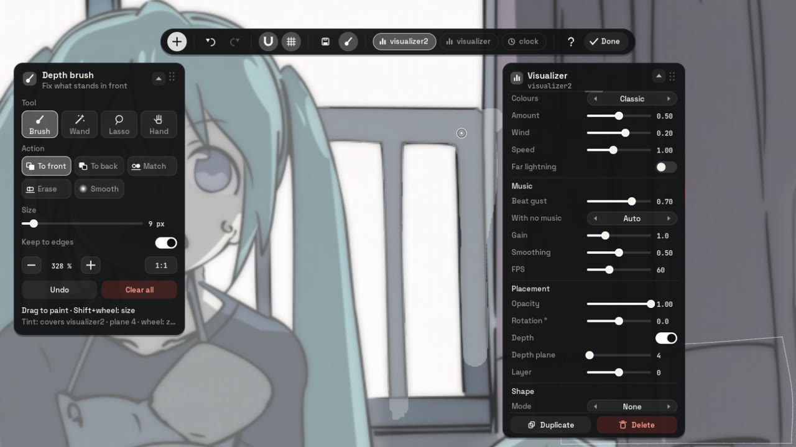
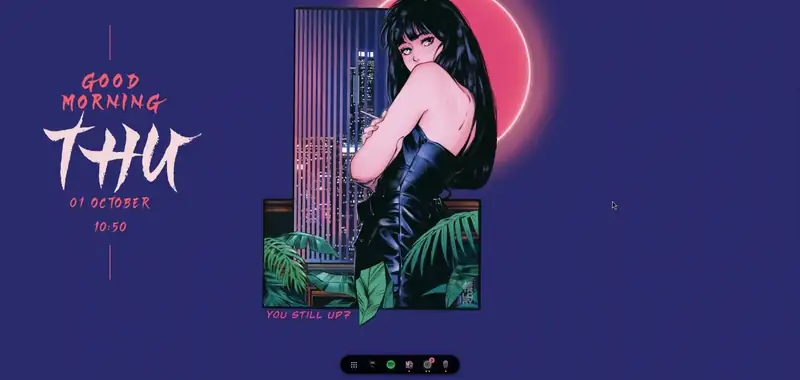

# Wallpaper, effects and depth

Part of [undershell](../README.md)'s documentation.

## Wallpaper filter and effects

The **filter** widget changes how the wallpaper looks: brightness,
contrast, saturation, hue, warmth, a tint or a two-tone in any colours, a
vignette, blur, grain, posterize or pixelate. Ten styles set them at once
(warm, cool, noir, vintage, dream, night, vivid, faded, duotone, or custom),
and each can then be changed; the wheel steps through the styles. A widget
cannot filter what lies under it, so this one draws the wallpaper again,
fitted exactly as the shell fits it (checked: with nothing changed it
matches the real wallpaper pixel for pixel), under every other widget. Turn
**Background only** (its depth) on and the wallpaper's subject stays as it
is: only what lies behind it is filtered. One texture and one draw per
wallpaper or option change, nothing while still; a video or scene
wallpaper has no still picture, and then the filter draws nothing.

  

### Animated effects

The same widget can **move** the wallpaper, whatever program sets it:
**water waves**, **rippling water**, **flowing water** (a river, a waterfall),
**wind** in leaves and grass, a **2.5D camera** that drifts through the
picture using its depth, a **lens fringe** and a **VHS tape**, a **shine** that
sweeps across, **twinkles** on the bright spots, a **pulse** with the music,
**light rays** from a point you place, **an aurora** in the sky (on the beat if you like), **drifting mist** or cloud shadows,
**rain on the glass** (beads and running drops that bend the picture behind
them), **snow on things** (it settles on whatever the depth map says has a top:
heads, branches, roofs against the sky) and moving **film** grain. Turn them on in the inspector (each switch opens its
options), with `undershell msg set <id> fx_waves true`, or in the config
(`fx_<effect> = true`, options in [docs/OPTIONS.md](OPTIONS.md)). Each one
has a strength and a **where**: everywhere, only the background or only the
subject (from the wallpaper's depth), above or below a line (sky, water), or
one of four **masks you paint** on the wallpaper with the depth brush (its
"Paints on" row: the river for the waves, the trees for the wind). Each
wallpaper keeps its own masks; until one is painted, it means everywhere.
The subject is what is nearer than the widget's **Depth plane** (the default
plane unless you set one).

All effects that are on are joined into **one shader**: one full-screen pass,
plus a pass at a quarter to half the resolution for the soft ones (light
rays, mist), at their own frame rate (`fx_fps`, 30 by default) and quality
(the performance level). On an Intel HD 520 at 1366×768 the wallpaper with
one effect costs about 1 ms of GPU per frame and with six 2.5 ms: about 7 % of
that GPU at 30 fps. It stays at full resolution (a softer copy of the
wallpaper would show at once); under load the governor lowers the effects'
quality and the lights pass's resolution instead.

### The real weather

**Real weather** (`weather_fx = true`) lets the sky outside decide: rain and
drops on the glass when it rains (heavier in a storm), snow when it snows,
and snow on things that thickens over twenty minutes of snowfall, fog or
cloud shadows when it is grey; on a clear day, the wallpaper as it is. The
weather comes from Open-Meteo for **Weather at** (`weather_location`), or the
place your weather widget names; it is asked for every half hour. Your own
settings of those effects (amount, speed, behind the subject, where) stay,
the weather only turns them on and off and sets how heavy.

### Particles

The wallpaper widget also lays **particles** over the wallpaper: **snow**,
**rain**, **petals**, **fireflies**, **floating dust**, **embers**,
**bubbles** and **sparks to the beat**. Each has its amount, speed, size,
wind, tint and how much it follows the music, and two things a plain overlay
cannot do: **behind the subject** (each particle lives on a plane between
the widget's Depth plane and you, so snow falls behind the person in the
picture and in front of the mountains, and never behind what lies beyond
the plane; lower the plane to send it behind more of the picture, or fix
the subject with the depth brush) and **where** (above or below a line, or
a mask you paint). The simulation
runs on the CPU at a fixed step (30 or 60 Hz by the performance level), the
counts follow the level too, and each system is one instanced draw: 700
snowflakes take 0.02 ms of CPU per frame on the HD 520. Your own systems are
JSON files in `~/.config/undershell/particles/` ([docs/PARTICLES.md](PARTICLES.md)).

The same effects work on **every other widget** too (a clock in the wind, a
picture under water, a title with a shine): the "Animated effects" section
at the end of any widget's inspector, or `fx_<effect> = true` in its block.
There the widget draws into a texture of its own size and the effects draw
that texture; with none on it costs nothing more.

You can write your own: a small GLSL function with a JSON header that
declares its options, saved as `~/.config/undershell/effects/<name>.glsl`. It
shows up in the inspector with its own rows as soon as it is saved (format
and an example in [docs/EFFECTS.md](EFFECTS.md)).

## Wallpaper gallery

The editor's toolbar has a **wallpapers** button: a card with your pictures
(from `[general] wallpaper_dirs`, or the current wallpaper's folder and a
Wallpapers folder in your pictures) and, if you have Wallpaper Engine, its
Workshop scenes and videos, as thumbnails (made on a thread and kept in
`~/.cache/undershell/thumbs`). Pick a picture and it is set through whatever
program draws your wallpaper (the same `wallpaper-set` as below), on that
screen; pick a Workshop wallpaper and a scene widget plays it there. So
nobody needs a separate wallpaper picker to use undershell.

## Wallpaper Engine scenes and videos

If you own Wallpaper Engine on Steam, the **scene** widget plays the
wallpapers you downloaded from its Workshop, from your own install: give it
a Workshop id (or a folder with a `project.json`) in its inspector row or
with `undershell msg set <id> scene 1234567890`. Videos play through FFmpeg.
Scenes are unpacked first by `undershell-scene`, a small helper that does
all the reading of the package and its textures in its own process,
confined with Landlock to the scene's folder and its output, into
`~/.cache/undershell/scenes` (the twelve most recent stay); then they are
drawn layer by layer, with their nesting, alignment, colour and blending,
in 0.1 to 0.5 s here. While one loads, its preview picture stands in.

Their **effects** run through undershell's own (written from scratch):
what never moves (opacity masks, tints) is baked into the layer once; water
waves, ripples, flowing water, wind and shaking, pulses, shines, light rays,
film grain, VHS and scrolling move through the effects of the section above,
each kept inside its own mask. Their **particles** run on undershell's
particle engine, with their textures and sprite sheets, in the order they
stand among the layers. Here that draws 2016 of the 2831 effects and 485
particle systems of 126 scenes; the rest is authors' own shaders, scripts
(SceneScript) beyond text, and puppet animations, not drawn yet. A layer with
effects is processed at the size it shows on screen, so a typical scene
costs 1 to 7 ms of GPU per frame at 1366×768 on an HD 520.

The **properties** a scene's author offers (a colour scheme, things to show
or hide, sliders, choices) appear in the scene widget's inspector; changing
one reads the scene again beside the one on screen and swaps them when it is
ready, with no gap. Once loaded, the scene leaves a **still** of itself
(without particles, so it is the same every time) beside its unpacked files,
and undershell takes it as that screen's wallpaper: the depth map and the
layouts kept per wallpaper follow the scene.

Scenes also get their **camera** (Wallpaper Engine follows the mouse; a
background layer gets no pointer on Wayland, so the parallax drifts slowly,
weighted by each layer's depth, and the shake shakes: switch it off with
"Camera moves"), their **bloom** (from the balanced level up) and their
**text**, drawn with undershell's own text. Most text in scenes is a clock or
a date written by a **script** (SceneScript, JavaScript): those run in
`undershell-script`, a separate process with quickjs-ng and none of its file,
process or network modules, a memory limit and a time limit per call, and no
file access at all once started (Landlock); a script that runs away is
stopped and the rest go on.

Nothing of Wallpaper Engine ships with undershell, and undershell is not
affiliated with it: it only reads, at run time, what you installed.

## Depth planes

Widgets pass behind the scenery: undershell knows how near each point of the
wallpaper is and erases a widget wherever the wallpaper is nearer than the
widget's plane, on the GPU, live. By default every widget sits on the default
plane, `[general] depth_threshold` (30 unless you set it). Give a widget its
own plane with **Depth plane** in the inspector (or `depth_level = 1..100`).
Higher is nearer: at 95 almost nothing covers the widget, at 5 almost
everything does. `0` goes back to the default plane. Where widgets overlap,
the nearer one is drawn on top (a widget with depth off counts as nearest);
the order you give them in the editor's **Layers** panel (`layer`, higher in
front) overrides that. `depth_feather` softens the edge of every cut.

### Where the depth comes from

undershell runs a depth model,
[Depth Anything V2 Small](https://github.com/DepthAnything/Depth-Anything-V2)
(Apache-2.0), the same one Noctalia's `wallpaper_depth` plugin uses. It does
not need the plugin.

- **Fetch the model once** (~95 MB, from Hugging Face, checked by size and
  SHA-256): the **Download the depth model** button under *Depth* in the
  inspector, or `undershell msg depth-model`. Nothing is downloaded until you
  ask. If the plugin already downloaded it, that copy is used.
- A new wallpaper gets its map in a few seconds (about 5 s on an HD 520
  laptop, for any size), computed by `undershell-depth`, a separate, niced
  process (ONNX Runtime on the CPU), so the model's memory (~460 MB while it
  runs) never stays in the service. The map is then refined against the
  wallpaper (under a second, off the main thread).
- **Every wallpaper with a layout of its own** (see
  [A layout per wallpaper](#a-layout-per-wallpaper)) gets its map ahead of
  time, in the background, at the lowest priority and on half the cores, so
  coming back to it is instant. Those maps are kept for good in
  `~/.cache/undershell/depth` (about 2 MB each); of the others, the 16 most
  recent.
- `undershell msg status` shows the state (`depth: ready`, `computing … (N
  more queued)`, `downloading the model, 42 %`). `[general] depth_model =
  false` turns depth off. It needs undershell built with ONNX Runtime
  (`-Ddepth_model`, on by default when `libonnxruntime` is found: Arch's
  `onnxruntime-cpu`, Fedora's `onnxruntime-devel`, Debian 13's
  `libonnxruntime-dev`; Ubuntu 24.04 has no package, so it is built without).
- Coming from the plugin: the first run writes its threshold and feather into
  `[general]` (`depth_threshold`, `depth_feather`), so layouts look the same.
  undershell no longer reads its masks or maps, so the plugin can be turned
  off unless Noctalia's own desktop widgets use it.

   
  The spectrum goes behind the blade: its plane cuts it where the wallpaper is nearer.

### Moving wallpapers

A depth mask belongs to one still picture. When a video or a Wallpaper
Engine scene is on screen (undershell asks skwd-wall with `skwd-helm
current`, and also treats a video file set as the wallpaper as moving),
depth turns off for every widget and its controls lock — the inspector
rows, the depth brush, `msg set … depth`, and the Noctalia panel — until a
still wallpaper returns; the widgets' settings are kept.

When skwd-wall (or its fork undershell-wall) is running, undershell also takes
**which picture each screen shows** from it rather than from the shell: with
Noctalia's own wallpaper service off, the path Noctalia keeps can be an old
one, and the filter would redraw that old picture over skwd's. undershell
subscribes to skwd's socket (`$SKWD_WALL_V2_SOCK`, or `wall.sock` in
`$XDG_RUNTIME_DIR/skwd-wall-v2`), so a wallpaper applied there reaches the
filter, the depth and the per-wallpaper layouts at once, with no hooks. A
wallpaper named in `[general] wallpaper` still wins over both.
`undershell msg wallpaper-check` asks again by hand.

### Fixing the depth by hand

The depth model guesses: an object may come out as a ramp (so a plane cuts
it in two), and the background next to an object often gets a halo of
false nearness. The **brush** button in the editor's toolbar opens the
depth brush: the wallpaper is tinted where it would cover the selected
widget (or, with none selected, the default plane), and you correct it.

**Tools** (how you pick an area) — none needs a steady hand except the brush:

- **Brush** — paint; with *Keep to edges* on it only takes what looks like
  the spot under its centre. Shift+wheel sizes it.
- **Wand** — one click takes a whole object: the region that continues
  smoothly in tone and depth, filled solid. Shift+wheel sets the tolerance.
- **Lasso** — click around an object (no dragging); click the first point,
  double-click or press Enter to close; Backspace drops the last point, Esc
  cancels. With *Keep to edges* the outline settles onto nearby edges.
- **Hand** — drag to move the zoomed view (the middle button and the arrow
  keys do it with any tool).

**Actions** (what happens there): **To front**, **To back**, **Match** (the
depth where you start), **Erase** (corrections), **Smooth** (softens
jagged or abrupt depth).

**Zoom**: the wheel zooms about the pointer up to 8× (also + / − / 0 and the
panel's buttons); zoomed, the editor shows the wallpaper magnified and the
brush gets finer by the same factor. **Undo** / Ctrl+Z steps back one
stroke or selection; **Clear all** asks twice; right click or Esc leaves.

  

Corrections are kept per wallpaper in `~/.config/undershell/depth-edits/`
and apply to every widget, including those on the default plane.

## A layout per wallpaper

undershell remembers where your widgets were for each wallpaper. Arrange
them for one wallpaper; when the wallpaper changes (Noctalia's picker,
skwd-wall, `noctalia msg wallpaper-set`, a script) the layout on screen is
filed under the old wallpaper and the new one's comes back: widgets, their
number, positions, tilt, looks and options. A wallpaper seen for the first
time keeps the current layout, so you start from it.

- `config.toml` always holds the layout on screen; the others wait in
  `~/.config/undershell/profiles/<sha256 of the image>.toml` (renaming or
  moving a wallpaper keeps its layout).
- Only the `[[widget]]` blocks move; `[general]` is shared.
- `undershell msg status` shows the current profile; `profiles = false` in
  `[general]` turns this off.

  

### Saved profiles

Besides that automatic memory, you can keep named layouts, like save slots
in a game: the **floppy** button in the editor's toolbar opens a panel with
every saved profile (a thumbnail, name, date, wallpaper and widget count).
**Save what is on screen** creates one and lets you type its name (Enter
keeps it); each row can be **loaded** (one undo step: Ctrl+Z brings the
previous layout back), **overwritten**, **renamed** or **deleted** (two
clicks). Loading a profile also makes it the current wallpaper's layout.
They live in `~/.config/undershell/saves/`, and the Noctalia panel lists
them too. From a terminal: `undershell msg saves | save [name] |
save-load <id> | save-overwrite <id> | save-rename <id> <name> |
save-delete <id>`.
