# Widgets

Part of [undershell](../README.md)'s documentation.

## Clock: 12 faces

`digital`, `minimal`, `analog`, `flip` (cards that flip, colon that
"breathes"), `rings`, `bighour` (outlined month and seconds), `metal` (with
the weather from Noctalia's cache), `goodnight` (the day in the "kana" alphabet),
`grand` (Fraunces serif), `column`, `outline` (hollow numerals) and `banner`
(with a halo). Dates: `inline`, `badge`, `stacked` or `none`. Translated from
Ryoku's QML with its same measurements; the design fits the widget box.
Day and month names follow the system language (or `language = "en" | "es"`).
It redraws only when the second (or minute) changes; `flip` animates at 30 fps.

## Clock structures

Five clock faces are **editable structures**: `goodnight` (the card),
`column`, `flip`, `metal` and `stacked` (the Modern Clock layout: a big
weekday, the date, the time). Select the clock in the editor: the
inspector's **Elements** section lists its parts — open one to set its
**font** (every installed family, each shown in itself; type to search),
size, weight, spacing, capitals and colour; the arrows reorder parts and
the switch hides one (flip keeps its layout). Each structure also has
options of its own: the card's weekday drawn in strokes or set in a font,
the column's line overlap and alignment, flip's corners and pulsing
separator, metal's separator, stacked's alignment, gap and date format.
To use fonts you download, see [Fonts](#fonts). Untouched, a structure looks exactly as designed; changes are flat keys
in the widget (`goodnight_time_font = "Space Grotesk"`,
`goodnight_order = "rule_top,greeting,time,day,date,rule_bottom"`), so
they travel with wallpaper profiles and saved layouts. The other faces
stay as classics.

<p align="center">
  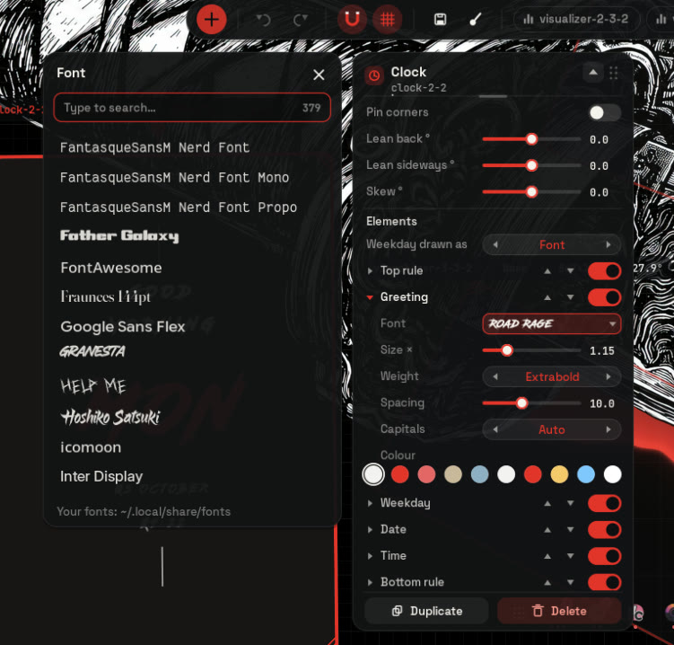
</p>

## Fonts

The five editable clock structures (`goodnight`, `column`, `flip`, `metal`,
`stacked`) can use any font installed on your system, and so do the music
card's title, artist and clock. The classic clock faces keep the fonts of
their design. Space Grotesk, Fraunces, Inter
Display, JetBrains Mono, Google Sans Flex and Bangers come bundled, so they are
always there.

<p align="center">
  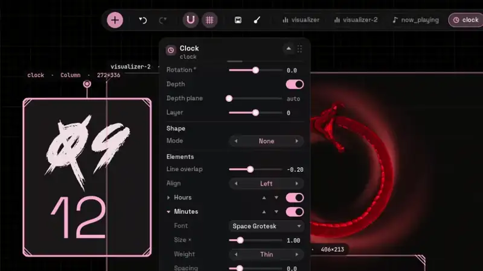
</p>

**Adding your own:**

1. Download the font as `.ttf` or `.otf` (variable fonts work too).
2. Copy the files to `~/.local/share/fonts/` (create the folder if needed;
   subfolders are fine). Fonts installed system-wide, for example with your
   package manager, work as well.
3. In the editor, select the clock, open a part under **Elements** and click
   its **Font**. The list is read again each time it opens, so new fonts show
   up without restarting undershell or running `fc-cache`. Type to search;
   each family is shown in its own typeface.
4. The first entry, **Design · …**, goes back to the face's own font.

**In the config file**, a part's font is `<face>_<part>_font`, with the family
name as `fc-list : family` prints it:

| Face | Parts with a font |
|---|---|
| `goodnight` | `greeting`, `date`, `time` (the weekday is drawn in strokes; `goodnight_day_style = "font"` sets it in `goodnight_day_font`) |
| `column` | `hours`, `minutes`, `extra` (seconds and AM/PM) |
| `flip` | `digits`, `colon` |
| `metal` | `time`, `ampm`, `weekday`, `date`, `weather` |
| `stacked` | `day`, `date`, `time` |

```toml
[[widget]]
type = "clock"
face = "stacked"
stacked_day_font = "Bebas Neue"
stacked_time_font = "JetBrains Mono"
```

If a family name doesn't match an installed font, Pango falls back to a
similar one; check the exact name with `fc-list : family | grep -i <name>`.

## Calendar

The **calendar** widget: the **month** as a grid (ISO week numbers if you
like), the **week** as a strip, **today** as a tear-off page, or an
**agenda** of the days ahead, with today in the accent colour, days gone by
faint and weekends tinted. On a glass or solid plate or on nothing, in any
font, the week starting on Monday or Sunday, in English or Spanish; the
mouse wheel steps through the layouts.

**Events**, read from this computer only (nothing is fetched): `.ics` files
or folders of them (**.ics files**, separated by `;`), **khal**'s calendars
(the vdirs in its config) and **Evolution / GNOME Calendar**'s (the local
ones, and the copies Evolution keeps of online accounts; hidden or disabled
calendars are left out). Repeating events, time zones, exceptions and moved
occurrences are understood. The month and the week mark days with a dot per
event in its calendar's colour, the page lists today's, and the agenda shows
what is coming with times and places. Sources are watched, so a change shows
at once (Evolution's cache is looked at every 10 minutes); otherwise it
wakes only at midnight.

<p align="center">
  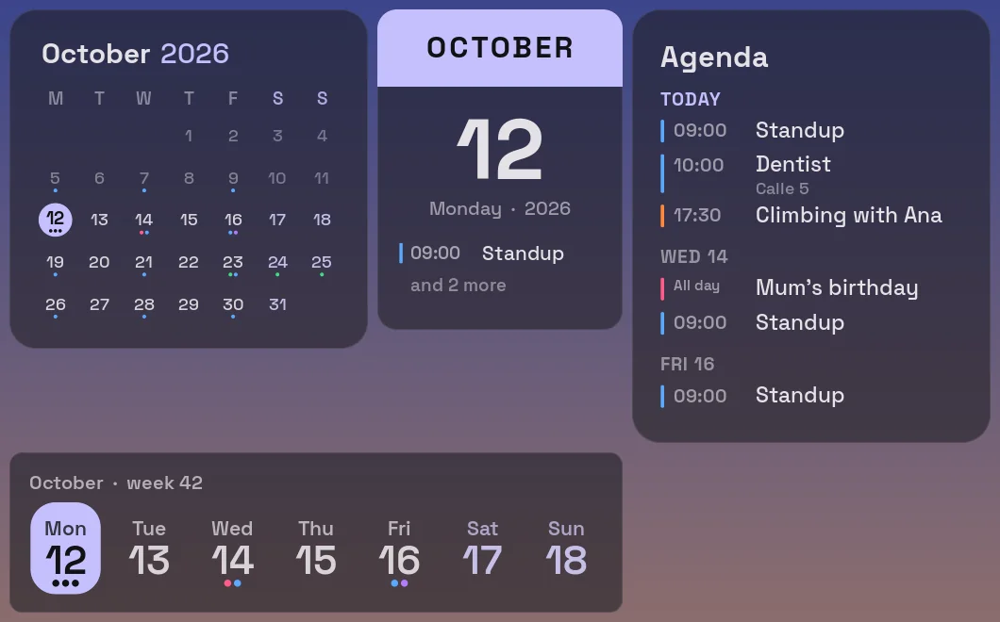
</p>

## Weather

The **weather** widget shows the weather where you say you are, from
[Open-Meteo](https://open-meteo.com) (free, no account, no key): now (an icon,
the temperature, the sky in words and the place), a card with today's high
and low, how it feels, humidity, wind and the next hours, the week (with the
chance of rain), or the hours alone. Type your city in the inspector's
**Location** (`location = "Quito, Ecuador"`) or coordinates
(`location = "-0.18, -78.47"`); nothing locates you on its own. What leaves
your computer: the place's name once, to Open-Meteo's geocoding (its answer
is kept), then only its coordinates rounded to 0.01° (about a kilometre),
every half hour. Answers are kept in `~/.cache/undershell/weather`, so a
restart does not ask again. Metric or imperial, colour or one-colour icons;
it redraws when a report lands and on the hour.

<p align="center">
  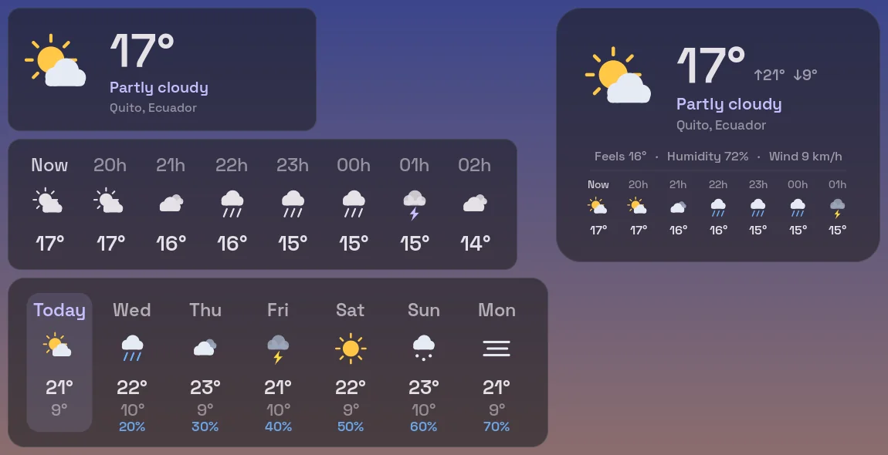
</p>

## System monitor

The **system** widget shows how the computer is doing: CPU, memory, GPU,
temperature, network, disk and battery, as **rings**, **bars**, short
**graphs** of the last minute, or plain **text**. Each reading can be turned
off (`show_cpu`, `show_ram`, `show_gpu`, `show_temp`, `show_net`, `show_disk`,
`show_battery`), and one past its limit (90 % used, 85 °C, a battery under
15 % on its own) takes the **Alert** colour. Everything comes from `/proc`
and `/sys`, with no programs run and no extra permissions: the GPU is AMD's
`gpu_busy_percent` or, on Intel, the share of time it was not asleep
(`rc6_residency_ms` on i915, `idle_residency_ms` on Xe); the temperature, the
CPU package's sensor. A reading takes about 0.2 ms of CPU every second
(`interval`), and the widget redraws only then.

<p align="center">
  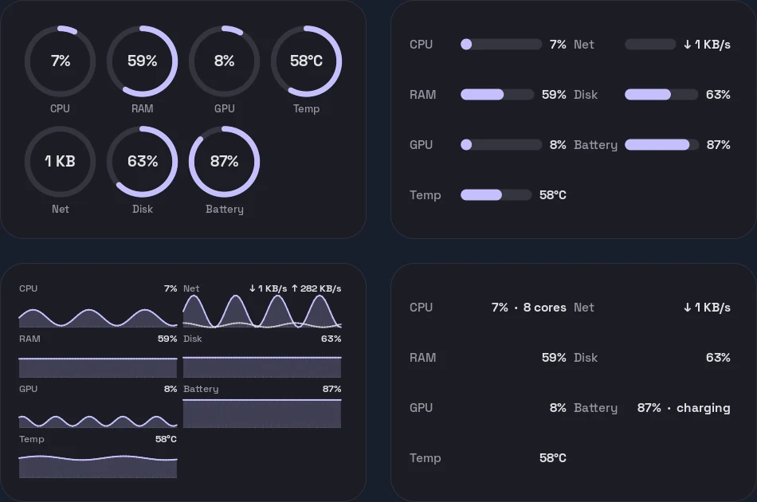
</p>

## Activity

The **activity** widget shows how much you committed each day: the grid code
hosts draw (weeks across, days down, four shades) or a bar per week, over
the last year or fewer weeks. It reads the git repositories under your
**Folders** (`folders = ["~"]`, three levels down, skipping hidden folders and
dependency trees) with `git log`, so nothing leaves your computer and private
repositories count; **Author** is your `git config user.email` unless you name
someone (or `all`). The reading runs on a thread of its own every half hour
(16 repositories: about 0.2 s); with **With the music** above 0 the busy days
twinkle on the beat.

<p align="center">
  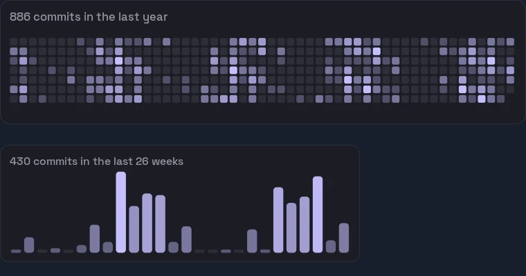
</p>

## Notes

The **notes** widget keeps a note in a Markdown file: headings, lists (nested
too), quotes, rules and tasks (`- [ ]` / `- [x]`), which are ticked with a
click right on the desktop. Write it in the editor straight on the widget
(double-click it, or **Write** in the inspector; Enter breaks the line, the
arrows, Home and End move, Esc or a click elsewhere keeps it), or in any text
editor (**Open the .md**, or `file = "~/notes/today.md"`): the file is
watched, so a change shows at once and nothing is polled. On a sticky-note
paper of any colour, a glass plate or nothing; without a `file` it is kept
in `~/.local/share/undershell/notes/<id>.md`. It draws once per change.

<p align="center">
  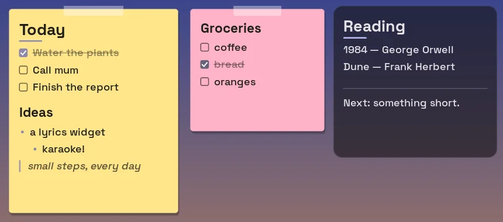
</p>

## Now playing (card)

Ryoku's music card: the cover (downloaded and decoded in the background),
the album color on the plate, the progress bar, the pulse and the play
button (Ryoku's `accentOf`), synced lyrics from **LRCLIB** (cached in
`~/.cache/undershell/lyrics`) with the sung line lit and its neighbors
fading, or a live spectrum when there are no lyrics; wavy seek bar
(**click to jump**), previous / play-pause / next and a button that opens your
app (`music_app`). The player is the one from Noctalia's MPRIS aggregator
(`dev.noctalia.Mpris`, via sd-bus) or, without Noctalia (KDE, GNOME, any other
desktop), the MPRIS player that is playing, staying with it while it plays and
falling back to the one heard last; updates are instant, from signals.
It comes in seven **layouts** (`layout`), each drawn at its own shape, and every
piece of it can be left out. Options: `layout`, `plate` (cover, glass, none),
`rail_style`, `show_lyrics`, `viz` (bars, wave), `accent_source` (album,
theme), `music_app`, `fps`, the `show_*` switches and the type options below.

<p align="center">
  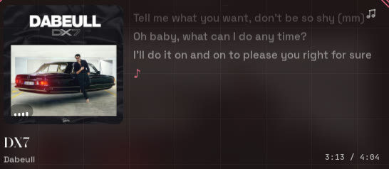
</p>

Widgets are click-through except on their buttons, so the desktop
keeps working normally around them.

## Music card

**Layout** (`layout`) picks the shape of the card:

| | |
|---|---|
| `sheet` | the original: the sleeve leads, this song's lyrics run beside it, and the track, its clock, the rail and the three moves close it out (560 × 302) |
| `vinyl` | the sleeve is the label of a record whose grooves turn while the song plays, with the track and the moves to its right (440 × 160) |
| `tile` | a small card the sleeve steps out of, the track set against the right edge (320 × 132) |
| `poster` | the artwork is the card, the track on it under a veil (300 × 400) |
| `strip` | one line of it, for a narrow gap (560 × 72) |
| `portrait` | the sleeve on top, everything else centred under it (280 × 392) |
| `text` | only the title and the artist, as large as the widget's box allows (any size) |

Only `sheet` has room beside the sleeve, so the lyrics and the spectrum belong
to it. The others make their own use of the sleeve, the track and the moves.

**Just the track** (`layout = "text"`): no sleeve, no clock, no controls -- the
title and the artist, scaled together until they meet the box one way or the
other, so resizing the widget resizes the type. `text_form` is `stacked` (the
title over the artist; a long title breaks into two balanced lines when that
lets it be clearly larger) or `line` (`Title · Artist` on one baseline).
`text_align` (left, center, right) and `text_valign` (top, center, bottom) set
where it sits in the box. The fonts, `artist_size` (the artist's share: half
the title by default), `show_artist`, `plate` and `ink` still apply. Nothing on
it moves, so it only redraws when the song changes.

**The pieces** switch off one by one: `show_cover`, `show_artist`, `show_time`,
`show_rail`, `show_transport`, `show_open` (the button that opens your player),
`show_pulse` (the bars on the sleeve while sound is moving), `show_viz` and
`show_lyrics`. A piece that is not shown leaves no hit target behind.

**Seek rail** (`rail_style`): `wave` (a travelling wave), `line`, `dots`,
`bars` (they stand taller where the song has been) or `ring`, drawn around the
sleeve. The ring needs a round sleeve -- the record, or `cover_shape =
"circle"` -- and anywhere else it keeps to the rail.

**The track's type**: `title_size`, `artist_size` and `time_size` scale the
sizes the card was drawn with, and `title_font`, `artist_font` and `time_font`
take any family installed (empty keeps the design's). The block is placed by
what the type really paints, so a decorative face that spills out of its
metrics still sits right. See [Fonts](#fonts).

**Cover shape** cuts the cover to a Material 3 shape (`cover_shape`: any of
the 18 names), or `cycle`: each song gets its own shape (the same song, the
same shape) and the cover morphs into it on Material's expressive spring,
overshooting a little. `rounded` keeps the rounded square.

**Lyrics style** sets how far the sung line stands out from the ones around
it. `plain` is Ryoku's gentle step: a couple of pixels larger, a weight up,
and the album's colour. `focus` takes it much further -- the sung line is
set half again as large and bold, and its neighbours fall back -- while
keeping one face and one size per line, so no lyric in any language can come
out uneven.

## Lyrics

The **lyrics** widget shows the song playing line by line, in time: the
synced lyrics the music card already fetches from LRCLIB (and caches),
from any MPRIS player. Three **layouts**: **three lines** that scroll, the
one being sung in the middle and the ones around it smaller and faint;
**one line** that gives way to the next with a slide, a fade, a pop or typed
out; and **karaoke**, the line lighting up as it is sung. It takes the text
widget's ten styles and every effect, animation and music reaction (the
wheel steps through the styles here too). Without synced lyrics it shows
the title and artist, a note, or nothing; **Delay** nudges the timing when a
song's lyrics run early or late. Between lines it sleeps until the next one
is due, so it only draws while a line changes (karaoke: 30 fps for the
light).

A local track with a `.lrc` beside it (`song.flac` → `song.lrc`) uses that
file first, with no network. When the lyrics time each word (enhanced LRC,
`[00:12.00]<00:12.00>Hola <00:12.40>mundo`), karaoke lights them word by word
as they are sung; otherwise it spreads the light over the line's time.

<p align="center">
  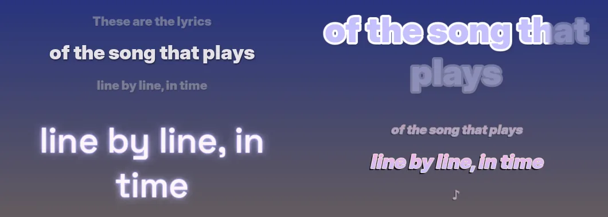
</p>

## Text

Words on the desktop with effects: a **fill** (a colour, a gradient across
the whole text, a moving rainbow, or none for hollow letters), an
**outline**, a **shadow**, a **glow** and a **3D depth** in any direction, each
in any colour. The letters can **wave**, **bounce**, **type themselves**,
**glitch**, **flicker** like a failing neon tube or **shake**, and with the
music they can **pulse**, **glow** or **jump** each with its band of the
spectrum. Ten **styles** (plain, neon, retro, comic, outline, sticker,
chrome, glitch, rainbow, typewriter) set all of that at once, and every
option can then be changed on its own; the mouse wheel over a text steps
through the styles. The words are typed straight into the inspector
(Shift+Enter for a new line), and `{title}`, `{artist}`, `{album}`,
`{time}`, `{date}` and `{day}` are filled in. The text grows to fill its box,
in any installed font. Pango draws it once into a texture and one shader
builds every effect from it: a still text is drawn once, a neon sign
flickers at 12 fps, and only moving letters draw at 60.

<p align="center">
  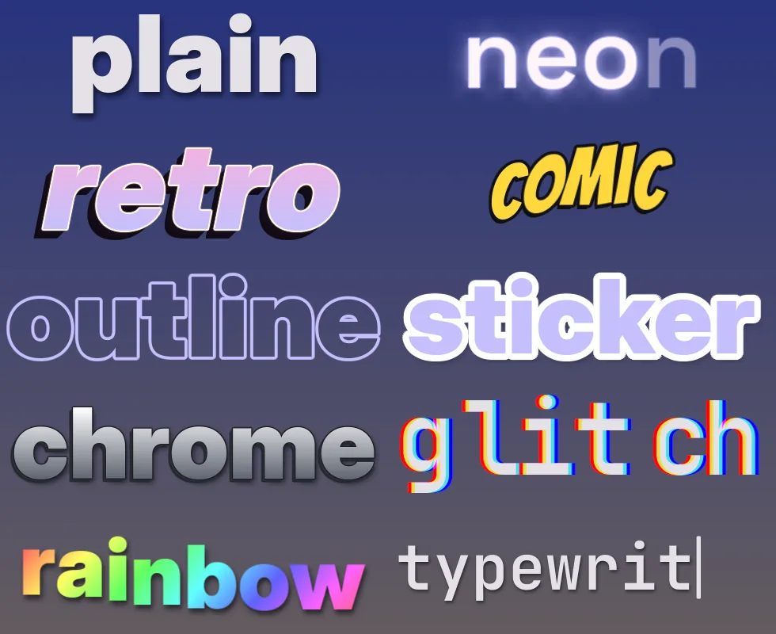
</p>

## Shapes

Geometric shapes to build compositions out of layers (see **Layers** and
**Groups** under Usage): rectangle, ellipse, triangle, polygon (3–16 sides),
star (its points and how sharp they are), heart, ring (or an arc of one),
line, and the Material 3 shapes (cookies, clovers, bursts, flower, sun…).
Each has a **fill** (a colour, a linear or radial gradient between two, or
none), an **outline** inside its edge, a **glow** and a soft **shadow**, and
can **spin** or **pulse** / **glow** with the music's kicks. Every colour can be
a palette role or any colour from the picker. One distance shader draws it
all, so a still shape is drawn once and then costs nothing; the mouse wheel
over one in the editor steps through the shapes.

<p align="center">
  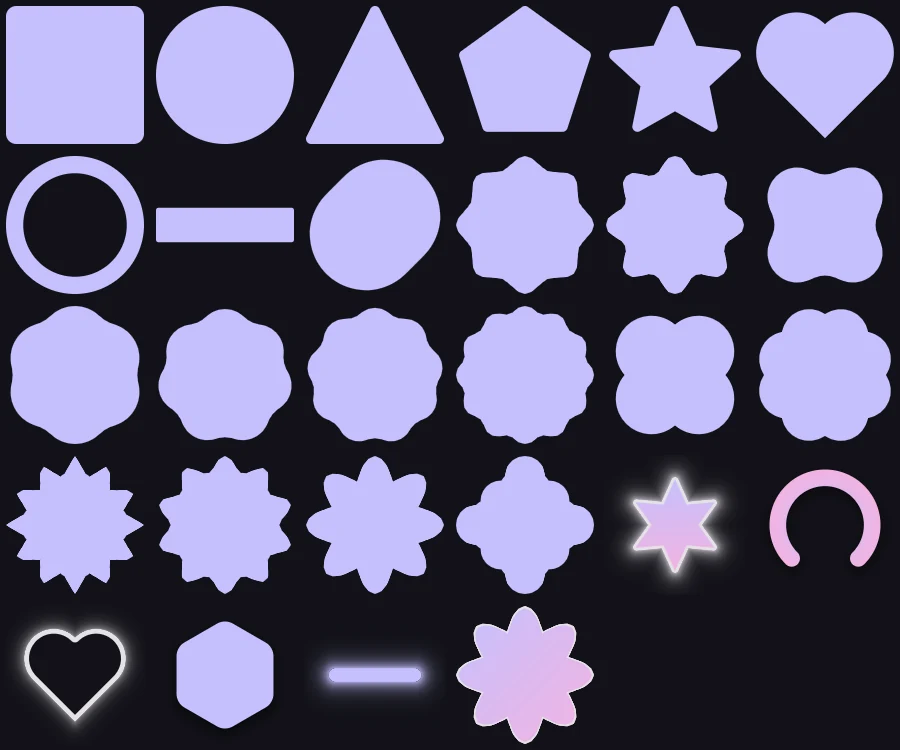
</p>

## Pictures and stickers

The **image** widget puts a picture on the desktop: a photo, a sticker, a GIF,
an animated WebP or APNG, or a video, keeping its transparency. **Choose a
picture…** in the inspector opens the desktop's file chooser (or
`msg pick-files <id>`, or `file = "~/Pictures/cat.png"`). It is fitted into
its box (**Fit**: all of it, filling it, or stretched), with rounded corners
or **cut** to a circle or a Material 3 shape, and as a sticker: an
**outline** round its silhouette in any colour and a soft **shadow** under
it. **Mirror** flips it; an animation has a **speed**; it can **bounce** or
**pulse** with the music's kicks. Like every widget it can pass behind the
wallpaper's subject.

A still picture is decoded once, at the size it is shown, and drawn once. An
animation is decoded on its own thread (FFmpeg, as for the TV; GIFs and still
pictures also through gdk-pixbuf), kept whole when it is short, and the
widget sleeps until its next frame is due: a 12 fps GIF is drawn 12 times a
second.

## Pet

The **pet** is a pixel-art companion that lives on your desktop: it walks
along the line where you put it, stops to look about or sit, hops up onto the
**tops of windows** and falls when the window under it goes, **dances** and
hops on the beat while music plays, and dozes off after a minute of silence.
It is drawn over the windows but never in the way (the overlay layer,
click-through), on a surface the size of its box that moves with it. Where
the windows are comes from Umbriel (`umbriel subscribe windows`, only while a
pet climbs); on other compositors it keeps to its line. Its speed, and
whether it climbs, dances and sleeps, are options; in the editor it waits at
home.

**Companion** picks who it is: **Sprout**, the original round creature with
a sprout on its head (its colours follow the theme), or one of 28 sprites:
fourteen detailed creatures from Chinese, Greek, Japanese and Norse
mythology, Western fantasy, two mecha and two original anime-style
characters, and a **chibi** version of each (`kitsune_chibi`). The sprites
are 128 × 128 pixels, drawn by whole pixels (256 × 256 shows them at 2×).
The [catalogue](PETS.md) has them all.

<p align="center">
  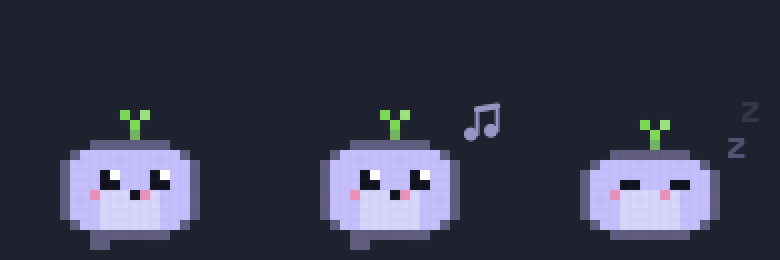
</p>

```sh
undershell msg add pet long
undershell msg add pet long_chibi
undershell msg edit          # select the pet, then Companion / Compañero
```

## Colours from the album

Set **Colours from** to **Cover** (`colors_from = "cover"`) on a
visualizer, clock, lyrics, text, shape, calendar, notes or weather widget and
its palette colours (`primary`, `secondary`, `tertiary`, `surface`… and the
gradients and looks built on them) follow the album that is playing. When a
new cover arrives, undershell asks `noctalia theme` for the cover's Material 3
scheme in your theme's scheme and mode (about 0.1 s of CPU, off the main
thread, once per album); without Noctalia it builds one from the album's
accent. Colours you set as `#rrggbb` stay as they are; while the music is
paused the widget keeps the album's colours, and once the player closes it
goes back to the theme's. The music card has its own `accent_source = "album"`.
